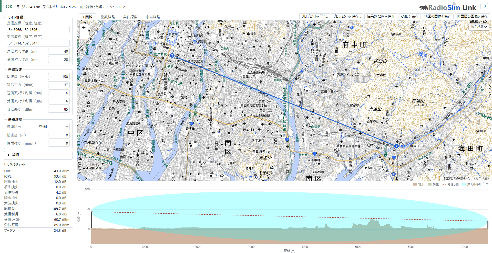
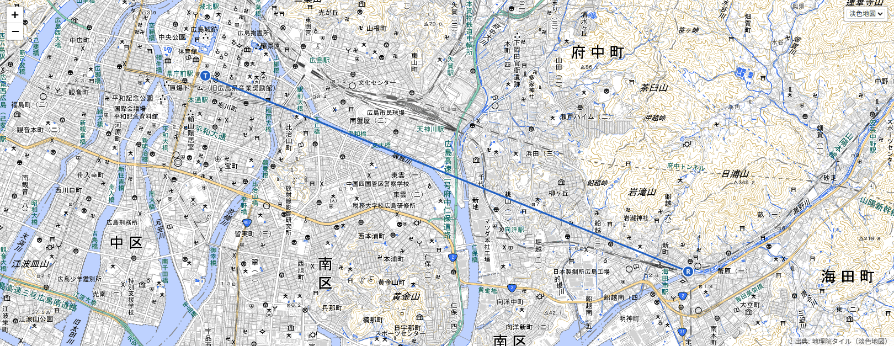
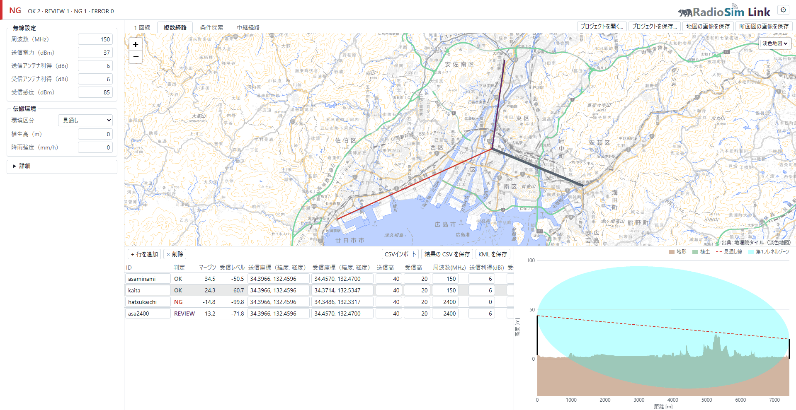

# RadioSim Link — 地上無線回線の伝搬シミュレーター（国土地理院 DEM 自動取得）

[](LICENSE)

> 📣 **RadioSim Link は RadioSim Pro 3.x の後継です。** RadioSim Pro の開発は 3.9.1 で終わり、3.9.x では Link 1.0 を正式に公開するまで致命的な不具合だけを直します。3.x の次に予定していた変更（判定の `REVIEW`・成果物 CSV の末尾 2 列・ライス K の見直し）は Link 1.0 で入ります。3.x で保存したプロジェクトファイル（`.rsproj`）は Link 1.0 で開けます（3.9.x と同じ計算方式で計算します）。
>
> *RadioSim Link is the successor to RadioSim Pro 3.x. Development of RadioSim Pro ends with 3.9.1; until Link 1.0 is officially released, 3.9.x receives fixes for critical bugs only. The changes planned after 3.x (the `REVIEW` verdict, two appended CSV columns, and the Rice K review) arrive in Link 1.0. Project files (`.rsproj`) saved by 3.x open in Link 1.0, calculated with the same method as 3.9.x.*

**国土地理院 DEM（数値標高モデル）を自動で取得し、地形断面・回折損・フレネル第1ゾーン遮蔽率・リンクバジェットを計算する Windows デスクトップアプリです。** 送信点と受信点の座標・アンテナ高・周波数を入れるだけで、その回線が通りそうかを数秒で判定します。**現地調査に出る前のスクリーニング**に用途を絞ったツールで、無料・MIT ライセンス・Python のインストール不要の Windows 版も配布しています。

> **組み込みの標高データと背景地図は国土地理院タイルのみです。日本国外で使うには、利用者が宣言ファイルで外部の DEM ソースと背景地図ソースを追加してください。保存する地図の画像は地図の右上で選んだ背景地図に従うため、宣言した外部ソースを選べば日本国外でも描かれます。**（詳細は下記 FAQ「日本国外の回線には使えますか？」）

*A desktop propagation simulator for land mobile radio links: terrain profiles, diffraction loss, Fresnel zone clearance and link budgets, computed from **GSI DEM** (Geospatial Information Authority of Japan) elevation tiles fetched automatically. The only built-in elevation source and background map are GSI, but you can add external DEM and background map sources via declaration files to work outside Japan; the saved map image follows the background map selected at the top right of the map, so it works outside Japan too once you add an external source. English documentation: [docs/manual_en.md](docs/manual_en.md) (users) and [docs/developer_en.md](docs/developer_en.md) (developers).*



---

## 想定用途

- **回線設計の一次スクリーニング** — 現地調査に行く価値があるかを机上で絞り込む
- **エリア調査の下ごしらえ** — 候補地を複数比べ、見込みの薄い組み合わせを先に落とす
- **中継点の検討** — 直接は届かない 2 点を、尾根などの中継点で継げるか
- **アンテナ高・周波数の当たり付け** — 1 本の経路で条件を振り、成立ラインを探す
- **複数経路の一括計算** — CSV に並べた N 本をまとめて回し、結果を CSV と KML で保存

**使わないほうがよい用途**: 回線設計の最終判断。組み込みの国土地理院 DEM の水平解像度は 5〜10m です。計算を実測で較正していないので、回折損に「±何 dB」という誤差の幅は名乗りません。前提（植生高・環境区分・回折の方式など）を振ると判定が裏返る回線は、判定を `REVIEW`（現地確認を推奨）にして示します——これは誤差の幅ではなく、結果が前提にどれだけ依存するか（前提依存性）です。⚠️ **地形の解像度と DEM 標高の誤差は振っていません**。複数の障害物が重なる経路の合成損失も、実測とも基準実装とも突き合わせていません（下記）。

> 🔴 **回折損は過大にも過小にも出ることがあり、どの経路で信頼できるかを事前に見分ける方法がありません。** 回折モデルは **Bullington 等価ナイフエッジ（ITU-R P.526 §4.5.1）** です。①合成損失は**実測とも基準実装とも突き合わせていません**。②**離れた 2 つ以上の尾根がある経路では小さめに出ます**（この手法の既知の性質です）。③**地形の解像度を上げると回折損が増えます**（「低」の 20m 間隔 →「高」の画素の縁ごとで最大 +407%）。④**平滑地球の球面回折の項を持たないため**、低いアンテナで見通し距離を超える長い平坦路（海上など）では過小になりえます。⚠️ **起伏の大きさでも F1 遮蔽率でも、どの経路が外れるかは判定できません。**⚠️ F1 遮蔽率は表示上 **100% で頭打ち**なので、率の側からは異常に気づけません。
>
> 🛡 **自衛策** — **「回折モデル」を `Single` に切り替えて計算し直し、2 つの値を見比べてください。**大きく食い違う経路では既定（Bullington）の値を信用しないでください。⚠️ **これは正しさを決める手段ではなく、結果がモデルの選び方にどれだけ依存しているかの診断**です（差が小さくても正しさは保証されません）。`Single` は複数障害物の合成損失を表現せず標準の補正項も掛けないので **Bullington より小さく出ます**が、それが真の値に近いという意味ではありません。
>
> *🔴 **Diffraction loss can come out too high or too low, and no advance test tells you which paths are safe.** The diffraction model is the **Bullington equivalent knife edge (ITU-R P.526 4.5.1)**. Multi-obstacle results have **not been checked against measurements or a reference implementation**; the method **reads low where two or more ridges are well separated**; a finer terrain resolution raises the diffraction loss (up to +407% from the 20 m "low" step to the pixel-edge "high" step); and the **spherical-earth term is not included**, so long flat paths with low antennas beyond the radio horizon can read low. Neither relief nor Fresnel blockage predicts which paths are affected. Fresnel blockage is **capped at 100%** wherever it is shown, so the percentage will not warn you either. **Mitigation**: re-run with the Diffraction Model set to `Single` and compare — where the two differ substantially, do not trust the default.*

## 主な機能

- **地形断面（パスプロファイル）の自動生成** — 座標を入れると標高タイルを取得して断面を描画
- **見通し（LOS）判定とフレネル第1ゾーン遮蔽率** — どこがどれだけ塞がっているかを数値と図で表示
- **リンクバジェット** — 送信電力・利得・各種損失から受信レベルとマージンを算出
- **判定の帯** — 判定の語と、前提を振った幅を画面の上に出す。前提しだいで判定が裏返る回線は `REVIEW` にして、裏返す前提を示す
- **4 つの実行フロー** — 1 回線 / 複数経路（CSV で入出力）/ 条件探索（比較・スイープ）/ 中継経路
- **地図** — 端点のピンをドラッグして座標を入れる・背景地図を切り替える・断面図にマウスを載せると、その地点が地図に出る
- **プロジェクトファイル（`.rsproj`）** — 座標・パラメータ・複数経路の行・条件探索の条件・中継経路をまとめて保存し、続きから再開
- **日本語 / 英語 UI**・ダークモード対応
- **表示言語を自分で足せる** — `<言語コード>.json` を置くと「設定」の枠の言語に現れます（置き場はインストール形態で異なり、**インストーラ版**は `%APPDATA%\RadioSim\Link\lang`、**ポータブル版**はアプリと同じフォルダの `lang`）。訳が無いキーは英語のまま出るので、全部を訳さなくても壊れません（**非公式な訳**という位置づけで、追加した言語では画面の見切れを保証しません）




## 計算モデル

| 項目 | 準拠・方式 |
| --- | --- |
| 回折損 | **Fresnel-Kirchhoff** 単一エッジ（**ITU-R P.526** のナイフエッジ式）／**Bullington 等価ナイフエッジ**（**ITU-R P.526 §4.5.1**・標準の補正項つき。⚠️ P.452 の完全法が足す球面回折の項は持ちません） |
| 自由空間伝搬損失 | FSPL（球面波） |
| 地球曲率補正 | 標準大気 K = 4/3 |
| フレネルゾーン | 第 1 フレネル半径と地形・植生の交差から遮蔽率を算出 |
| 植生減衰 | 見通し線への侵入深さモデル（植生高は経路一律） |
| 環境損失 | 市街地 / 郊外 / 農村 / 見通し の 4 区分 |
| 降雨減衰 | **ITU-R P.838-3** |
| 大気（ガス）減衰 | **ITU-R P.676-13** Annex 2 簡易式 |
| 標高データ | 国土地理院 標高タイル（5m / 10m メッシュ・自動取得＋ローカルキャッシュ） |

## 出力形式（CSV・KML・PNG）

成果物は保存の道具を押すたびに 1 つずつ、選んだ場所へ保存します（結果フォルダは作りません）。

| 形式 | 内容 |
| --- | --- |
| **CSV** | 結果の数値。1 回線と複数経路は `summary.csv`・中継経路は `hops.csv`・条件探索は `scenario.csv` |
| **KML** | 1 回線は地形・見通し線・フレネルゾーン・遮蔽区間の 3D 表示、複数経路は判定で色分けした経路。**Google Earth** でそのまま開けます |
| **PNG** | 地図の画像と断面図の画像 |

> A4 の帳票（印刷用の HTML レポート）は Link にはありません。

## インストール

### Windows 版（Python 不要）

**インストーラ版（推奨）**: [Releases](https://github.com/kumahide/radiosim/releases) から `RadioSimLink-Setup-<版>.exe` をダウンロードして実行（管理者権限不要）。設定・キャッシュ・ログは OS 標準の場所（`%APPDATA%\RadioSim\Link\`／`%LOCALAPPDATA%\RadioSim\Link\`）へ保存されます。インストーラ版は 1 台に 1 つで、別の版を入れると置き換わります（古い版へ戻すときは確認します。詳細は [docs/manual_ja.md](docs/manual_ja.md#別の版を上から入れるとき)）。

**ポータブル版**: 同じく Releases から `RadioSimLink-<版>.zip` をダウンロードし、ZIP を展開して `RadioSimLink.cmd` をダブルクリック。設定・キャッシュ・ログは展開したフォルダの中に作られ、USB メモリ等で持ち運べます。**複数の版を並べて使うときはこちら**（版ごとに別のフォルダへ展開すれば、データごと分かれます）。

画面は Microsoft Edge のアプリモードで開きます。

> 署名なしのインストーラのため SmartScreen 警告が出る場合があります。「詳細情報」→「実行」をクリックしてください。
>
> ⚠️ インストーラが**ウィザードを 1 画面も出さずに**「エラー 4551: アプリケーション制御ポリシーによってこのファイルがブロックされました」で中止される場合、これは SmartScreen ではなく **Windows のアプリケーション制御による実行拒否**で、続行するボタンがありません（Windows 11 の Smart App Control が有効な PC で起こります。有効かどうかは〔Windows セキュリティ〕→〔アプリとブラウザーの制御〕で確認できます）。**その場合は上のポータブル版をお使いください。**ただしポータブル版も同じ判定の対象なので、必ず起動できるとは限りません（止められた場合は組織の管理者にご相談ください）。詳細は [docs/manual_ja.md](docs/manual_ja.md#インストーラが-windows-に止められたとき) を参照してください。

### ソースから動かす

Python 3.12 以降と Microsoft Edge が必要です。

```bash
git clone https://github.com/kumahide/radiosim.git
cd radiosim
python -m pip install -r requirements.txt
python -m webui
```

## 使う前に

### 国土地理院 DEM の取得に登録や API キーは必要ですか？

不要です。標高タイルは公開されており、アプリが必要な範囲だけを自動で取得します。取得したタイルはローカルにキャッシュされるので、同じ経路を何度計算しても再取得は起きません。

### 日本国外の回線には使えますか？

限定的に使えます。組み込みで登録されている標高データは国土地理院のタイルだけですが、利用者が設定フォルダに宣言ファイルを置くと、外部の標高タイル（XYZ PNG）を DEM ソースとして追加できます。改善するのはカバー範囲であって精度ではありません。

地図の背景地図も、同じように宣言ファイルで追加できます。足さない場合の背景地図（淡色地図・航空写真）は国土地理院タイルなので、日本国外では何も描かれません。**保存する地図の画像は、地図の右上で選んだ背景地図に従います**ので、宣言した外部ソースを選べば日本国外でも描かれます。

### 有料ですか？ 商用利用できますか？

MIT ライセンスの無料ソフトです。商用利用も可能です（[LICENSE](LICENSE)）。

### 社内プロキシの環境でも動きますか？

動きます。「設定」の枠からプロキシを設定できるほか、企業内 CA を使う環境向けに OS の証明書ストアを参照する経路も用意しています。

---

## ドキュメント

| 読みたいもの | 場所 |
| --- | --- |
| 使い方（Windows 版の利用者向け） | [docs/manual_ja.md](docs/manual_ja.md) |
| 開発者向け（構成・計算モデル詳細・アーキテクチャ） | [docs/developer_ja.md](docs/developer_ja.md) |
| 変更履歴 | [CHANGELOG.md](CHANGELOG.md) |
| 変更履歴（RadioSim Pro 3.9.1 まで） | [CHANGELOG_3x.md](CHANGELOG_3x.md) |
| English — user manual | [docs/manual_en.md](docs/manual_en.md) |
| English — for developers | [docs/developer_en.md](docs/developer_en.md) |

> ℹ️ 上のリンク先は開発中の最新（main）の文書で、まだ公開していない版の説明を含むことがあります。お使いの版の説明は、配布物に同梱の文書（アプリの「設定」の枠 →「ドキュメントを開く」）か、[その版のタグ](https://github.com/kumahide/radiosim/tags)の文書をご覧ください。
>
> *The links above point to the latest documents on main, which may describe a version not yet released. For the version you use, read the documents bundled with it (Settings panel → Open Documentation in the app) or the documents at [that version's tag](https://github.com/kumahide/radiosim/tags).*

---

© 2026 BearValley AI Craftworks. All rights reserved.
