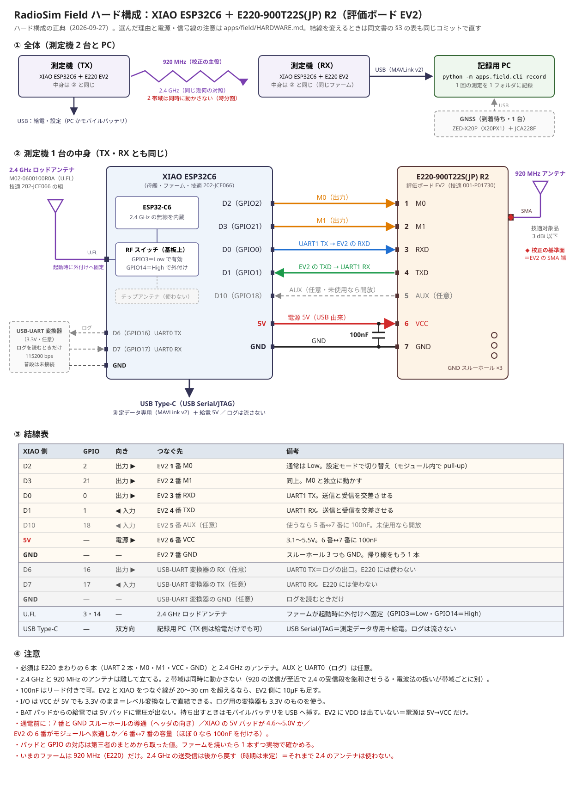

# RadioSim Field の測定機の結線（母艦 XIAO ESP32C6 ＋ 920 MHz モジュール）

2 台（TX 側と RX 側）を同じ形で組みます。この文書は結線と電源系統だけを扱います。測り方は [BENCH.md](BENCH.md)、ファームの使い方は [firmware/README.md](firmware/README.md) にあります。

**920 MHz モジュールは E220-900T22S(JP) R2 に決まり、実物を入手しました**（2026-09-27）。

🔑 **ハード構成の正典は [wiring.svg](wiring.svg)** です（全体・1 台の中身・台とケース・結線表・注意を 1 枚にまとめた図）。この文書は、その構成を選んだ理由と、電源・信号線の注意を書く場所です。**結線を変えるときは、図と §3 の表を同じコミットで直してください**（同じピンの対応を 2 か所に載せています）。



**結線は評価ボード `E220-900T22S(JP)-EV2` のピン番号で書いています**（2026-09-22 にピン配置図を読んで確定。→ §6）。EV2 の外に出ているのは **7 本だけ**で、モジュール単体（DFN-22）の番号とは対応が総取り替えになります。単体の番号はデータシートを引くときの参考として §3 の右端の列に残してあります。

| EV2 | 1 | 2 | 3 | 4 | 5 | 6 | 7 |
|---|---|---|---|---|---|---|---|
| 名称 | M0 | M1 | RXD | TXD | AUX | VCC | GND |

ほかに **GND のスルーホールが 3 つ**あります（ピン配置図の注記「3つのスルーホールは全てGND」）。

⚠️ **EV2 について残っている未確認は「VCC 端子がモジュールへ素通しか」の 1 点だけ**です（回路図を見ていません）。USB シリアルは載っていないことと、`VDD` が出ていないことは確認済みです（→ §2 の案B・§5）。

## 1. 全体

2 帯域を積みますが、**同時には動かしません**（920 の送信が至近で 2.4 GHz の受信段を飽和させうること、電波法の会計が帯域ごとに別なことの 2 つが理由です）。測る帯域はファームの設定（`band 920`／`band 2400`）で 1 つに固定し、設定番号に載せます。起動時にその帯域だけを起こし、もう片方は止めておきます（920 のときは Wi-Fi を起こさず、2.4 GHz のときは E220 をスリープに置いたままにします）。

全体の図は [wiring.svg](wiring.svg) の ① と ② です。

- 母艦を XIAO ESP32C6 のまま続ける理由は、PC へのデータ線が USB Serial/JTAG で、ESP-IDF のログは UART0 のピンへ逃がしてあるためです。**920 のモジュールは UART1 に付けられ、「ログがデータに割り込むと電波の欠けと区別できない」という既存の決めごとと衝突しません。**
- 母艦の 2.4 GHz 側（オンボードのチップアンテナと外付けの切り替え）は、2.4 GHz で測るときにファームが起動時に外付け側へ固定します（920 MHz で測るときは切り替えに触りません）。切り替えに使う GPIO3 と GPIO14 はパッドに出ていないので、下の結線とは当たりません。

## 2. 電源系統

**EV2 を使う限り案A の 1 択です。** 案B は将来モジュール単体を自分の基板に載せるときのために残してあります。

### 案A（USB から給電するとき・EV2 ではこれだけ）

XIAO の `5V` パッドから、EV2 の `VCC`（6 番）へ入れます。モジュール内蔵の LDO が自分で整流するので、母艦のスイッチング電源のリプルを無線部へ持ち込みません。

```
USB Type-C（5V）
   │
   ├─▶ XIAO 内部：電源経路（ショットキーと P-ch MOSFET）→ SGM6029C（同期整流バック・1A 定格）
   │                                                    └─▶ +3V3 → ESP32-C6
   │
   └─▶ XIAO の 5V パッド ──┬──▶ EV2 6番 VCC（モジュールの枠は 3.1〜5.5V）
                            ├── 100nF（6番と 7番の間へ渡す）
                            └── 10µF（ケーブルが長いときだけ・下を見てください）

   XIAO の GND パッド ──────▶ EV2 7番 GND
                            └── GND のスルーホールのどれかへ帰り線をもう 1 本
```

⚠️ **バッテリ（BAT パッド）で動かすと 5V パッドには電圧が出ません。** モバイルバッテリを USB に挿して使うぶんには問題ありません。

- **100nF は `VCC`（6 番）と `GND`（7 番）の間に入れます。** この 2 本は隣り合っているので、リード付きの品種を足に渡してはんだ付けするだけで済みます。**基板を起こす必要はありません。** ⚠️ **MLCC はチップ部品という意味ではありません**（積層セラミックという誘電体の呼び名で、足の生えた品種があります）。
- ⚠️ **EV2 にバイパスコンデンサが載っている可能性は消えていません。** 公開されている基板写真を 600 dpi まで拡大した範囲では電源まわりに部品が見当たりませんでしたが、**裏面は写っておらず、回路図も見ていません**。届いたらテスターの容量レンジで 6 番↔7 番を当て、ほぼ 0 なら付けてください。
- 🔑 **ケーブルで引く構成では、電源を落ち着かせる場所は母艦側ではなく EV2 側です。** 線が長いぶんインダクタンスが増えるので、コンデンサは必ず EV2 の端子側に付けます。**ケーブルが 20〜30 cm を超えるなら、この案でも 10µF のバルクを EV2 側に 1 個**足してください（§4 の部品表は案B 専用として書いていましたが、条件はケーブル長です）。

### 案B（リポを BAT パッドに付けるとき）⛔ EV2 では選べません

⛔ **EV2 のヘッダに `VDD` は出ていません。** 外に出ているのは M0 / M1 / RXD / TXD / AUX / VCC / GND の 7 本だけなので、**EV2 を使う限り電源は案A の 1 択**です。リポで動かしたいなら、モバイルバッテリを XIAO の USB へ挿す形にしてください。

以下はモジュール単体を自分の基板に載せるときのために残します（番号は単体の DFN-22）。XIAO の `3V3` パッドから、モジュールの `VDD`（15 番）へ入れます。**`VCC`（10 番）は必ず開放にしてください**（両方から給電してはいけません）。

```
XIAO の 3V3 パッド ──[フェライトビーズ]──┬──▶ E220 15番 VDD（2.1〜3.6V）
                                          ├── 10µF（バルク）
                                          └── 100nF（VDD のすぐ近く・MLCC）

XIAO の GND パッド ───────────────────────▶ E220 の GND／AGND 全部

E220 10番 VCC は開放（必須）
```

- **UVLO を無効にしない限り、下限は 3.0V です**（無効時は 2.1V まで）。XIAO の 3V3 は 3.3V なので枠内ですが、余裕は多くありません。
- 🔑 **この案で気にするのは容量ではなくリプルです。** XIAO の 3V3 は 4 MHz のスイッチング出力で、データシートは VDD 給電についてこう書いています。

  > スイッチング電源などリプルが大きくなる可能性がある電源（中略）を使用する場合は、バイパスコンデンサ、および、リプル低減のための電源出力ローパスフィルタなどでの対策を推奨します。もしくは、通常の VCC から高めの電圧を給電してください。（中略）**この VDD 電源の品質は無線モデムチップへの安定電圧の給電の安定性に直接的に影響します。**

  我々は感度と受信レベルの生値をそのまま数字として使うので、ここの劣化は**測定値に化けて出ます**（校正を黙って無効にする形）。だから案A を推しています。

### 電流の見積り

| 項目 | 値 | 出所 |
|---|---|---|
| XIAO の 3V3 を作っているバックの定格 | **1A**（VIN ≥ 2.3V・`SGM6029C`） | SG Micro のデータシート「RECOMMENDED OPERATING CONDITIONS」 |
| E220（22S）の送信時 | **43 mA**（瞬間消費電流 @13 dBm） | E220 データシートの共通仕様表 |
| E220 の受信待機時 | **8.2 mA**（パケット受信時も同じ） | 同上 |
| E220 の内部コンポーネントへのピーク時給電 | **150 mA 程度** | E220 データシート 2.7 節 |

⚠️ **43 mA と 150 mA は同じ文書の別の場所にあり、条件の書き方が揃っていません。** 机上でどちらかに決めず、**厳しい側（150 mA）で見積もります**。それでも 1A 定格に対しては桁で余るので、**容量そのものは論点になりません**。

## 3. 信号線

最小構成は **UART 2 本 ＋ M0 ＋ M1 の 4 本**です。AUX は使わなくても動きます。

| XIAO のパッド | GPIO | 向き | **EV2 のピン** | 名称 | （参考）単体の番号 |
|---|---|---|---|---|---|
| D0 | 0 | 出力 ▶ | **3** | RXD | 7 |
| D1 | 1 | ◀ 入力 | **4** | TXD | 8 |
| D2 | 2 | 出力 ▶ | **1** | M0 | 5 |
| D3 | 21 | 出力 ▶ | **2** | M1 | 6 |
| （任意）D10 | 18 | ◀ 入力 | **5** | AUX | 9 |
| 5V | — | ▶ | **6** | VCC | 10 |
| GND | — | — | **7** ＋ スルーホール 3 つ | GND | 4・11・19（GND）、1・2・3・20・22（AGND） |

⚠️ **右端の列はモジュール単体（DFN-22）の番号で、データシートを引くときだけに使います。** EV2 に結線するときは必ず EV2 の列を見てください。

- ⛔ **D6（GPIO16）と D7（GPIO17）は使えません。** ここは UART0＝ESP-IDF のログの出口です。普段は何もつながず、ログを読むときだけ 3.3V の USB-UART 変換器を D6・D7・GND へつなぎます（115200 bps＝ESP-IDF の既定値で、`sdkconfig.defaults` では変えていません）。
- ⚠️ **パッド（D0〜D10）と GPIO 番号の対応は、メーカーの回路図ではなく第三者のまとめから取りました。** 回路図の PDF はテキストにすると記号の並びしか出ず、対応を読み取れません。**焼く前に 1 本ずつ実物で当たってください**（空きパッドを出力にして振り、テスターで追うのが早いです）。
- **M0 と M1 は独立に動かします。** 通常の送受信は両方 Low、設定を読み書きするときは設定モードへ切り替えるためです（WOR を使わないなら 1 本で兼ねられますが、兼ねると設定モードへ入れません）。モジュール内部で weak pull-up されているので、母艦が落ちている間は High 側に寄ります。
- **AUX は送信完了の時刻取りには使いません。** データシートの 5.4 節（「送信完了のタイミングを正確に把握できます」）と 6.14 節（「内部送信バッファが空になったタイミング」）が食い違っていて、後者なら立ち上がりは空中の送信完了ではないためです。空中の時間は母艦側で送信間隔を見て測ります。⚠️ 一次情報が互いに食い違っているので、**どちらが正しいかを机上で決めません**。配線しておくかは自由で、使うなら AUX と GND の間に 100nF を入れます（EV2 では 5 番と 7 番の間。あいだに 6 番 VCC を挟むので、案A の 1 個目のように足を渡す形にはできません）。未使用ならフローティングのままにします。
- ⛔ **信号線に 5V TTL を当てると焼損します。** モジュールの I/O は給電端子の電圧に追従し、案A（VCC = 5V）でも 3.3V のままなので、XIAO と直結できます。⚠️ **VCC に 3.3V 以下を入れる使い方をするなら、レベルシフトを挟むことがデータシートで推奨されています**（案A・案B のどちらもその条件には当たりません）。

### 表示の LED（台に載せる）

台（`pcb/field_carrier.kicad_pcb`）の背面の端に 2 色の LED を 3 個寝かせて並べ、背面パネルの穴（Φ3.2）から見ます。並びは、外から見て左から 2.4｜920｜電源｜USB-C です。

| XIAO のパッド | GPIO | 向き | つなぐ先 | 抵抗 | 点き方 |
|---|---|---|---|---|---|
| D4 | 22 | 出力 ▶ | 920 の LED（D2）の**赤** | 330 Ω（R1） | 送信 |
| D5 | 23 | 出力 ▶ | 920 の LED（D2）の**緑** | 330 Ω（R2） | 受信 |
| D8 | 19 | 出力 ▶ | 2.4 の LED（D3）の**赤** | 330 Ω（R3） | 送信（連続送信の間は点けっぱなし） |
| D9 | 20 | 出力 ▶ | 2.4 の LED（D3）の**緑** | 330 Ω（R4） | 受信 |
| 5V | — | 電源 ▶ | 電源の LED（D1）の赤と黄緑 | 1 kΩ を 1 本ずつ（R5・R6） | 常時点灯（両方点けて黄） |

LED のカソードは 3 個とも GND へつなぎます。

- 3 個とも同じ品です（秋月 `OSRGHC3132A`・Φ3・白の拡散・赤と黄緑の 2 色でカソード共通）。足は **1＝赤のアノード・2＝共通のカソード・3＝黄緑のアノード**（2.54 mm 間隔）です。
- 電流は GPIO 側が約 3.6 mA（3.3 V・Vf 2.1 V typ）、電源側が約 2.9 mA（5 V）です。
- 送受の 1 回ごとに約 30 ms 点けるのはファームです（`firmware/main/led.c`）。E220 の AUX は送信と受信の両方で下がり、ESP32-C6 の無線にも送信中を示す端子が無いため、電波の側から点ける道がありません。送信は設定の空中送信でも点きます。受信は CRC の通った Field の枠だけで点きます（ほかの機器の電波では点きません）。
- XIAO の基板上の LED は使いません。XIAO を裏返しに差すので、台の側を向いて見えないためです。
- パッドと GPIO の対応は、上の表と同じく第三者のまとめから取りました。焼いたら 1 本ずつ実物で当たってください。

## 4. 部品

| もの | 数 | 備考 |
|---|---|---|
| Seeed Studio XIAO ESP32C6 | 2 | 母艦。2.4 GHz 側の無線でもある |
| E220-900T22S(JP) R2 ＋ 評価ボード EV2 | 2 | EV2 は SMA 端子・7 ピンのヘッダ。モジュールの技適は `001-P01730` |
| 2.4 GHz ロッドアンテナ（U.FL・M02-0600100R0A） | 2 | XIAO の技適 `202-JCE066` の証明書の条件に入っている組 |
| 920 MHz アンテナ（SMA） | 2 | 技適対象品。特小の枠に収めるので**利得 3 dBi 以下** |
| 100nF（積層セラミック・**リード付きで可**） | 2〜4 | EV2 の 6 番↔7 番へ渡す。AUX を使うならその分。⚠️ EV2 に載っていれば不要 |
| 10µF | 2 | **母艦と EV2 を結ぶケーブルが 20〜30 cm を超えるとき**（案A）。案B なら必須 |
| フェライトビーズ | 2 | 案B のときだけ（**EV2 では使いません**） |
| 2 色 LED（秋月 `OSRGHC3132A`・Φ3・赤と黄緑・カソード共通） | 6 | 1 台に 3 個（電源・920・2.4）。10 個入りの 1 袋で 2 台分が足りる（→ §3 の表示の LED） |
| 抵抗 330 Ω（1/6 W・DIN0204） | 8 | 1 台に 4 本（GPIO 側） |
| 抵抗 1 kΩ（1/6 W・DIN0204） | 4 | 1 台に 2 本（電源の LED） |
| 台の基板（`pcb/field_carrier.kicad_pcb`・55.0 × 45.8 mm・厚み 1.6 mm） | 2 | XIAO・EV2・LED・抵抗・コンデンサを載せる（→ 下の「台とケース」） |
| ケース タカチ `EXPE7-4-6`（アルミ押出・枠の色で `SB`＝黒／`SG`＝灰） | 2 | 正面にアンテナ 2 本、背面に USB-C の穴と LED の穴 3 つを開ける |

### 台とケース

- **台の寸法は 55.0 × 45.8 mm・厚み 1.6 mm**です。幅は下カバーの溝の底どうし（55.5 mm）に、長さは前後のパネルの内面どうし（46.0 mm）に合わせています。
- 🔑 **長さは前の縁（アンテナの側）だけを 0.2 mm 控えています。** JLCPCB の外形の公差は ±0.2 mm（標準）なので、46.0 ちょうどで作ると、太った個体がパネルの間に入りません。後端は背面パネルに当てる基準（USB-C と LED のつば）なので動かしていません。
- **止め方**＝台の両端を下カバーの下の溝（幅 1.7 mm）に差し、前後をパネルの内面で挟みます。台にねじ穴はありません。XIAO の USB-C にケーブルを挿す力は、台を通してパネルで受けます。
- 🔑 **XIAO は台の後端から 4.55 mm 内側に置いています**（基板の縁の位置）。ケーブルを奥まで挿すと、胴（UGREEN の USB-C・幅 12×厚み 6.8 mm）の先端は XIAO の基板の縁から 4.6 mm の所で止まります（実測）。この配置だと胴の先端は背面パネルの穴（12.8×7.6 mm）に約 1.45 mm 入り、ケーブルをこじる力を受け口でなくパネルが受けます。受け口の面はパネルの外面から約 4 mm 奥になります。
- 部品は台の両端から 2.7 mm より内側に収めます（溝より上の内壁は、歯の先どうしが 49.6 mm）。
- 🔑 **ケースは GND へ落とします。** 溝に入る帯（台の両端から 0.5〜2.5 mm）は、表裏ともレジストを抜いた GND のベタです。表裏は縫いビア（片側 9 個・5 mm 刻み）でつないでいます。下カバーの内面は塗装の無いアルミ地（図面の「内面無処理」）なので、溝の面に触れたところでケースが GND につながります。パネルの内面も導通処理なので、SMA のナットがパネルの内面に当たれば、そこでもつながります。
- ⚠️ **溝の幅 1.7 mm に台の厚み 1.6 mm＝遊びは 0.1 mm です。** 板厚の公差で入らない個体も、緩い個体もあり得ます。遊びがあると導通は片面だけになります。届いたら台を差し、入るかと、ケースと GND の導通をテスターで確かめてください。

## 5. 組む前に実物で確かめること

- **XIAO の 5V パッドの電圧**（USB を挿した状態で 5V–GND をテスターで）。回路図にはショットキー `D1`（LMBR4010BST5G）と P-ch MOSFET `Q1` が入っていて、`VBUS` と `+5V` は別のネットとして描かれています。**5V パッドが電源経路のどちら側に付いているかは、回路図のテキストからは読み取れませんでした。** 4.6〜5.0V 付近が出れば案A はそのまま通せます（仮に 1 段降下していても VCC の枠内です）。
- **EV2 の 6 番 VCC がモジュールへ素通しか**（6 番と、モジュールの VCC パッドの間の導通）。素通しなら §2 の 3.1〜5.5V がそのまま枠になります。**EV2 の回路図は見ていないので、ここだけは実物で当たってください。**
- **EV2 の 6 番↔7 番の容量**（テスターの容量レンジ）。ほぼ 0 なら 100nF を自分で付けます（→ §2 の案A）。
- **ヘッダの並びが 1=M0 … 7=GND で合っているか。** 通電する前に、7 番と GND のスルーホールが導通していることをテスターで見れば、向きの取り違えはそこで分かります。

✅ **EV2 に USB シリアルは載っていません**（7 ピンのヘッダと SMA だけ）。母艦の UART と取り合う心配は無くなりました。

## 6. 出典

- E220-900T22S/L(JP) データシート firmware ver2.0（Rev.1.0.2・CLEALINK TECHNOLOGY）: https://dragon-torch.tech/wp-content/uploads/2024/11/DS241012JA_E220-900T22Xv2_Rev.1.0.2.pdf
  ⚠️ ブラウザ越しには読めないことがあります。UA を付けて落とし、`pymupdf` でテキストにすると読めます。
- E220-900T22S(JP)-EV2 ピン配置: https://dragon-torch.tech/wp-content/uploads/2026/06/EV2_pin.pdf
  **§1 と §3 のピン番号はここから取りました。** 基板写真も載っていて、モジュールの技適 `001-P01730` が読めます。
- E220-900T22S-EV1 外形図（`10060-V1.1`）: https://dragon-torch.tech/wp-content/uploads/2025/12/E220-900T22S-EV1_10060-V1.1_F_M.pdf
  36.00 × 20.90 mm・7 パッドが 2.54 mm ピッチ。⚠️ **これは EV1 の図で、EV2 と同一基板だとは確認できていません。** 穴位置を使って治具や箱を作るなら EV2 の実物で当たってください。⚠️ テキストを持たない図面なので、`pymupdf` で画像に焼いて読みます。
- XIAO ESP32C6 回路図 v1.0: https://files.seeedstudio.com/wiki/SeeedStudio-XIAO-ESP32C6/XIAO-ESP32-C6_v1.0_SCH_PDF_24028.pdf
- SGM6029 データシート（SG Micro）: https://www.sg-micro.com/rect/assets/3323f5dc-718f-4b81-b820-398ddb702989/SGM6029.pdf
