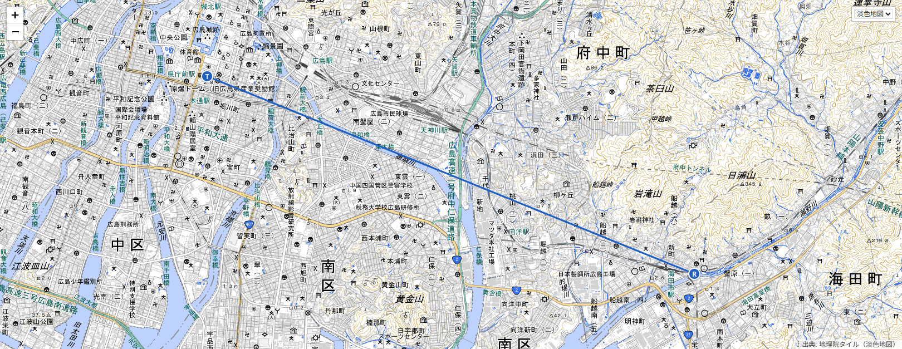
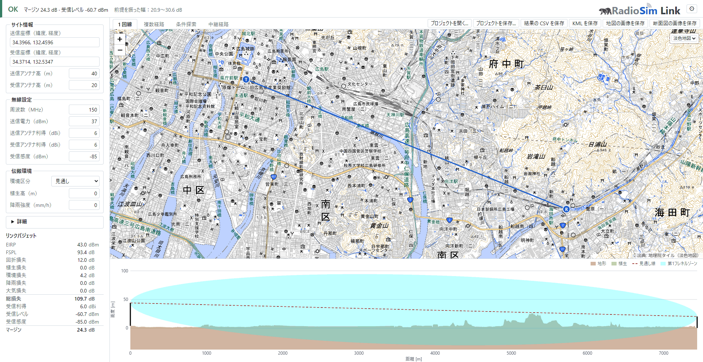
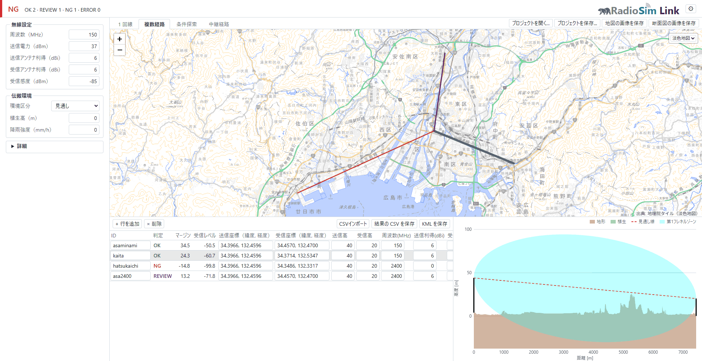
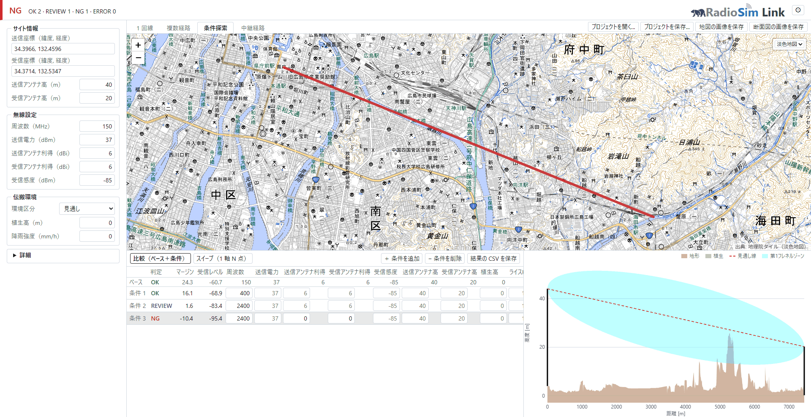
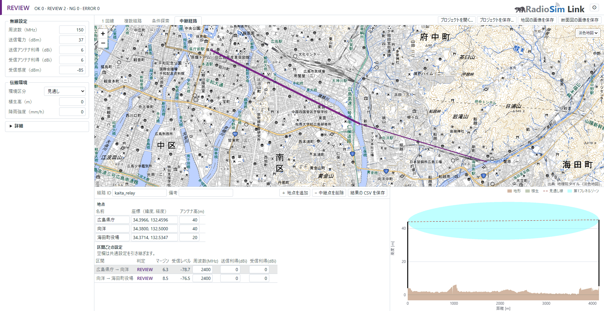
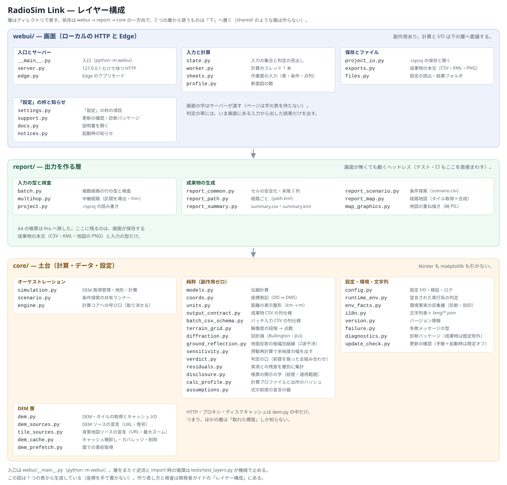

# RadioSim Link 1.0

> **対象読者**: **ソースから動かす・中身に手を入れる方**向けの開発者ドキュメントです。
> アプリの使い方だけを知りたい場合は [manual_ja.md](manual_ja.md) を参照してください。

> 📣 **RadioSim Link は RadioSim Pro 3.x の後継です。** 3.x で保存した `.rsproj` は Link 1.0 で開けます。開いたときは 3.9.x と同じ計算方式で計算します（詳細は [manual_ja.md](manual_ja.md#プロジェクトファイルrsproj)）。

地上無線回線の伝搬特性を現地調査前にスクリーニングするデスクトップシミュレーターです。
国土地理院 DEM（数値標高モデル）を自動取得し、地形断面・回折損・植生減衰・リンクバジェットをリアルタイムに可視化します。

---

## 目次

1. [概要・用途](#概要用途)
2. [Windows バイナリのビルド](#windows-バイナリのビルド)
3. [動作環境・依存ライブラリ](#動作環境依存ライブラリ)
4. [ファイル構成](#ファイル構成)
5. [インストール・起動（ソースから実行）](#インストール起動ソースから実行)
6. [「設定」の枠](#設定の枠)
7. [地図](#地図)
8. [使い方 — 1 回線](#使い方--1-回線)
9. [使い方 — 複数経路](#使い方--複数経路)
10. [使い方 — 条件探索（比較 / スイープ）](#使い方--条件探索比較--スイープ)
11. [使い方 — 中継経路](#使い方--中継経路)
12. [入力パラメータ詳細](#入力パラメータ詳細)
13. [計算モデル詳細](#計算モデル詳細)
14. [DEM 取得ロジック](#dem-取得ロジック)
15. [保存パッケージ](#保存パッケージ)
16. [プロジェクトファイル（.rsproj）](#プロジェクトファイルrsproj)
17. [アーキテクチャ](#アーキテクチャ)
18. [開発環境のセットアップ](#開発環境のセットアップ)
19. [テスト](#テスト)
20. [既知の制限・注意事項](#既知の制限注意事項)
21. [不具合の報告](#不具合の報告)
22. [著作権](#著作権)

---

## 概要・用途

RadioSim Link は、無線回線設計における **現地調査前の概算スクリーニング** に特化したツールです。
TX（送信局）と RX（受信局）の座標・アンテナ高・無線設定を入力すると、国土地理院の標高データを自動取得して地形断面を描画し、リンクバジェットの成立可否を数秒で判定します。

### 主な機能

#### 実行フロー（4 つ）

**★クラス点検の単位**でもあり、欠陥を直すときは「この 4 つ＋地図の 5 面すべてに当てはまらないか」を必ず問う。

| フロー | 実装 | 入力の source of truth |
| --- | --- | --- |
| **1 回線** | `simulation.py` | 左の列の入力欄 |
| **複数経路** | `batch.py` | 面の表（CSV の読み書き） |
| **条件探索（比較 / スイープ）** | `scenario.py` | 固定した経路＋条件列。**DEM 取得 1 回＋純計算 N 回**（計算が 2 フェーズであることを使う） |
| **中継経路** | `multihop.py` | waypoint 列（地点）。区間は導出。再生中継モデルで**全体判定は min**（最も余裕の少ない区間）、内訳と両方を出力 |

画面は `webui/`（Edge のアプリモードで開くローカルの HTTP サーバー）。4 つの面は右の上で切り替え、計算は `webui/worker.py` が裏のスレッドで回す。

#### 地図

- **地図**（`webui/static/app.js`・Leaflet）: 右の上に 1 つ。端点のピン（T・R）をドラッグして座標を入れる（離したときに 1 回だけ計算を頼む）・右上で背景地図を切り替える・断面図にマウスを載せると、その地点が地図に出る

#### 計算モデル（`models.py`。純関数・副作用ゼロ）

- 国土地理院 DEM PNG タイル（5m / 10m メッシュ）から地形断面を自動生成
- 地球曲率補正（標準大気 K = 4/3 固定）
- Bullington 法 / Fresnel-Kirchhoff 法による回折損計算
- 植生減衰（LoS 侵入深さモデル）
- 環境損失（市街地 / 郊外 / 農村 / 見通し の 4 区分）
- 降雨減衰（ITU-R P.838-3）・大気減衰（ITU-R P.676-13 Annex 2）

#### 出力（`report/` が本文を作り、画面が選んだ場所へ書く。すべてヘッドレス）

- 作業面の結果の CSV（`summary.csv`・`hops.csv`・`scenario.csv`）。列は出力契約（`core/output_contract.py`）に従う
- KML（1 回線は `path.kml`・複数経路は `summary.kml`）
- 地図と断面図の PNG
- 結果フォルダは作らない（成果物は 1 つずつ、選んだ場所へ保存する）。A4 の帳票は Link には無い（RadioSim Pro の機能）

#### 入力の再利用

- **プロジェクトファイル（`.rsproj`）**: 座標・全パラメータ・バッチ行・条件探索の条件・waypoint 列を 1 ファイルに束ねて保存／再開（**結果と app 設定は含めない**）
- **案件情報（案件名・自由メモ）**: 新しい画面に入力欄は無い。開いた `.rsproj` の案件情報は、保存し直しても持ち越す

#### 画面

- 判定の帯（判定の語・詳細・前提を振った幅）と、左の列の内訳（リンクバジェット）
- 断面図（`webui/profile.py` が描く材料を作る）。マウスを載せると地図と連動する
- 座標表記の切り替え（DD / DMS・`coords.py` は純関数）
- 日本語 / 英語 UI 切替（`i18n.py` が単一ソース）＋**利用者が言語を足せる**（`lang/<コード>.json`）。`t()` は前からキー単位で英語へフォールバックするので、外部の表は**上書きできた分だけ**効く。⛔ プラグイン機構は作らない（読むのは JSON 1 種類だけ）。⚠️ **成果物の語（`html_*` / `pl_*`）は開かない**。出力契約が利用者ごとに変わるためである。**差し込み（`{n}` など）が英語と違うキーは採用せず、そのことを起動時に画面で言う**（採用すると `str.format` が `KeyError` を投げてその画面で落ちるため、黙って壊れさせない）
- テーマ（ライト / ダーク / システム自動）。切り替えは「設定」の枠（⚙）

### 精度の位置付け

組み込みの国土地理院 DEM の水平解像度は 5〜10m です。計算を実測で較正していないので、回折損に「±何 dB」という誤差の幅は名乗りません。前提（植生高・環境区分・回折の方式など）を振ると判定が裏返る回線は、判定を `REVIEW`（現地確認を推奨）にして示します——これは誤差の幅ではなく、結果が前提にどれだけ依存するか（前提依存性）です。⚠️ **地形の解像度と DEM 標高の誤差は振っていません**。複数の障害物が重なる経路の合成損失も、実測とも基準実装とも突き合わせていません（後述）。
本ツールはあくまで「現地調査が必要かどうかを判断する」スクリーニング用途を目的としており、回線設計の最終判断には使用しないでください。

---

## Windows バイナリのビルド

python.org の **embeddable Python** に、依存ライブラリと製品のソースを並べた配布フォルダを作ります。自前の exe は作らず、起動には Python Software Foundation の署名がある `pythonw.exe -m webui` を使います（PyInstaller で作った exe が Smart App Control に 2 回止められたため、Link 1.0 で切り替えました）。検査と手順はすべて `buildtools/build_link.py` にあり、`build.bat` はその入口です。

### 前提条件

- **環境変数 `RADIOSIM_PYTHON`**（**必須**）: テストを走らせている仮想環境の `python.exe`。依存ライブラリはこの Python の site-packages から写すので、検証した版と配る版が同じになります。→ [開発環境のセットアップ](#開発環境のセットアップ)
- **環境変数 `RADIOSIM_EMBED_ZIP`**（**必須**）: python.org の embeddable の zip。`RADIOSIM_PYTHON` と同じ版のものを指定します（`vendor\` の拡張モジュールがその版用なので、版が違えば止まります）
- ⚠️ **ビルドに使う Python に Tk 9 が要ります**。アイコンを `webui/static/brand.svg` から Tk 9 の SVG 読み込みで描くためです（Windows 版の Python 3.15 は Tk 9.0 を同梱しています。確かめ方は `python -c "import tkinter; print(tkinter.TkVersion)"`）。配布物の中では Tk を使いません

> **なぜ環境変数で明示させるのか**：以前 `build.bat` は `PATH` の Python でビルドしており、pytest が検証した環境と推移的依存が食い違ったまま配布していました（TLS の CA バンドルを含む）。探索やフォールバックを持たせると食い違っても黙って成功するため、**未設定なら止める**設計にしています。

### ビルド手順

```bat
build.bat
```

`buildtools/build_link.py` は次の順に進み、どこかで食い違えばビルドを中止します。

| ステップ | 内容 |
| --- | --- |
| 1 | `RADIOSIM_PYTHON` で走っていること、`RADIOSIM_EMBED_ZIP` の実体と版を確かめる |
| 2 | embeddable を展開し、`python3XX._pth` で読む場所を標準ライブラリ・`vendor`・`app` だけにする |
| 3 | 実行時の依存を `vendor\` へ写す。`requirements.txt` の固定と版が違うとき、依存の依存が写す物の中で閉じていないときは中止する |
| 4 | `core/`・`report/`・`webui/` を `app\` へ写して `.pyc` を作り、同梱文書（マニュアル日英から辿れる `.md` と絵）・`LICENSE`・`icon.ico`・`version.txt` を置く |
| 5 | **同梱漏れの検査**。作った木の `python.exe` で製品の全モジュールを読み、読めなければ中止する（開発機には全部入っているので、ソースから実行しても漏れは見えない） |
| 6 | `portable.txt` と起動用の `RadioSimLink.cmd` を足して zip に固める |

`build.bat clean` は再生成可能な生成物・キャッシュ・ログ・配布 zip を一掃します。

- **残すもの**: 仮想環境と、**リポジトリ直下の** `terrain_cache/` `results/` `basemap_pale/`（ソース実行で貯めたデータで、取り直しが高価、または利用者のもの）
- **消すもの**: ビルド出力の下は**すべて**。⚠️ **配布フォルダから起動したアプリが自分の隣に作った `terrain_cache/` `results/` も消えます**（これらはビルド出力の一部で、通常のビルドでも作り直されます）。

### 出力

リポジトリ直下の `dist/`。

```
dist/
├── RadioSimLink/                  ← 配布フォルダ
│   ├── python.exe / pythonw.exe   ← embeddable Python（標準ライブラリは zip）
│   ├── vendor/                    ← 実行時の依存ライブラリ
│   ├── app/                       ← core / report / webui
│   ├── docs/                      ← 同梱文書
│   └── LICENSE / icon.ico / version.txt
├── RadioSimLink-<版>.zip          ← ポータブル版
└── RadioSimLink-Setup-<版>.exe    ← build.bat installer のとき
```

版は `core/version.py` の `APP_VERSION` から実行時に取得します（この手順書に版を書き写さない。写すと版を上げた日に嘘になる）。

### 配布パッケージの作成

`build.bat`（引数なし、または `build.bat link`）が **ZIP まで自動で作ります**。配布フォルダに `portable.txt` と `RadioSimLink.cmd` を足して `dist\RadioSimLink-<版>.zip` へ固めるところまでがビルドの一部です。zip を展開した利用者は `RadioSimLink.cmd` から起動します。

`core.config.is_portable()` は `portable.txt` の有無で分岐します（無ければ「インストール先が書込禁止かもしれない」と見なし、OS 標準の場所〔`%APPDATA%` 等〕へ書きます）。

### インストーラのビルド（Inno Setup）

```bat
build.bat installer
```

同じ配布フォルダを作ったうえで、`installer/link.iss`（Inno Setup）を使って `RadioSimLink-Setup-<版>.exe` を生成します（`build.bat link-installer` も同じ）。**`portable.txt` は同梱しません**（インストール先は常に非ポータブル扱いで、設定・キャッシュ・ログ・結果は OS 標準の場所）。

- **前提条件**: [Inno Setup 7](https://jrsoftware.org/isinfo.php) 導入済み（`winget install JRSoftware.InnoSetup.7`）＋環境変数 `RADIOSIM_ISCC` に `ISCC.exe` のフルパスを設定。導入先はユーザー単位なら `%LOCALAPPDATA%\Programs\Inno Setup 7\ISCC.exe`、マシン単位なら `C:\Program Files (x86)\Inno Setup 7\ISCC.exe` です（設定例は cmd なら `setx RADIOSIM_ISCC "C:\...\ISCC.exe"`、PowerShell なら `setx RADIOSIM_ISCC "$env:LOCALAPPDATA\Programs\Inno Setup 7\ISCC.exe"`。**`%LOCALAPPDATA%` は PowerShell では展開されない**ので、そのまま貼るとリテラルが保存されます）。未設定・実体なしならビルドを中止します。
  - **配布ビルドは Inno Setup 7 系で作ります**。ビルドがコンパイラの版を確かめ、7 でなければ中止します。**黙って 6 で作った配布物が出てしまう**のを防ぐためのゲートです（上流の更新は 6.7.3〔2026-05-26〕を最後に 7 系へ移っています）。意図して別の版で作るときだけ `RADIOSIM_ISCC_ANY_VERSION=1` を宣言してください。
- **インストール先の既定**: `{autopf}\RadioSim Link`（`PrivilegesRequired=lowest`。管理者権限が無ければユーザー配下、あればユーザーが選べる）。
- **出力先**: 配布フォルダと同じ `dist/`（`RadioSimLink-Setup-<版>.exe`）。
- **署名**: `RADIOSIM_SIGNTOOL` が定義済みならインストーラに署名します（未定義なら未署名のまま）。現在の配布物は未署名です。⚠️ **「未署名では導入がブロックされる」状況は 2026-09-07 に実際に確認しました。** Windows 11 の Smart App Control（⚠️ **クリーンインストールした環境に限らない**・対象地域は限られる）が、インストーラが `%TEMP%` へ展開する本体を実行拒否します（下のトラブルシューティング表）。**証明書の取得は見送ると決定しました（2026-09-11）。** 自己署名では通らず（Smart App Control は信頼された署名者か評価を要求します）、無償の OV 系サービス（SignPath Foundation）や EV も文書上は通る見込みが立ちましたが、単独開発者が毎リリース外部依存を1つ増やすコストに見合わないと判断したためです。ポータブル版 ZIP の案内が恒久的な仕様です。3.x では ZIP を展開した自前の exe も止められました（2026-10-24 に開発機で確認）。Link 1.0 からは起動に署名のある `pythonw.exe` を使いますが、それでも止まった場合は組織の管理者に相談するよう案内しています（利用者マニュアルの同じ節）。

### 製品名と外の包み

上に載る非公開の層は、この道具を借りて自分の配布を作ります。`--product` で配布の名前（フォルダ・zip・インストーラ・起動の `.cmd`・スタートメニュー）が替わり、`--license` でその許諾を `LICENSE` の隣へ足します。`--package 名前=フォルダ` と `--entry 名前` で、このリポジトリの外の包みを `app\` へ足して起動の口をそちらへ替えます（公開側のコードは上に載る層の名前を知りません）。⛔ インストーラの AppId とインストール先は替えません。同じ場所の Lite を置き換え、設定とキャッシュを引き継ぐためです。

### トラブルシューティング

| 症状 | 対処 |
| --- | --- |
| `ModuleNotFoundError` が起動時に発生 | ビルドの同梱漏れの検査は、関数の中の import までは読みません。足りない配布物を `buildtools/build_link.py` の依存の一覧（外の包みなら `--runtime-dist`）に足してビルドし直す |
| エラーメッセージが見えない | 配布フォルダでコマンドプロンプトから `python.exe -m webui` を起こすと、例外がそこに出る（`pythonw.exe` はコンソールを持たない） |
| SmartScreen 警告（配布先） | 署名なしインストーラのため正常。「詳細情報」→「実行」で続行 |
| インストーラが「エラー 4551: アプリケーション制御ポリシーによってこのファイルがブロックされました」で中止（配布先） | **SmartScreen ではなく実行拒否で続行不可**。Windows 11 の Smart App Control（⚠️ **クリーンインストールした環境に限らない**。有効になる経路は複数あり、**そこは数えない**。判定に要るのは「その機械で今オンかどうか」だけ）または組織のアプリケーション制御が、未署名の `setup.tmp`（Inno Setup が `%TEMP%` へ展開する本体）を弾いている。**MOTW ではないので「ブロックの解除」も効かない。** 恒久的な案内はポータブル版 ZIP（署名は見送りと決定済み）。それでも止まったら組織の管理者へ相談するよう案内する。詳細は `docs/manual_ja.md` の「インストーラが Windows に止められたとき」 |
| 上記が自分の環境で起きているか確かめたい | `Get-WinEvent -LogName Microsoft-Windows-CodeIntegrity/Operational` の EventID `3033` / `3077` にブロックされたファイル名とポリシー ID が残る。Smart App Control の状態は `HKLM\SYSTEM\CurrentControlSet\Control\CI\Policy` の `VerifiedAndReputablePolicyState`（`0`=オフ / `1`=オン・適用 / `2`=評価モード） |

---

## 動作環境・依存ライブラリ

| 項目           | 要件                                                  |
| -------------- | ----------------------------------------------------- |
| OS             | Windows 10/11（macOS / Linux でも動作しますが未検証） |
| Python         | 3.12 以上（固定版 numpy 2.5 の要件。3.15 で動作確認済み） |
| インターネット | DEM 取得時に必要（取得済みタイルはキャッシュ）        |

### 必要ライブラリ

```
python -m pip install -r requirements.txt
```

**版は [`requirements.txt`](../requirements.txt) が単一ソース**です（固定することでソース実行と配布バイナリで同じ版が入る）。名前を並べて入れると版が固定されず、下表と二重管理になります。

| ライブラリ | 用途 |
| ---------- | ---- |
| numpy      | 地形・伝搬計算のベクトル演算 |
| matplotlib | Pro の帳票の図（公開側のアプリは使いません。Pro が同じ固定版を使うため一覧に残しています） |
| requests   | 国土地理院タイルと更新の確認の HTTP 取得 |
| Pillow     | PNG タイル画像のデコードと、成果物の地図画像の描画 |
| markdown   | 「設定」の枠の「ドキュメントを開く」で文書を HTML にして開く（省略可。無ければ `.md` をそのまま開きます） |
| truststore | 企業プロキシ環境での SSL 証明書検証（省略可、なくても動作します） |

---

## ファイル構成

```
radiosim/
│   # 層はディレクトリで表す。依存は webui → report → core の一方向。
│   # 2 つの層から使われるものは「下」へ置く（`shared/` のような箱は作らない）。
│
├── core/                 # 土台。計算・データ・設定。tkinter も matplotlib も引かない
│   ├── models.py         # 純粋計算ロジック（副作用ゼロ）
│   ├── diffraction.py    # 回折損（Bullington 等価ナイフエッジ。球面回折は未実装）
│   ├── ground_reflection.py # 地面反射（2波干渉）の振幅包絡線・受信電力へは混ぜない（純関数）
│   ├── sensitivity.py    # 摂動再計算。余裕度[dB]の幅を出す（モデル無変更・純関数）
│   ├── residuals.py      # 実測との残差。環境区分×帯域×距離帯の中央値・ばらつき（純関数）
│   ├── assumptions.py    # 式の前提を式の隣に宣言する器（ASSUMPTIONS の型）と、式を持たないモジュールの一覧
│   ├── simulation.py     # ViewModel / オーケストレーター
│   ├── config.py         # アプリ設定 I/O・入力バリデーション・ロギング（外部依存は最小）
│   ├── dem.py            # DEM/淡色タイルの1点取得・標高デコード・タイルキャッシュI/O・プロキシ（外部依存を閉じ込め）
│   ├── dem_sources.py    # DEMソースの宣言ファイル（URL/デコード方式/無効値/出典・利用条件）
│   ├── tile_sources.py   # 背景地図タイルソースの宣言ファイル（URL/最大ズーム/出典・利用条件）
│   ├── dem_cache.py      # タイルキャッシュの棚卸し・カバレッジ表示・削除
│   ├── dem_prefetch.py   # 面での事前取得（bbox → 位置の列挙・優先順位つき降下・ワーカープール）
│   ├── terrain_grid.py   # DEM の格子と地形の解像度（段階→点数の解決・純関数）
│   ├── scenario.py       # 条件探索の共有ランナー（A-1 比較 / A-2 スイープ・フェーズの宣言・ヘッドレス）
│   ├── coords.py         # 座標表記変換（DD ⇔ DMS・純関数）
│   ├── units.py          # 距離の表示整形（内部 km → 表示 m・純関数）
│   ├── output_contract.py # 成果物 CSV の列仕様。出力契約の単一ソース（純データ）
│   ├── batch_csv_schema.py # バッチ入力 CSV の列仕様（列名・順序・必須/任意）の単一ソース（純データ）
│   ├── disclosure.py     # 帳票の「結果の取扱に関する補足」の字（前提・適用範囲の刻印・純関数）
│   ├── calc_profile.py   # 計算プロファイル ID と、入力設定・地形のハッシュ（純関数）
│   ├── verdict.py        # 判定の口（OK／REVIEW／NG／ERROR・前提を振った全組み合わせ・集約と件数）
│   ├── engine.py         # 計算コアへの呼び口（取り消せる地形の取得・計算・作業面の 1 件ずつの実行）
│   ├── runtime_env.py    # 実行環境の事実（frozen か・同梱物の根・書き込み先の解決）
│   ├── env_facts.py      # 環境事実の収集層（版・設定・直近ログ・キャッシュ統計・環境情報。座標は伏せる）
│   ├── diagnostics.py    # 診断パッケージの ZIP 生成（パス中のユーザー名を伏字化・成果物は既定除外）
│   ├── i18n.py           # 多言語文字列テーブル＋外部言語（lang/*.json）の検証と読み込み
│   ├── failure.py        # 失敗メッセージの型（何が起きた／次に何をすべきか／詳細）
│   ├── update_check.py   # 更新の確認（GitHub Releases へ問い合わせ・知らせる版の選択は純関数）
│   └── version.py        # バージョン情報
├── report/               # 出力を作る層。作業面の行の型と成果物（CSV・KML・地図の PNG・.rsproj）の生成（ヘッドレス）。帳票は Pro（Link 1.0 ステージ11b）
│   ├── batch.py          # 複数経路の行の型と検査（PathRow・PathResult・1 行の読み取り・SimParams への変換）
│   ├── multihop.py       # 中継経路（A-3）の入力の型と検査（waypoint→ホップ導出・min 集約・hops.csv）
│   ├── project.py        # プロジェクトファイル（.rsproj）の読み書き。入力一式を束ねる
│   ├── report_common.py  # 成果物の共有部品（CSV のセルの安全化と末尾 2 列・図に焼く字の大きさ・純関数）
│   ├── report_path.py    # 1 回線の path.kml
│   ├── report_summary.py # 複数経路の summary.csv と summary.kml
│   ├── report_scenario.py # 条件探索の scenario.csv
│   ├── report_map.py     # 経路を重ねた地図の PNG のヘッドレス生成と出典の字
│   └── map_graphics.py   # 地図オーバーレイ描画の純 PIL 実装（判定の色の単一ソース）
├── webui/                # 画面（ローカルの HTTP と Edge のアプリモード）。入口は `python -m webui`
│   ├── __main__.py       # `python -m webui` の入口（先に Edge を起こす・truststore は初めての通信の直前に `core/dem.py` が入れる・設定は読むだけ）
│   ├── state.py          # 入力の集合と見出し（古い版の結果を今の判定に見せない）
│   ├── sheets.py         # 作業面の入力（複数経路・条件探索・中継を画面の文字列のまま持ち、実行と保存のときに型へ直す）
│   ├── project_io.py     # .rsproj の保存と開く（画面の入力と ProjectDoc の変換・ファイルの形は report/project.py）
│   ├── exports.py        # 作業面と 1 回線の成果物の本文（CSV・KML・地図の PNG。ファイルを書くのは画面）
│   ├── worker.py         # 計算のスレッド 1 本（地形の取得は取り消せる・作業面は 1 件ずつ回す）
│   ├── profile.py        # 断面図の数（帳票と同じ線・1200 点まで間引く）
│   ├── settings.py       # 「設定」の枠（言語・テーマ・座標の表記・プロキシ・起動時の更新の確認・背景地図）
│   ├── files.py          # 「設定」の枠のファイルの 4 つ（パラメータ読込・アプリ設定読込・結果フォルダを開く・全キャッシュ削除）と訳のひな形
│   ├── support.py        # 「設定」の枠のヘルプ（更新の確認・診断パッケージ）
│   ├── docs.py           # 「設定」の枠の説明書を開く（Markdown を HTML にして既定のブラウザで開く）
│   ├── notices.py        # 起動時の知らせ（読み込めなかった言語・宣言ファイル・新しい版。地図の上の閉じられる帯）
│   ├── server.py         # 127.0.0.1 だけで待つ HTTP（起動ごとの鍵・Host の検査・静的ファイル）
│   ├── edge.py           # Edge を専用プロファイルのアプリモードで開く
│   └── static/           # 画面の殻（HTML・JS・CSS・Leaflet）
│
│   # 本体とは別のアプリはここ。`apps/*` が引けるのは core/ だけ（アプリ同士は引かない）。
│   # 本体（上の 3 層）はいまのところ直下に置いたまま。
│
├── apps/
│   └── field/           # 実測補助（別アプリ・開発中。本体の配布物には入らない）
│       ├── session.py    # 測定セッション（1 回の測定＝1 フォルダ。ヘッダ JSON ＋追記のみの CSV）
│       ├── aggregate.py  # 受信サンプルをウィンドウごとにまとめ、打ち切りを判定してバッチ CSV へ書き出す
│       ├── recorder.py   # 測りながら書く（UART のバイト列と作業者の操作をセッションへ追記・生ログからの作り直し）
│       ├── calib.py      # 個体ごとの校正ファイル（机上試験が書き、記録が個体 ID で読んでセッションへ写す）
│       ├── bench.py      # ステージ0 の机上試験（2 台の役割をコマンドで入れ替えて両方向を測り、生ログと段を残す）と、人の操作が要らない動作確認
│       ├── bench_analysis.py # 机上試験の判定（生ログから数え直す・線形性・ディザ・受信率・校正ファイル）
│       ├── gnss.py       # GNSS 受信機の生データの記録器（静止観測。版を問い合わせ、出力を RAM 層だけに設定して UBX をそのまま残す）
│       ├── ntrip.py      # NTRIP の補正（RTCM 3）を caster から受け、記録器と同じポートから受信機へ流して残す（`gnss log --ntrip`）
│       ├── cli.py        # コマンドライン（雛形の書き出し・記録・バッチ CSV への書き出し・動作確認・机上試験・連続送信・GNSS の記録）
│       ├── mavlink/      # 受信サンプル・設定のメッセージ定義（ファームと PC 側の両方がここから生成する）
│       │   ├── dialect.py # 定義の XML を読み、フィールドの並び・CRC を組み立てる
│       │   ├── reader.py  # UART のログをフレームへ分解し、受信サンプルへ変える
│       │   └── gen_c.py   # 定義の XML からファーム用の C ヘッダ（見本のフレームつき）を作る
│       └── firmware/     # 送受信機のファーム（XIAO ESP32C6・ESP-IDF。手順は README.md）
├── docs/                 # 読み物（開発者向け・利用者向けとも、入口の README.md を除いてここ）
│   ├── developer_ja.md   # このファイル
│   ├── developer_en.md   # 英語版の開発者ドキュメント
│   ├── manual_ja.md      # 利用者向けマニュアル（exe に同梱・ヘルプ「ドキュメントを開く」が開く）
│   ├── manual_en.md      # 英語版の利用者向けマニュアル（同上）
│   ├── glossary.md       # 用語集（画面・レポートに出る語）。tests/test_i18n_glossary.py が守る
│   ├── screenshots.md    # スクショの撮り方（座標・条件・期待値・配置先の正典）
│   └── images/           # そのスクショと図（architecture_*.svg は層構成図）。exe にも同梱
├── buildtools/           # ビルドと開発の道具（層には属さない）
│   ├── build_link.py     # 配布物（embeddable の Python・vendor・zip・インストーラ）を組む。`build.bat` が呼ぶ
│   ├── architecture_figure.py # 層構成図（docs/images/architecture_*.svg）を作る
│   ├── dev_check.py      # 実装後の検証を 1 コマンドで（下の「テスト」）
│   └── deploy_qa_fixtures.py # 動作確認用の設定ファイル（qa_fixtures/）を配置先へ配る
├── installer/
│   └── link.iss          # インストーラ（Inno Setup）の定義
├── README.md             # リポジトリの入口（GitHub で最初に読まれる 1 本）
│
│   # テストは**名前だけ**。説明は「テスト」セクションの表が正典（同じ説明を 2 か所で持たない）。
│   # 例外は表に載らないもの。`test_*.py` でないファイルで、そこだけここに説明を付ける。
│
└── tests/
    ├── test_models.py
    ├── test_golden_links.py   # 回帰コーパス（代表回線のゴールデン値＋純関数の不変条件）
    ├── golden_corpus_gen.py  # 同コーパスの生成器（手動実行・実 DEM を取得）
    ├── test_ground_reflection.py  # 地面反射の振幅包絡線（3.4 ステージ4）
    ├── test_model_preconditions.py  # 式の前提をコーパスの全回線に当てる
    ├── test_assumptions.py  # 式の前提の宣言の閉じた世界のゲート
    ├── test_p526_reference.py  # 規格例照合コーパス（回折の式を P.526 の厳密値と手計算に突き合わせる）
    ├── test_sensitivity.py    # 摂動再計算エンジン（3.4 ステージ4）
    ├── test_residuals.py      # 実測との残差計算（3.4 ステージ5）
    ├── test_simulation.py
    ├── test_config.py
    ├── test_dem.py
    ├── test_dem_bilinear.py
    ├── test_dem_sources.py
    ├── test_tile_sources.py
    ├── test_batch.py
    ├── test_report.py
    ├── test_scenario.py
    ├── test_multihop.py
    ├── test_field_session.py
    ├── test_field_aggregate.py
    ├── test_field_mavlink.py
    ├── test_field_recorder.py
    ├── test_field_firmware.py
    ├── test_field_bench.py
    ├── test_field_monitor.py
    ├── test_field_gnss.py
    ├── test_field_ntrip.py
    ├── test_project.py
    ├── test_report_map.py
    ├── test_coords.py
    ├── test_terrain_grid.py
    ├── test_units.py
    ├── test_version.py
    ├── test_update_check.py
    ├── test_output_contract.py
    ├── test_calc_profile.py
    ├── test_verdict.py
    ├── test_engine.py
    ├── test_runner_logging.py
    ├── test_failure_messages.py
    ├── test_build_link.py
    ├── test_i18n_glossary.py
    ├── test_i18n_key_duplication.py
    ├── test_i18n_external.py
    ├── test_layers.py
    ├── test_paths.py
    ├── test_write_locations.py
    ├── test_smoke.py
    ├── test_webui.py
    ├── test_webui_docs.py
    ├── test_webui_workspace.py
    ├── test_webui_exports.py
    ├── test_webui_project.py
    ├── test_webui_review_contract.py
    ├── test_docs_consistency.py
    ├── test_env_consistency.py
    ├── test_experiments_probes.py
    ├── test_env_facts.py
    ├── test_diagnostics.py
    ├── test_repo_hygiene.py
    ├── test_dev_check.py
    ├── test_qa_fixtures.py
    ├── test_claude_hooks.py
    ├── test_codex_review_tool.py
    ├── test_autorun_tool.py
    ├── test_qa_gate_cache.py
    ├── test_pre_commit_gate.py
    ├── test_commit_gate_scope.py
    ├── test_release_check.py
    └── test_hook_shim.py
```

---

## インストール・起動（ソースから実行）

```bash
# リポジトリの中へ移る（requirements.txt と webui/ はここにある）
cd radiosim

# 依存ライブラリのインストール（版は requirements.txt が単一ソース。固定して配布物と揃える）
python -m pip install -r requirements.txt

# テスト・ビルドもする場合は開発用も（PYYAML_FORCE_LIBYAML=0＝bandit が使う PyYAML には
# Python 3.15 向けの wheel が無くソースから組むので、C 拡張を作らせない。下の「開発環境のセットアップ」と同じ）
PYYAML_FORCE_LIBYAML=0 python -m pip install -r requirements-dev.txt

# 起動（Microsoft Edge のアプリモードで画面が開く）
python -m webui
```

初回起動時にプロジェクトルートへ以下のディレクトリが自動作成されます。

| ディレクトリ       | 内容                           |
| ------------------ | ------------------------------ |
| `terrain_cache/` | DEM タイルのディスクキャッシュ |

Link は結果フォルダ（`results/`）へ書きません。成果物は保存のたびに選んだ場所へ 1 つずつ書きます。`results/` は 3.x の結果を探す口として、「設定」の枠の「結果フォルダを開く」で開けます（無ければ作ってから開く）。

---

## 「設定」の枠

メニューバーはありません。上の帯の右端の **「設定」ボタン（歯車）** が小さな枠を開き、**設定 / ファイル / ヘルプ** の 3 つの群が並びます。枠の中身（今の値・選べる値・字）はサーバーが `webui/settings.py` の `payload` で渡し、画面（`webui/static/app.js`）はそれだけで枠を組みます。ラベルは `i18n.py` の辞書が単一ソース。以下がその全項目です。

- **1 つ替えるたびに保存**（`settings.apply` が検査してから `config.save_app` を呼ぶ）。枠の OK は閉じるだけ。
- 押した結果と失敗の理由は、枠の下の 1 文で返す（ダイアログは出さない）。
- **背景地図**（`basemap_layer`）は枠ではなく地図の右上の欄で替える（保存の口は同じ `settings.apply`）→ [地図](#地図)。
- **プロジェクトの開く・保存**は枠ではなく、右の列の上（面の切り替えの隣）の道具 → [プロジェクトファイル（.rsproj）](#プロジェクトファイルrsproj)。

### 設定

選択内容は `radiosim_conf.json` に保存されます（実装は `webui/settings.py`・扱う鍵は `KEYS`）。

| 項目                  | 選択肢                      | 説明                                                          |
| --------------------- | --------------------------- | --------------------------------------------------------------- |
| 言語                  | 日本語 / English（＋自分で足した言語） | UI の表示言語。替えると画面を読み直す（画面の字は起動時の表から組むため） |
| 訳のひな形を書き出す... | —                         | 訳せる全キー＋英語の値を `_template.json` で書き出す（`webui/files.py` の `write_lang_template`）。ブラウザの保存の画面は初期フォルダを選べないので、`USER_LANG_DIR` へ直に書き、上書きはしない → [表示言語を自分で足す](../docs/manual_ja.md#表示言語を自分で足す) |
| テーマ                | システム / ライト / ダーク  | 画面の明暗                                                      |
| 座標の表示形式              | 十進度（DD）/ 度分秒（DMS） | 座標の**表示**表記（`coords.py`）→ 下記                        |
| プロキシ URL          | URL 入力                    | HTTP プロキシを明示指定（空欄 = OS のプロキシ設定を使用）→ 下記 |
| 起動時に更新を確認 | チェック | 既定オフ（`update_check_auto`＝`"on"` のときだけ）。起動時に `webui/notices.py` の `start_update_check` が背景のスレッドで `update_check.auto_due()` を見て、真なら試みた日（`update_check_last`）を**打つ前に**保存して 1 回問い合わせる＝失敗しても同じ日に 2 度目は打たない。新しい版があるときだけ地図の上の帯で知らせ、最新・失敗はログだけ |
| プレリリースも知らせる | チェック | `update_check_prerelease`＝`"on"`／`"off"` は利用者が選んだ値、既定の `""` は「いまの版で決まる」（`update_check.want_prerelease()`＝正式ならオフ・RC/a/b ならオン）。チェックの印はその解いた値を映す。触ったら以後は `"on"`／`"off"` に固定。手動と起動時の両方に効く |

### ファイル

**ファイル／OS の外へ出る操作**の置き場（実装は `webui/files.py`）。

| 項目                  | 説明                                                                     |
| --------------------- | -------------------------------------------------------------------------- |
| パラメータ読込...     | 設定ファイルから**シミュレーション条件だけ**を入力の変更にする（`sim_changes`＝app の鍵は捨てる） |
| アプリ設定を読込む... | 設定ファイルから、「設定」の枠が持つ app の鍵（言語・テーマ・座標の表示形式・背景・プロキシ）**だけ**を取り込む（`settings.apply_many`） |
| 結果フォルダを開く    | `results/` をエクスプローラーで開く（無ければ作ってから開く）。Link はここへ書かない＝3.x の結果を探す口 |
| 全キャッシュ削除...   | 取得済みの DEM / 地図タイルを削除（枠の中で確認）。DEM のソースが 2 つ以上のときだけ、ソースごとに選ばせる |

> **「パラメータ読込」と「アプリ設定を読込む」は領分が排他**。前者はシミュレーション条件、後者は「設定」の枠の項目。**互いに相手を書き換えません**（他人のファイルを開いた瞬間に表示言語やネットワーク設定が変わらないための設計）。

### ヘルプ

| 項目           | 説明                                 |
| -------------- | -------------------------------------- |
| ドキュメントを開く | `webui/docs.py`。配布物はマニュアル・ソース実行はこのドキュメントを、`markdown` で HTML にして既定のブラウザで開く（描けないときは `.md` を OS の既定のアプリで開く） |
| 診断パッケージを保存... | `webui/support.py` が保存前に何が入るかを枠の中に並べ（環境事実は既定でチェック・`results/` の成果物は既定でチェックなし）、`core/diagnostics.py` が ZIP を組み立てる。画面から来た名前は一覧の中だけ受ける → [ユーザーマニュアルのヘルプセクション](../docs/manual_ja.md#ヘルプ) |
| 更新の確認... | `core/update_check.py` が押したときだけ GitHub Releases へ問い合わせる（プロキシ設定に従う）。最新・新しい版・失敗のどれも枠の下の 1 文で返す。ダウンロードと入れ替えはしない |
| バージョン情報 | `version.py` の版数を枠の下の 1 文で示す              |

### 起動時の知らせ

`webui/notices.py`。読み込めなかった訳・宣言ファイルの報告と、起動時の更新の確認で見つけた新しい版を、**地図の上の閉じられる帯**に出す（作業を止めない・起動のたびに出す）。文を組む関数は純関数で、試験が直に呼ぶ。

### 座標の表示形式（DD / DMS）

**表記（表示）の設定であって入力モードではありません。** 入力は `coords.parse_pair` が DD / DMS の双方を寛容に受理し、計算前に必ず DD へ正規化されます（`simulation.SimParams` へ渡る値は常に DD）。

欄の書き直しは画面（`webui/static/app.js` の `reformatCoords`）が持ち、走るのは**表記の切替時・アプリ設定の読込時・地図のピンを動かしたとき（選んだ表記で書き戻す）**。対象は送信・受信の端点の欄だけで、**読めなければ原文が残る**（整形されないこと自体が「読めていない」の合図）。⚠️ 複数経路・条件探索・中継経路の表の座標は書き直さない（打った形のまま持ち、実行と保存のときに `webui/sheets.py` が型へ直す）。

### プロキシ設定

企業ネットワーク等でプロキシを経由して DEM タイルを取得する場合は、「設定」の枠の **プロキシ URL** へ入力してください。

```
http://proxy.example.com:8080
```

- 確定すると即時反映されます（`dem.set_proxy` と地形の覚えの破棄。アプリの再起動は不要）
- 空欄にすると OS のプロキシ設定（システム設定 / 環境変数）に戻ります
- SSL インターセプトを行う企業プロキシ向けに `truststore` による Windows 証明書ストア連携も有効です
- プロキシ未設定で標高サーバーへ一切到達できない場合、**連続失敗で打ち切り**て知らせます（平坦な地形として黙って完走しない）

---

## 地図



地図は画面の右の上に 1 つだけあり、4 つの面で共有します（`webui/static/app.js`・Leaflet）。別のウィンドウは開きません。コアのシミュレーションは地図なしで完結し、地図は入力と結果を見るための補助です。

- **1 回線**: 送信点と受信点にピン（T・R）を立て、2 点を線で結びます。初めて 2 点がそろったとき、経路全体が入るように寄せます。**ピンをドラッグすると座標が入ります**。ドラッグの間は左の列の座標欄と線だけが動き、**離したときに 1 回だけ計算を頼みます**（地形の取得は端点が決まったときだけ）。座標欄が source of truth で、欄を書き換えるとピンがその位置へ移ります
- **複数経路・条件探索・中継経路**: 作業面の表の各件を、送信点から受信点への線で判定の色に塗って描きます。表で選んだ件は太くなり、地図の線を押すと表のその行が選ばれます。条件探索は全件が同じ経路なので 1 本だけ描きます。全件がそろって座標の組が変わったときに、全体が入るように寄せます
- **断面図との連動**: 断面図にマウスを載せると、その地点が地図に印で出ます。逆に、地図の線（1 回線の線と、作業面で選んだ件の線）に載せると、断面図の側にその地点が出ます
- **背景地図**: 右上の欄で切り替えます（淡色・航空写真と、宣言ファイルで足した背景地図）。選んだものは設定の `basemap_layer` に保存し、保存する地図の PNG の背景も同じものになります。タイルは手元のサーバー（`webui/server.py` の `/tile/`）を通して取り、キャッシュに残します。表示義務のある出典は地図の右下に出します

範囲を指定して DEM タイルを先に取っておく処理は `core/dem_prefetch.py` に残っています（新しい画面からは呼びません）。取得済みで**読めるもの**は取り直しません（外部サーバー配慮）。全キャッシュの削除は「設定」の枠のファイル（全キャッシュ削除...）です。

---

## 使い方 — 1 回線



起動すると 1 回線の面が開きます。**実行ボタンはありません**。左の列の欄を変えると、少し待って（`DEBOUNCE_MS`）変えた欄だけをサーバーへ送り（`/api/inputs`）、計算のスレッド（`webui/worker.py`）がその版の入力で計算し直します。

### 1. 左の列の入力欄

欄の並びと語は `webui/server.py` の `_FORM` が単一ソースで、画面（`webui/static/app.js`）はそれを並べるだけです。

| 群 | 欄 |
| --- | --- |
| サイト情報 | 送信座標・受信座標（緯度, 経度）・送信／受信アンテナ高（m） |
| 無線設定 | 周波数（MHz）・送信電力（dBm）・送信／受信アンテナ利得（dBi）・受信感度（dBm） |
| 伝搬環境 | 環境区分（市街地 / 郊外 / 農村 / 見通し）・植生高（m）・降雨強度（mm/h） |
| 詳細（畳んである） | 回折モデル・地形の解像度・DEM ソース（選べるソースが 2 つ以上のときだけ出す） |

- 座標の 2 欄は十進度でも度分秒でも読みます（[座標の表示形式（DD / DMS）](#座標の表示形式dd--dms)）。空にしたときだけ書式の例を薄字で出します
- 値域は欄の吹き出しにあり、外れた値は計算に進まず上の帯が「入力待ち」と理由の 1 文になります（検査は `config.validate_config`・範囲は[入力パラメータ詳細](#入力パラメータ詳細)）
- ライス K の欄は出しません。入力の集合（`webui/state.py`）には残り、プロジェクトファイルの読み書きでは値を保ちます
- **地形の解像度**は高 約4m 画素 / 中 約8m 画素 / 低 20m 間隔 の 3 段階。⚠️ **段階の名前は「標本を置く画素の大きさ」**であって、*どの標高データを読むか*ではありません（標高は段階によらず**取れる中でいちばん細かい層**から返ります）。画素の実寸は緯度で 3.3〜4.4m と振れるので「約」です。**入れるのは段階だけで、点数はアプリが解きます**。「高」「中」は**経路が通る DEM 画素の縁ごと**に標本を置くので**等間隔ではなく**、点数は経路の長さ・向き・緯度から決まります（「低」だけは 20m の等間隔で、*粗いが速い*段階として画素を飛ばします）。ただし点数が上限に当たる極端に長い経路では、「高」「中」も等間隔に落ちます。既定は「中」

欄の下の **リンクバジェット** の表は、EIRP から総損失・受信レベル・受信感度・マージンまでを足し引きの順に並べます（行は `_BREAKDOWN`・値は見出しの同じ名前の数）。判定が古い間は薄く出し、今の入力の値ではないことを示します。

### 2. 地形の取得と計算

計算のスレッドは 1 本で、1 回の手順は「版の写しを取る → 検査 → 地形 → 計算 → その版の見出しとして載せる」です。

1. **地形**: 端点・標本・段階・DEM ソースから作る鍵（`engine.terrain_key`）が手元の地形と同じなら取り直しません。違えば `engine.fetch_terrain` で標本ごとに標高を取ります（取ったタイルはディスクのキャッシュに残る）。取得中に地形の鍵が変わる入力が来たら古い取得を取り消し、地形に効かない欄だけが変わったときは取り終えてから最新の入力で計算します
2. **計算**: `engine.calculate` は地形の上の純計算で、ネットワークへ出ません。アンテナ高や送信電力を変えても地形は取り直さないので、すぐ判定が返ります

標高サーバーへ届かないときは、上の帯が「地形なし」と理由の 1 文になります（平坦な地形として黙って計算しない）。

> **地形データの日付**: キャッシュ済みのタイルは取り直さないため、地形に載る取得日（`TerrainProfile.dem_acquired`）は実行日ではなく**標高を読んだタイルをこの PC に保存した日**（キャッシュファイルの更新日時・`dem.tile_acquired_date`）です。経路上で日付が複数にまたがるときは最古〜最新の範囲になります。この値の算出はネットワークへ出ません。新しいタイルで計算し直したいときは、「設定」の枠の全キャッシュ削除で消してから計算させます。

### 3. 上の帯の判定

画面の上の帯が判定の語（OK / REVIEW / NG / ERROR）・マージン・受信レベルを出します。前提を振った幅があるときはその幅を、REVIEW のときは判定を裏返す前提を並べます（字はサーバーが作る）。🔑 **帯の判定は、いま画面に出ている入力から計算したものだけ**です。計算中は「判定を更新しています…」と取得の進み具合を出し、古い判定を残しません。

### 4. 断面図

右の下に、地形断面を canvas で描きます（`app.js` の `drawProfile`・形はサーバーの `webui/profile.py` が帳票と同じ線で作る）。

| 表示要素 | 説明 |
| --- | --- |
| 地形 | 地球曲率補正済みの地表（下端から塗る） |
| 植生 | 地表の上に植生高 |
| 見通し線 | 送受信アンテナの先端を結ぶ破線 |
| 第1フレネルゾーン | 標本の位置で見通し線の ±F1 の帯 |
| 両端の縦棒 | 送信・受信アンテナ（足元から先端まで） |

マウスを載せると、その地点の距離と地表の標高を出し、地図にも同じ地点の印を出します（[地図](#地図)）。

### 5. 入力の持ち運び

入力は `radiosim_conf.json` へ**書き戻しません**（起動時に読むだけで、3.x の最後の入力から始まる）。作業を残すのは右の列の上の **プロジェクトを保存...**（[プロジェクトファイル（.rsproj）](#プロジェクトファイルrsproj)）、他の設定ファイルから条件だけを取り込むのは「設定」の枠の[ファイル](#ファイル)（**パラメータ読込...**）です。結果の保存は[保存パッケージ](#保存パッケージ)を参照してください。

---

## 使い方 — 複数経路



右の上の面の切り替えで **複数経路** を選ぶと、地図の下に表が出ます。表を直すと少し待って面の入力を丸ごと送り（`/api/inputs` の `sheets`）、全行を 1 件ずつ取得して計算します（`engine.run_paths`）。結果は済んだ行から表の右端（判定・マージン・受信レベル）へ返り、全行がそろうと上の帯に全体の語と語ごとの件数が出ます。

### 設計思想 — 共通の入力は 1 つ、行は経路だけ

無線機と環境の欄は 4 つの面で 1 つです（左の列）。複数経路の面では**端点とアンテナ高の欄を隠し**（各行が持つ）、残りの欄が全行の共通設定になります。行の周波数・利得が空欄なら共通設定を継ぎます。表は打った字のまま持ち（`webui/sheets.py`）、型へは実行と保存のときに直します。

### 入力方法

**手動入力**: 表のセルに ID・座標・アンテナ高・周波数・送受信利得・備考を打ちます。表に出すのは CSV の 9 列（`_BATCH_SHOWN`）で、実測の列は表に出さずに持つだけです。

- **+ 行を追加**: 末尾に空の行を足します（ID は今ある数の ID の次）
- **× 削除**: 選んだ行を（選んでいなければ末尾を）消します
- **CSVインポート**: CSV を読んで表を差し替えます（`/api/batch_csv`）。見出しの誤りは表の上に 1 文で出します

⚠️ **行の誤りはその行だけ ERROR** にし、ほかの行は計算します（`sheets.batch_plan`）。誤りの 1 文は行に載せ、その行を選ぶと断面図の場所に出ます。

#### CSV フォーマット

必須列: `id, start, end, h_tx, h_rx`

省略可能列: `freq, gain_tx, gain_rx, note, meas_dbm, meas_method, feeder_loss_db, env_class`

```csv
id,start,end,h_tx,h_rx,freq,gain_tx,gain_rx,note,meas_dbm,meas_method,feeder_loss_db,env_class
path01,"34.54, 132.41","34.53, 132.40",30.0,10.0,2400,12.5,8.0,メイン回線,-78.5,spot,2.1,suburban
path02,"34.55, 132.42","34.52, 132.39",20.0,15.0,,,,サブ回線,,,,
```

- `start` / `end` は「緯度, 経度」の形式でダブルクォートで囲んでください
- `freq` / `gain_tx` / `gain_rx` を省略した場合は共通設定の値が使われます（**リンク識別属性**として経路ごとに変えられる）。環境区分・降雨強度・回折モデルは共通設定で一括指定します
- `gain_tx` / `gain_rx` 列のない旧 CSV もそのまま読めます（後方互換・利得は共通設定を継承）
- 列名は**大小文字と前後の空白を区別しません**（`ID,Start,…` でも読めます）。`id` は**大小文字を区別せず**一意である必要があります（`p01` と `P01` は重複として弾かれます）
- `meas_dbm` / `meas_method` / `feeder_loss_db` / `env_class` は実測突合せ用の任意列（列の単一ソースは `core/batch_csv_schema.py` の `CSV_COLUMNS`。読み込んだ値は `batch.PathRow` の属性に入る）。層別（環境区分×帯域×距離帯）の残差統計は `core/residuals.py` が計算し、表にして載せるのは Pro の複数経路のサマリ帳票です（スポット測定を統計から外す `compute_layered_stats(exclude_spot=True)` も Pro 側から使う）。`meas_method` は `spot` / `mean` の想定値。**記録は測定時にしかできない**ので、利用者向けの手順は[マニュアルの「実測との突合せに使う場合の記録項目」](manual_ja.md#実測との突合せに使う場合の記録項目)を参照

### 地図と断面図

地図には各行の送信点から受信点への線を判定の色で描き、行を選ぶと太くなります。地図の線を押すとその行が選ばれ、選んだ行の断面図を 1 件だけサーバーから取ります（`/api/profile`・全件の断面は見出しに載せない）。

### 実行の取り消し

🔑 **実行中に入力の版が進めば、走っている全件を取り消して新しい版でやり直します**（表の 1 字を直しても、走っている全件は古い入力の結果になるため）。1 回線の「地形の鍵が違うときだけ取り消す」とは規則が違います。

---

## 使い方 — 条件探索（比較 / スイープ）



右の上の面の切り替えで **条件探索** を選びます。**1 本の確定した経路を、条件を変えて掘る**面で、経路は左の列の入力（1 回線と同じ）、計算側は `core/scenario.py` が持ちます。操作手順は [manual_ja.md](manual_ja.md) が詳しいので、ここでは実装の勘所を挙げます。

- **地形は 1 回線と共有する**: 条件探索は左の列の入力の地形の上で `scenario.evaluate()` を回します。地形の鍵が同じなら取り直さないので、条件を振り直しても DEM の再取得は起きません（これがこの面の使い方そのもの）。評価は純計算なので、全件をそろえてから 1 回で載せます
- **条件は「差分」で持つ**: `Condition` はベースからの上書き辞書で、変えられる欄は `scenario.OVERRIDABLE` が単一ソース。**座標と地形の解像度は入っていません**（経路そのものを比べるのは複数経路の仕事）。比較は最大 `MAX_COMPARE_CONDITIONS` 件
- **ベースは左の列**: 比較の表の先頭の「ベース」の行は左の列の値を映すだけで、表では打てません。条件の空欄はベースを踏襲し、空欄にはベースの値を薄字で出します
- **比較とスイープは同じ計算路を通る**: 表の上の切り替えで比較（ベース＋条件）とスイープ（1 軸 N 点）を選びます。スイープは軸・開始・終了・点数だけを持ち、`webui/sheets.py` の `conditions` が `linspace_values()` → `sweep_conditions(axis, values)` で `Condition` の列に落としてから `evaluate()` に渡します。軸は `SWEEP_AXES`、点数は `MAX_SWEEP_POINTS` が上限。**分岐しているのは入力の作り方だけ**で、評価と結果型（`ScenarioRun` / `ScenarioPoint`）は 1 本です
- **検証は DEM 取得より前**: `validate_base()` はベース値を取得前に弾きます（取得後に落ちると待ち時間を捨てさせる）。条件側は `Condition` が自分で検査済み
- **地図は 1 本**: 全件が同じ経路なので、地図には線を 1 本だけ描きます（選んだ件の語の色・選んでいなければ全体の語の色）。断面は全件が同じ地形で、アンテナ高の上書きだけが線を変えます
- 取得から帳票までを通す `run_scenario()`（`Phase` / `Phases` で取得・計算・成果物の重みを宣言して進捗を出す）も `core/scenario.py` に残っています。新しい画面は使いません

---

## 使い方 — 中継経路



右の上の面の切り替えで **中継経路** を選びます。**再生中継**（受けて送り直す）前提で、区間ごとに独立したリンクバジェットを計算します。モデルは `report/multihop.py`・実行は `webui/worker.py`（区間を 1 件ずつ計算して `MultiHopRun` にまとめる）。表の上に経路 ID と備考、下に地点の表（名前・座標・高さ）と区間ごとの設定の表（周波数・送受信利得・空欄は共通設定を継ぐ）が並びます。

- **経路は点列＋接続規則で持つ**: `MultiHopPath` は `Waypoint` の列と区間ごとの `HopRF` を持ち、区間は `links(path)` が導出します（並びの意味を各所で書かない）。**高さは `Waypoint` にだけ**あり——中継点のアンテナは 1 本なので、前の区間の受信高と次の区間の送信高を別々に持てない形にしてあります。上限は `MAX_HOPS`（地点は `webui/sheets.py` の `MAX_WAYPOINTS`）
- **トポロジーの宣言は 1 か所**: `TOPOLOGIES` に鎖と星があり、**実際に走れるのは `SUPPORTED_TOPOLOGIES` だけ**。読む・書く・実行するの 3 層がこの 1 つを参照し、ゲートは `require_runnable()`。集約（`ok` / `worst` / `overall_margin`）は**鎖の意味論**なので、鎖以外では黙って数字を返さず止めます（星の min は意味を持たない）
- **実行層は複数経路と同じ**: `hop_rows(path)` が区間を `batch.PathRow` へ落とし、計算のスレッドが複数経路と同じ `engine.run_paths()` に流します。⚠️ **1 区間 = 1 回の DEM 取得**なので取得量は区間数に比例します（隣接区間は端点を共有するのでタイルのキャッシュは効きます）。地点の形の誤りは鎖全体を「入力待ち」にします（複数経路の行ごとの ERROR とは違う）
- **判定の単一ソースは `batch.PathResult.status`**: 計算に失敗した区間はここで OK から外れます。全体判定は「一番余裕の少ない区間」で、**損失は足し合わせません**
- **全体の語は `verdict.aggregate()` が返す**: 区間と同じ語で、NG＞REVIEW＞OK、**`ERROR` の区間が 1 つでもあれば全体も `ERROR`**。⛔ `run.ok` の真偽から語を組み立てないでください——`ok` は「鎖が成立したか」しか答えられないので、判定不能が不成立に潰れ、区間の表と件数の数え方と食い違います
- **地点の追加と削除で区間の設定をずらさない**: 「＋ 地点を追加」は末尾に足し、「− 中継点を削除」は焦点のある地点（無ければ末尾）と、**その地点に入ってくる区間の設定**を一緒に落とします。区間の設定は位置で持つので、地点だけを消すと後ろの区間の周波数・利得が 1 つずれ、**画面は自然なまま別の区間の設定で計算します**
- **中継点は「置く」もので「動かして探る」ものではありません**: 動かすたびに新しい取得が走るため、高さや条件を振るのは条件探索の役目です

---

## 入力パラメータ詳細

### バリデーション範囲

| パラメータ   | 最小                           | 最大    | 単位 |
| ------------ | ------------------------------ | ------- | ---- |
| 周波数       | 1                              | 100,000 | MHz  |
| 送信電力     | -30                            | 60      | dBm  |
| 送受信利得   | 0                              | 60      | dBi  |
| 受信感度     | -130                           | -20     | dBm  |
| アンテナ高   | 0                              | 500     | m    |
| 植生高       | 0                              | 100     | m    |
| ライスK      | 0                              | 30      | —   |
| 地形の解像度 | 高 / 中 / 低                  | —      | —   |
| 降雨強度     | 0                              | 200     | mm/h |
| 環境区分     | 市街地 / 郊外 / 農村 / 見通し | —      |      |
| 回折モデル   | bullington / single            | —      |      |

---

## 計算モデル詳細

### 地球曲率補正

実際の電波伝搬では大気の屈折により電波は地球の曲率より大きく曲がります。これを等価地球半径係数 K でモデル化します。本ツールでは標準大気（K = 4/3 ≈ 1.333）を内部固定値として使用します。

```
等価地球半径 Re = R_earth × K  （K = 4/3 固定）
曲率補正量 Δh(d) = d × (D - d) / (2 × Re)  [m]
```

| K の値       | 意味                                 |
| ------------ | ------------------------------------ |
| 4/3 ≈ 1.333 | 標準大気（本ツール使用値）           |
| K > 4/3      | 大気ダクト（電波がより大きく曲がる） |
| K < 4/3      | 負の屈折（電波が地面側に曲がる）     |

### Fresnel ゾーン

電波は幾何光学的な直線だけでなく、その周囲の楕円体状の領域（Fresnel ゾーン）を伝搬します。第 1 Fresnel ゾーンが地形・植生に遮蔽されると回折損が発生します。

```
r₁(d) = √(λ × d₁ × d₂ / (d₁ + d₂))
```

### 回折損

#### Bullington 法（デフォルト・ITU-R P.526 §4.5.1）

複数の障害物をまとめて 1 枚の**等価ナイフエッジ**に置き換えるモデルです。両端から地形を見た仰角が最大の点へ引いた 2 本の接線の交点を障害物の位置とし、標準の補正項 `(1 - exp(-Luc/6)) × (10 + 0.02 × d[km])` を掛けます。

🔑 **3.0 で従来の独自 Deygout 実装から差し替えました**（履歴は「既知の制限」）。理由は精度ではなく**連続性**です。従来の実装は「障害物を数える」構成だったため、**植生高やアンテナ高を 1m 動かすだけで障害物の枚数が変わり、回折損が 84 dB 跳ぶ**ことがありました（アンテナを 1m 上げたら 84 dB 悪くなる）。等価ナイフエッジの位置は地形が動けば連続に動くので、この跳びが構造的に起きません。

⚠️ **「ITU-R P.526 準拠」とも「P.452 準拠」とも名乗りません**。採ったのは P.526 §4.5.1 の**この 1 手法だけ**で、P.452 §4.2.1 の完全法（Delta-Bullington）が足す**球面回折の項**も、clutter も ducting も持ちません。⇒ **標準の手法と同じ値にはなりません**（上の「既知の制限」を参照）。

#### Fresnel-Kirchhoff 損失 J(ν)

```
J(ν) = max(0, 6.9 + 20 × log₁₀(√((ν - 0.1)² + 1) + ν - 0.1))  [dB]  （ν > -0.8）
J(ν) = 0                                                          （ν ≤ -0.8）
```

#### Single 法

全サンプル点の ν を計算し、最大値のみで J(ν) を算出するシンプルなモデルです。

### 植生減衰

LoS 線が植生頂点に侵入した深さから経験的に推定します。

```
侵入深さ(d)   = clip(veg_top(d) - LoS(d), 0, 植生高)
重み(d)       = clip(侵入深さ / r₁(d), 0, 1)
有効植生長    = Σᵢ [(重み(dᵢ) + 重み(dᵢ₊₁)) / 2 × (dᵢ₊₁ − dᵢ)]
Veg Loss      = min(有効植生長 × coeff, 45 dB)
```

> **有効植生長は、隣り合う標本の間の実際の距離で積みます**（台形則。`np.trapezoid(重み, d)`）。
> 標本は等間隔とは限らないため、「重みの合計 × 一定の間隔」では求めません。両端の標本が
> 受け持つのは半区間ずつです（3.0 で是正）。

> ⚠️ **侵入深さの上限は植生高です。** 電波が植生の中を通る厚みは高々キャノピー高であり、
> それを超える分は地表そのものが見通しを切った量で、回折損の担当です。
> **植生高 0m なら植生減衰は必ず 0 dB**になります（3.0 で是正）。

| 周波数帯   | coeff（`v2`＝Link 1.0 の方式） | coeff（`v1`＝3.9.x の方式） |
| ---------- | ------------------------------ | --------------------------- |
| 1 GHz 未満 | 0.20 × f^0.7                  | 0.12 × f^0.5               |
| 1〜6 GHz   | 0.20 × f^0.7                  | 0.20 × f^0.7               |
| 6 GHz 以上 | 0.35 × f^0.9                  | 0.35 × f^0.9               |

> ⚠️ **Link 1.0（計算プロファイル `v2`）で 1 GHz 未満の係数を変えました。** 1 GHz 未満の枝（`0.12 × f^0.5`）をやめ、
> 1〜6 GHz の式を 1 GHz 未満にも使います。ITU-R P.833 の実測（106 MHz〜2.1 GHz）が 1 本の式（`0.194 × f^0.70`）に載り、
> 1〜6 GHz の式とほぼ同じだったためです（1 GHz で式を切り替える根拠が無く、切り替えると 1 GHz の前後で係数が 1.67 倍跳んでいました）。
> **1 GHz 未満の植生減衰は大きくなります。** 検証用の 32 経路を 922 MHz・植生高 3 m で計算すると、植生減衰が立つ 15 本で
> +0.00〜+14.87 dB（中央値 +6.04 dB）大きくなります（上限 45 dB に張り付いた 2 本は動きません）。
> ⚠️ **6 GHz の境目はそのままです**（境目の向こう側の実測が無いため）。6 GHz 以上で植生高を入れた回線には、
> 帳票に「境目で値が跳ぶ（未検証）」の注記が載ります。3.x で保存したプロジェクトを開いたとき（`v1`）は、3.9.x の係数のままです。

### 環境損失

地形・植生損失では捉えきれないマルチパス・散乱等を経験的に補正します。

```
Env Loss = base + slant_dist × dist_c
```

> ⚠️ **遮蔽に由来する量（F1 遮蔽率・回折損）は含みません**。地形が見通しを切ったことは
> 回折損がすでに表しており、環境損失に再び換算すると二重計上になるためです（3.0 で除外）。

| 環境区分 | base | dist_c | min | max  |
| -------- | ---- | ------ | --- | ---- |
| 市街地   | 10.0 | 1.20   | 6.0 | 30.0 |
| 郊外     | 6.0  | 0.80   | 3.0 | 30.0 |
| 農村     | 4.0  | 0.50   | 2.0 | 25.0 |
| 見通し   | 2.0  | 0.30   | 1.0 | 15.0 |

### 降雨減衰（ITU-R P.838-3）

```
γ_R = k × R^α  [dB/km]
Rain Loss = γ_R × d_slant
```

2.4 GHz では降雨の影響は非常に小さく（100 mm/h で約 0.1 dB/km 程度）、実用的な影響が出るのはおおむね 10 GHz 以上からです。

### 大気減衰（ITU-R P.676-13 Annex 2 簡易式）

```
γ_total = γ_O₂ + γ_H₂O  [dB/km]
Gas Loss = γ_total × d_slant
```

### リンクバジェット

```
EIRP      = P_tx + G_tx                             [dBm]
FSPL      = 20×log₁₀(d) + 20×log₁₀(f) - 147.55   [dB]
Total Loss = FSPL + Diff + Veg + Env + Rain + Gas   [dB]
P_rx      = EIRP + G_rx - Total Loss                [dBm]
Act Margin = P_rx - Sensitivity                     [dB]
Status    = OK（≥ 0 dB）/ NG（< 0 dB）                 ← v1（3.9 の方式）
            v2 は前提を振って裏返れば REVIEW・地形の取得に失敗した標本があれば ERROR
```

---

## DEM 取得ロジック

### 使用データソース

| レイヤー ID   | 解像度               | ズーム | カバレッジ     |
| ------------- | -------------------- | ------ | -------------- |
| `dem5a_png` | 5m（航空レーザ測量） | 15     | 都市部・山地   |
| `dem5b_png` | 5m（写真測量）       | 15     | dem5a より広域 |
| `dem_png`   | 10m（基盤地図情報）  | 14     | 全国           |

`dem5a_png` → `dem5b_png` → `dem_png` の順に試みます。上位レイヤーが 404 のとき、または画素がデータ欠損 `(128, 0, 0)` かちょうど 0 m `(0, 0, 0)` のときは次のレイヤーに降格します。範囲の事前取得も、下のレイヤーを取るか・残すかを同じ条件で決めます。通常の事前取得も、10m のタイルが無い位置ではキャッシュ済みの 5m のタイルの中身を読み、同じ条件で判定し直します（3.8 から）。3.7 より前に事前取得した範囲で 0 m の画素の下のレイヤーが欠けていても、これで埋まります。

### キャッシュ戦略

- **タイル事前取得**: シミュレーション実行時に TX/RX のバウンディングボックス内の全タイルを事前にディスクキャッシュへ保存（オフライン利用・複数経路の実行の高速化に寄与）。**組み込みの国土地理院を選んでいるときだけ**で、宣言した DEM ソースでは飛ばす（キャッシュ管理の範囲ダウンロード・強制再取得は 3.6 から全ソース対応）
- **メモリキャッシュ**: プロセス内にタイルを保持（キー: `(layer_id, xtile, ytile)`）
- **ディスクキャッシュ**: `terrain_cache/{layer_id}/{xtile}/{ytile}.png` に保存、セッションをまたいで有効。宣言ファイルで足した DEM ソースは 3.6 から `terrain_cache/external/{source_id}/{定義のハッシュ}/{layer_id}/…` に分けて置きます（`core/dem.py` の `DEM_EXTERNAL_SUBDIR`。組み込みの名前と重ならないようにするため）
- **地形キャッシュ**: 同じ TX/RX 座標・サンプル数・解像度の段階・DEM ソースなら DEM 再取得をスキップ。キャッシュの削除・強制再取得は無効化の世代番号（`core/dem.py` の `_cache_epoch`）を進め、世代の違う項目は使いません（取得中に世代が進んだ結果も登録しません）

---

## 保存パッケージ

### 個別シミュレーション

保存ボタンで `results/YYYYMMDD_HHMMSS/` に以下を保存します。

| ファイル                | 内容                                   |
| ----------------------- | -------------------------------------- |
| `profile.png`         | 地形断面グラフ（150 dpi）              |
| `report.html`         | 詳細レポート（地形断面グラフ＋経路地図を埋め込んだ HTML）|
| `path.kml`            | Google Earth 用 3D KML                 |
| `settings.json`       | 入力パラメータ一式（再読み込み可）     |
| `terrain_profile.csv` | 地形断面データ                         |
| `report.txt`          | テキスト形式のリンクバジェットレポート |

### 複数経路

`results/batch_YYYYMMDD_HHMMSS/` に保存します。

| ファイル         | 内容                                 |
| ---------------- | ------------------------------------ |
| `summary.html` | 全経路サマリー（台帳）               |
| `summary.csv`  | 全経路の数値結果                     |
| `summary.kml`  | 全経路の Google Earth 用 KML         |
| `report_all.html` | サマリ＋全経路の連結レポート（一括印刷用）|
| `{id}/`        | 経路ごとのパッケージ（個別と同構成） |

### 条件探索（比較 / スイープ）

`results/scenario_YYYYMMDD_HHMMSS/` に保存します。

| ファイル          | 内容                                                       |
| ----------------- | ---------------------------------------------------------- |
| `scenario.html` | A4 縦 1 枚（比較は差分表・Δ をセル内併記 / スイープは折れ線＋表）|
| `scenario.csv`  | 全条件・全点の数値（機械可読・桁区切りなし）                 |

### 中継経路

`results/multihop_YYYYMMDD_HHMMSS/` に保存します。

| ファイル | 内容 |
| --- | --- |
| `route.html` | 合成シート（全体判定は min ＋区間別の内訳＋俯瞰地図） |
| `report_all.html` | 合成シート＋全区間のシートを 1 文書へ連結（一括印刷用） |
| `hops.csv` | **1 行 = 1 区間**の台帳（バッチの `summary.csv` とは別契約。ファイル名と列名は出力契約なので `hop*` のまま） |
| `{id}/` | 区間ごとのパッケージ（個別と同構成） |


### 出力列の仕様（出力契約）と変更規約

集計スクリプトや表計算の数式は、**列の名前と並びをそのまま参照します**。そこでこのアプリは、成果物 CSV の**ファイル名・列名・列の並び・値の書式を「契約」として扱い**、次の規約で運用します（3.0 で明文化）。

- **列の追加は末尾のみ。** 既存の列の位置は動かしません（位置で読む相手が居るため）。
- **列の削除・改名・意味の変更は、1 つ前の版で予告してから。** 予告は CHANGELOG と本書の両方に載せます（片方だけだと、配布版だけを見る方に届きません）。
- **値の書式（単位・桁・頭打ち）も契約です。** 単位を変えるときは列名も変えます（例: 2.5 の `slant_km` → `slant_m`）。名前が変われば、古い数式は黙って通らず落ちます。
- **ファイル名も契約です。** 「1 行が何を表すか」が変わるときは、列を足さずに**別のファイル**にします（例: 中継経路の `hops.csv` は、`summary.csv` に区間の列を足す代わりに切り出したものです）。

⚠️ **この規約は「二度と変えない」約束ではなく、変えるときに通る道です。**

> 📣 **RadioSim Link 1.0 で変わったこと（3.4〜3.9.1 で予告したもの・変更規約 2）**:
> - **判定（`status`）列を 4 語にしました**（`OK` / `NG` / `REVIEW` / `ERROR`）。列名・位置と、`OK` / `NG` を分けるマージン 0 dB の線は変えていません。変えたのは、その線に当てるマージンです。予告では「悲観側の前提でも成立なら OK・楽観側の前提でも不成立なら NG」と書きましたが、実際には前提を振った**全部の組み合わせ**のマージンで決めます。`OK` は**評価した前提の範囲で成立**という意味で、地形の解像度と DEM 標高の誤差は振っていません。地形の取得が通信の失敗で欠けた標本があれば `ERROR` にします（標高データのタイルが無い海上・日本域外の標本は標高 0 m として計算し、その点数を帳票に名乗ります）。語の定義は下の「判定（`status`）の 4 語」にあります。**`ERROR` は改名していません。** `status == "OK"` のように 2 値で読んでいる場合は、`REVIEW` を「要確認」として別に扱ってください（`OK` 以外を一律に不成立とすると、現地確認で通るはずの回線まで落とします）。
> - **末尾に列を 2 つ足しました**（計算プロファイル ID `calc_profile` と入力設定のハッシュ `input_hash`）。既存の列は動いていません。
> - **画面・帳票の「ライスKファクター」（現在値）の欄をなくしました。** 回折損から `initial_k − diff_loss / 3` で求める表示専用の推定値でしたが、係数「3」に出典が無く、回折損が 30 dB を超える経路では製品の既定（初期値 10）で常に 0 を出していました（3.4 で実測）。計算には使っていなかったので、ほかの数字は動きません。
> - **1 GHz 未満の植生減衰が大きくなりました。** 予告の外の変更です（列の契約は変わらないので、変更規約 2 の対象ではありません）が、数字が動くので書きます。中身と量は [植生減衰](#植生減衰) にあります。地形の標高の読み方（標本の間を補間する）と、地形で遮られた経路の地面反射の幅（回折損が乗っている経路には出さない）も変えました。
> - **数字がどれだけ動いたか。** 検証用の 31 経路を、3.9.x の方式（計算プロファイル `v1`）と Link 1.0 の方式（`v2`）で比べました。`REVIEW` に移った経路は 13 本（`OK` から 9 本・`NG` から 4 本）、`OK` と `NG` の間で裏返った経路は 0 本です。マージンが動いた経路は 28 本で、1 dB を超えて動いたのは 9 本（最も下がった経路は植生減衰で −13.32 dB、最も上がった経路は回折損で +11.62 dB）です。
> - 3.x で保存したプロジェクトファイルは、3.9.x の方式（`v1`）のまま開きます（→ [プロジェクトファイル](#プロジェクトファイルrsproj)）。

> 🔴 **3.9 での変更（3.8 で予告）**: **ソースから実行する場合の対応 Python の下限を 3.11 → 3.12 に上げました。** 配布 exe を使っている場合は影響ありません。あわせて `numpy` を 2.4.4 から 2.5.3 へ更新しました。更新の前後で計算結果と成果物 CSV を比べ、値が 1 つも変わらないことを確かめています（比べ方は `experiments/numeric_parity_probe.py`）。

⚠️ **自由文字列の列（`note` / `error` / `label`）は、`=` `+` `@` などで始まる値に `'` を前置します**（表計算ソフトが数式として解釈するのを防ぐため）。数値として読める値（マージンのような負の数）はそのまま書きます。

**判定（`status`）の 4 語**（計算プロファイル `v2`）: 判定は、既定の前提で計算したマージン 1 つではなく、前提を振った全部の組み合わせのマージンで決めます。振る前提は、植生高（入力値の ±30%）・環境区分（隣の区分まで）・回折の方式（single と Bullington）・回折損と植生減衰の合成（和と大きいほう）の全組み合わせと、地面反射の振れ幅（打ち消し合う側から強め合う側まで）・陸のデータ欠損の画素を前後の標高で埋め直した計算の 3 つです。

- `OK` は、**評価した前提の範囲で成立**することを表します（どの組み合わせでもマージン ≥ 0 dB）。地形の解像度と DEM 標高の誤差は振っていないので、そこまでは保証しません。
- `NG` は、どの組み合わせでもマージンが 0 dB 未満であることを表します。
- `REVIEW` は、**前提の取り方で結果が裏返る**ことを表します（既定の前提で成立しても最悪の組で不成立、または既定の前提で不成立でも最良の組で成立）。現地での確認を推奨します。
- `ERROR` は、判定できなかったことを表します（計算か成果物の生成に失敗した、または地形の取得が通信の失敗で欠けた標本がある）。
- `margin_db` などの数値列は、どの語でも既定の前提で計算した値です。
- `OK` 以外を一律に不成立として読む処理は、`REVIEW` の回線まで落とします。`REVIEW` は「要確認」として別に扱ってください。
- 計算プロファイル `v1`（3.9.x の計算方式。計算プロファイルを持たない旧プロジェクトを開いたときに使います）は、3.9.x と同じく既定の前提のマージンだけで `OK` / `NG` を決め、`REVIEW` を出しません。

#### `summary.csv`（複数経路 ／ **1 行 = 1 経路**）

| 列 | 単位 | 内容 |
| --- | --- | --- |
| `id` | — | 経路 ID（入力 CSV の `id`） |
| `status` | — | 判定（`OK` / `REVIEW` / `NG` / `ERROR`。意味は上の「判定（`status`）の 4 語」） |
| `freq_mhz` | MHz | 周波数 |
| `gain_tx_dbi` | dBi | 送信アンテナ利得 |
| `gain_rx_dbi` | dBi | 受信アンテナ利得 |
| `h_tx` | m | 送信側アンテナ高 |
| `h_rx` | m | 受信側アンテナ高 |
| `rx_dbm` | dBm | 受信レベル |
| `margin_db` | dB | マージン（受信レベル − 受信感度） |
| `fspl_db` | dB | 自由空間損失 |
| `diff_db` | dB | 回折損 |
| `veg_db` | dB | 植生減衰 |
| `env_db` | dB | 環境損失 |
| `rain_db` | dB | 降雨減衰 |
| `gas_db` | dB | 大気減衰 |
| `total_loss_db` | dB | 総損失 |
| `slant_m` | m | 斜距離（整数） |
| `f1_pct` | % | F1遮蔽率（**100% で頭打ち**） |
| `note` | — | 入力 CSV の備考（自由文字列） |
| `error` | — | 失敗の理由。成功した経路では空 |
| `f1_depth_x` | ×F1 | F1侵入深さ。障害物が F1 半径の**何倍**まで食い込んでいるか（**頭打ちしません**）。`f1_pct` が 100 のとき、`1.00` なら*ちょうど*完全遮蔽、`2.50` なら F1 半径の 2.5 倍まで突き抜けています |
| `samples` | 点 | その回線で地形を刻んだ点数。**解像度の段階と経路から行ごとに決まる**ので、同じ CSV でも行によって違います。⚠️ **「高」「中」の標本は等間隔ではないため**（DEM 画素の縁ごとに置きます。点数が上限に当たったときだけ等間隔。「低」は 20m の等間隔）、**個々の標本の間隔はこの点数からは求められない**（平均的な間隔だけは `horiz_m ÷ (samples − 1)` で近似できる）。効いている刻みは帳票の「結果の取扱に関する補足」に出る 1 画素の寸法です |
| `horiz_m` | m | 送受信点間の水平距離（整数）。`slant_m` は標高差を含む斜距離なので、実効間隔を見たいときは `slant_m` でなくこちらを使うこと（`horiz_m ÷ (samples − 1)` も、標本が等間隔でない解像度では近似にしかならない） |
| `dem_fail_pct` | % | DEM 取得が通信の失敗や想定外の例外（復号の失敗など）で終わった標本の割合（**頭打ちなし**）。海抜0mの正当な値や、国土地理院に元々データが無い地点（404・海上・日本域外）は含まない |
| `calc_profile` | — | 計算プロファイル ID（`v2` は Link 1.0 の計算方式・`v1` は 3.9.x の計算方式）。入力が解けなかった行は空欄 |
| `input_hash` | — | 入力設定のハッシュ（`i1-` で始まる字）。同じ値なら、計算を決める入力が同じです。計算プロファイルと地形は含みません（同じ設定でも、標高データを取り直すと数値は変わります）。入力が解けなかった行は空欄 |

⚠️ **`status` が `ERROR` でも数値列が埋まっていることがあります。** 計算は通り、成果物（グラフ・レポート）の生成だけが失敗した場合です。何が欠けたかは `error` 列が持ちます。

#### `hops.csv`（中継経路 ／ **1 行 = 1 区間**・N 行で 1 経路）

| 列 | 単位 | 内容 |
| --- | --- | --- |
| `group_id` | — | 経路 ID（同じ経路の全区間で同じ値） |
| `hop_index` | — | 区間の番号（1 始まり） |
| `hop_id` | — | 区間の ID |
| `from` | — | 区間の始点の地点名 |
| `to` | — | 区間の終点の地点名 |
| `status` | — | 区間の判定（`OK` / `REVIEW` / `NG` / `ERROR`。意味は上の「判定（`status`）の 4 語」） |
| `freq_mhz` | MHz | 周波数 |
| `gain_tx_dbi` | dBi | 送信アンテナ利得 |
| `gain_rx_dbi` | dBi | 受信アンテナ利得 |
| `h_tx` | m | 送信側アンテナ高 |
| `h_rx` | m | 受信側アンテナ高 |
| `rx_dbm` | dBm | 受信レベル |
| `margin_db` | dB | マージン |
| `slant_m` | m | 斜距離（整数） |
| `f1_pct` | % | F1遮蔽率（**100% で頭打ち**） |
| `error` | — | 失敗の理由。成功した区間では空 |
| `f1_depth_x` | ×F1 | F1侵入深さ。障害物が F1 半径の**何倍**まで食い込んでいるか（**頭打ちしません**）。`f1_pct` が 100 のとき、`1.00` なら*ちょうど*完全遮蔽、`2.50` なら F1 半径の 2.5 倍まで突き抜けています |
| `samples` | 点 | その区間で地形を刻んだ点数。**解像度の段階と区間（長さ・向き・緯度）から区間ごとに決まる**ので、同じ経路でも区間によって違います |
| `dem_fail_pct` | % | DEM 取得が通信の失敗や想定外の例外（復号の失敗など）で終わった標本の割合（**頭打ちなし**）。区間ごとに DEM 取得が別なので、区間によって違う |
| `calc_profile` | — | 計算プロファイル ID（`v2` は Link 1.0 の計算方式・`v1` は 3.9.x の計算方式）。入力が解けなかった行は空欄 |
| `input_hash` | — | 入力設定のハッシュ（`i1-` で始まる字）。同じ値なら、計算を決める入力が同じです。計算プロファイルと地形は含みません（同じ設定でも、標高データを取り直すと数値は変わります）。入力が解けなかった行は空欄 |

⚠️ **区間をまたいで損失は足しません**（受けて送り直す再生中継のため）。全体判定は区間の判定を `NG`＞`REVIEW`＞`OK` の順で重いほうへ寄せたもので、**判定できなかった区間（`ERROR`）が 1 つでもあれば全体も `ERROR`** です（画面の表示では `ERR`）。

#### `scenario.csv`（条件探索 ／ **1 行 = 1 条件**・スイープでは 1 点）

| 列 | 単位 | 内容 |
| --- | --- | --- |
| `label` | — | 条件名（スイープでは軸の値） |
| `axis_value` | — | 比較では条件名（`label` と同じ値）、スイープでは軸の値 |
| `status` | — | 判定（`OK` / `REVIEW` / `NG` / `ERROR`。意味は上の「判定（`status`）の 4 語」） |
| `rx_dbm` | dBm | 受信レベル |
| `margin_db` | dB | マージン |
| `total_loss_db` | dB | 総損失 |
| `fspl_db` | dB | 自由空間損失 |
| `diff_db` | dB | 回折損 |
| `veg_db` | dB | 植生減衰 |
| `env_db` | dB | 環境損失 |
| `rain_db` | dB | 降雨減衰 |
| `gas_db` | dB | 大気減衰 |
| `f1_pct` | % | F1遮蔽率（**100% で頭打ち**） |
| `slant_m` | m | 斜距離（整数） |
| `freq_mhz` | MHz | その条件で使った周波数 |
| `p_tx_dbm` | dBm | 送信出力 |
| `gain_tx_dbi` | dBi | 送信アンテナ利得 |
| `gain_rx_dbi` | dBi | 受信アンテナ利得 |
| `sens_dbm` | dBm | 受信感度 |
| `h_tx` | m | 送信側アンテナ高 |
| `h_rx` | m | 受信側アンテナ高 |
| `veg_h` | m | 植生高 |
| `rain_mmh` | mm/h | 降雨強度 |
| `env_type` | — | 環境区分 |
| `diff_method` | — | 回折モデル |
| `f1_depth_x` | ×F1 | F1侵入深さ。障害物が F1 半径の**何倍**まで食い込んでいるか（**頭打ちしません**）。`f1_pct` が 100 のとき、`1.00` なら*ちょうど*完全遮蔽、`2.50` なら F1 半径の 2.5 倍まで突き抜けています |
| `axis` | — | スイープの軸の名前（`freq_mhz` など）。比較では空欄 |
| `dem_fail_pct` | % | DEM 取得が通信の失敗や想定外の例外（復号の失敗など）で終わった標本の割合（**頭打ちなし**）。条件探索は地形を1回だけ取得して固定するため、**全行で同じ値**になる |
| `calc_profile` | — | 計算プロファイル ID（`v2` は Link 1.0 の計算方式・`v1` は 3.9.x の計算方式）。入力が解けなかった行は空欄 |
| `input_hash` | — | 入力設定のハッシュ（`i1-` で始まる字）。同じ値なら、計算を決める入力が同じです。計算プロファイルと地形は含みません（同じ設定でも、標高データを取り直すと数値は変わります）。入力が解けなかった行は空欄 |

⚠️ 軸に `freq_mhz` / `h_tx` / `h_rx` / `veg_h` を選ぶと、`axis_value` とは別に、その条件で実際に使った値を持つ同名の固定列（例: `freq_mhz`）も並ぶ。両者は意味が違い、`axis_value` は軸として振った値、固定列は**その行で実際に使われた全パラメータの値**。

#### `terrain_profile.csv`（個別シミュレーション ／ **1 行 = 地形断面の 1 点**）

| 列 | 単位 | 内容 |
| --- | --- | --- |
| `Distance_m` | m | 送信点からの水平距離（0.1 m 刻み） |
| `Elevation_m` | m | 標高（地球曲率の補正を掛ける前の生の値・0.01 m 刻み）。**通信の失敗や想定外の例外（復号の失敗など）で取れなかった標本は空欄**（3.2 で予告・3.3 で実施・規約2＝`dem.get_elevation` が `nan` を返すのは `network_failed()` が真のときだけ＝想定外の例外でもこの旗を立てる）。⚠️ **`0.0` は海抜 0m とは限らない**——404（海上・日本域外）で全レイヤーが尽きた標本とデータ欠損の画素も `0.0` を返し、`elev_source` もそのソースの `source_id` のまま。空欄と `elev_source` で区別できるのは、その取れなかった標本だけ |
| `elev_source` | — | この標本の標高の出所。`dem_sources.resolve()` が返した `source_id`。予約値は `gsi_dem`（組み込みの国土地理院 DEM）と `unavailable`（通信の失敗や想定外の例外で取れなかった）の 2 つ。宣言ファイルで足した外部ソースの標本にはその `source_id` が入る（値域は閉じていない） |
| `calc_profile` | — | 計算プロファイル ID（`v2` は Link 1.0 の計算方式・`v1` は 3.9.x の計算方式）。入力が解けなかった行は空欄 |
| `input_hash` | — | 入力設定のハッシュ（`i1-` で始まる字）。同じ値なら、計算を決める入力が同じです。計算プロファイルと地形は含みません（同じ設定でも、標高データを取り直すと数値は変わります）。入力が解けなかった行は空欄 |

⚠️ **行数は、その実行で地形を刻んだ点数そのものです**（解像度の段階と経路で決まります）。

⚠️ **「高」「中」では階段状に並びます**（点数が上限に当たる極端に長い経路では等間隔に落ちます）——標高データは 1 画素の中では一定の値なので、経路が通る画素ごとに**その画素に入る位置と出る位置の 2 行**が入ります。距離は 0.1 m 刻みで書くため、**同じ距離の行が 2 つ隣り合って見えることがあります**（標高が違えば、それが画素の境目です）。「低」は従来どおり等間隔に並びます。

---

## プロジェクトファイル（.rsproj）

**入力一式**を 1 つの JSON へ束ねる形式です。ランチャーの **ファイル → プロジェクトを開く / 保存** から読み書きします（実装は [`project.py`](../report/project.py)。ヘッドレス・tkinter に依存しません）。

### 束ねる範囲

| セクション | 内容 |
| --- | --- |
| `meta` | 案件名・自由メモ |
| `params` | ランチャーの sim パラメータ（座標は DD 固定） |
| `batch` | バッチ行（`PathRow` の属性名で持つ。CSV 列名ではない） |
| `scenario` | 条件探索の条件セット（**画面の文字列のまま**） |
| `multihop` | 中継経路の waypoint 列と区間別 RF |

**含めないもの**: 計算結果（`results/` 側の仕事）、app 設定（テーマ・言語・プロキシ・座標表示形式）、ウィンドウの位置/大きさ/開閉状態。app 設定を含めないのは、他人のプロジェクトを開いた瞬間に言語やプロキシが変わるのを防ぐためで、読み書きの両側で `config.select_sim` を通します。

### 互換性の規則

- `schema_version` は**ドキュメント全体で整数 1 つ**（セクションごとの版は持ちません）。
- **未知キーは無視／欠損キーは既定値／自分より新しい版は拒否**（`config.load_config` と同じ流儀）。
- `app_version` / `saved_at` は刻印であって**読込の判定には使いません**。
- **セクションが無い（キーが無い）ことは「そのウィンドウの情報を持たない」**であって「空のウィンドウ」ではありません。したがって読込側は触らず、保存側は前回値を持ち越します（複数経路のウィンドウを閉じただけで行が消えたファイルを書かないため）。
- 数値として読めない値（NaN / Inf）は書きません。該当するセクションは保存せず、UI がその旨を知らせます（規格外の JSON を作らない）。

### 読込の流儀

読込時は**ウィンドウを閉じません**（2.7 で変更）。開いているウィンドウの上に `views.dialogs.show_notice` のバーを出し、**押されたときだけ** `replace_rows` / `apply_project_spec` / `apply_project_path` で差し替えます。

⚠️ **既存の `↻ ランチャーから更新` には載せていません**。あちらは凍結バー（共通設定・案件情報）だけを触り、利用者が入れた行・地点には手を出さないボタンで、そこへ差し替えを足すと「共通設定を更新するつもりで押したら行が消えた」という事故になります。

⚠️ **セクションが `None` のファイルではバーを出しません。** `None` は「そのウィンドウの情報を持たない」で、空にする指示ではないためです（出すと「取り込む」が全消しとして働く）。取り込まないままウィンドウを閉じた場合は、閉じる処理が今までどおりそのウィンドウのセクションを持ち越すので、**画面に見えていた内容が残ります**（凍結方式と同じ向き）。

---

## アーキテクチャ

### レイヤー構成



**この図は生成物です。SVG を手で直さないでください。** `docs/images/architecture_ja.svg` と `architecture_en.svg` は、`buildtools/architecture_figure.py` の中の 1 つの表（帯 → カード → 行〔モジュール名・役割 ja・役割 en〕）から書き出します。座標・カードの寸法・図の寸法はすべて計算で決まり、字の幅は候補の書体で実測した**上限**で見積もるので、役割が長くなればカードのほうが広がります（字がはみ出すことはありません）。生成スクリプトは配布版には含まれません（リポジトリで作業してください）。

モジュールを足したら、表に行を足して作り直します。

```powershell
& "$env:RADIOSIM_PYTHON" buildtools/architecture_figure.py
```

`tests/test_docs_consistency.py` が、SVG が生成物と違うとき（手で直した／表を直して作り直し忘れた）、字が隣の字や箱の右端に届くとき、図にモジュールが欠けているときに落ちます。表の書体を替えるときは、Windows で `buildtools/architecture_figure.py --measure` を実行してその出力を `_ASCII_EM` に貼り、Windows でテストを通してください（書体の検査は Windows の書体が無い CI では skip されます）。

---

## 開発環境のセットアップ

依存の宣言は **2 ファイルに分かれています**（別アプリの実測補助の分は下の表の 3 行目）。

| ファイル | 中身 | 配布物に入るか |
| --- | --- | --- |
| `requirements.txt` | 実行時依存（numpy / matplotlib / requests …） | **入る** |
| `requirements-dev.txt` | テスト・静的解析・パッケージング（pytest / pytest-cov / pyright / ruff / bandit / PyInstaller） | **入らない** |
| `requirements-field.txt` | 実測補助（`apps/field`）がシリアルポートを開くための pyserial。テストには要らない（CI も入れない） | **入らない**（本体とは別のアプリ） |

分けてある理由は、開発用の道具を実行時依存に混ぜると EXE に同梱され得るためです。**どちらもピン留め**しており、`requirements-dev.txt` の PyInstaller は配布 EXE のブートローダを決めるため、ここが無ピンだと「その日の最新」で焼いた出荷物になります。

```bat
rem 1. 仮想環境を作る（クラウド同期フォルダの外に置くのを推奨。venv は絶対パスが
rem    焼き込まれるため同期しても他マシンでは使えず、同期する意味がありません）。
rem    ⚠️ Tk 9 を同梱する Python から作ること（ビルドの「前提条件」）。PATH の先頭の
rem    python が Tk 8.6 だと、その venv では build.bat が止まります。Python の版は
rem    py ランチャーで明示し、先に Tk の版が 9.0 と出ることを確かめます
py -3.15 -c "import tkinter; print(tkinter.TkVersion)"
py -3.15 -m venv D:\dev\radiosim\venv

rem 2. 実行時依存と開発依存の両方を、ピンどおりに入れる。
rem    PYYAML_FORCE_LIBYAML=0＝bandit が使う PyYAML には Python 3.15 向けの wheel が
rem    無くソースから組むので、C 拡張を作らせない（C コンパイラが無くても止まらない。CI も同じ）
set PYYAML_FORCE_LIBYAML=0
D:\dev\radiosim\venv\Scripts\python.exe -m pip install -r requirements.txt -r requirements-dev.txt

rem 3. その python.exe を「検証にもビルドにも使う唯一の環境」として宣言する
rem    （設定後はシェルを開き直すこと。ビルドとローカル QA フックがこれを見ます）
setx RADIOSIM_PYTHON D:\dev\radiosim\venv\Scripts\python.exe
```

`tests/test_env_consistency.py` が、pytest を走らせている環境の実版と `requirements.txt` のピンの一致を検証します（ずれた瞬間にテストが落ちます）。

宣言したあとは、**アプリの起動もその python で行ってください**。

```powershell
& "$env:RADIOSIM_PYTHON" main.py
```

宣言と違う python で起動した場合は、警告をログと標準エラー出力に出して**そのまま起動します**（止めません）。同じ版の Python でもライブラリの版だけが違う状態は起こり得るため、「起動できたから同じ環境」とは言えないためです。この警告は環境変数を宣言していない環境（配布版の exe を含む）では出ません。

## テスト

**宣言した環境（`RADIOSIM_PYTHON`）で回してください。**

```powershell
& "$env:RADIOSIM_PYTHON" -m pytest tests/ -v
& "$env:RADIOSIM_PYTHON" -m pytest tests/ --cov
```

> ⚠️ **裸の `python -m pytest` では回さないこと。** 別の環境で回すと依存の版が
> `requirements.txt` のピンとずれ、**検証した版と exe に入る版が食い違います**
> （`build.bat` は宣言された環境で焼きます）。`RADIOSIM_PYTHON` が設定されている
> のに別の Python で pytest を起動すると、`tests/conftest.py` が理由を示して止めます。
> **未設定の環境（CI・他マシンの clone）では何も起きません**ので、そこでは
> `python -m pytest` で構いません。

> 🖥 **表示のない環境（ヘッドレス）では `RADIOSIM_HEADLESS=1` を宣言してください。**
> GUI テストは Tk を起こせないと止まりますが、**宣言があれば skip・無ければ失敗**
> します。表示があるはずの機械で skip へ倒すと、**GUI 配線を 1 つも検査しないまま
> 「緑」**になるためです（2026-08-07 に 112 本中 106 本 skip・終了コード 0 を実測）。
> あわせて、**全体実行の skip が 25% を超えると失敗**します（理由を問わない網）。

### 実装後の検証を 1 コマンドで（`dev-check`）

`pytest` のほかに `bandit` と `git diff --check` が要るので、まとめて回す入口を置いてあります。

```powershell
# 全件。CI と同じくカバレッジゲートも掛かる（手で全体の緑を確かめるとき）
& "$env:RADIOSIM_PYTHON" buildtools/dev_check.py

# 実装の反復中は範囲を明示する
& "$env:RADIOSIM_PYTHON" buildtools/dev_check.py --tests tests/test_multihop.py
```

- **コミット前ゲートとは別の入口です。** Claude Code のフック（`tools/qa-hook/pre-commit-gate.mjs`）は `git commit` のたびに、変更した面に応じて部分テストかフルスイートを自動で選び、`git push` の前は必ず木全体の合格を確かめます。合格の記録はテストした中身で照らすので、同じ中身でフルスイートが通っていれば回し直しません。直前のフル合格から版の字（`core/version.py` の `APP_VERSION`）の 1 行だけが変わったときは、コミットも push も版の字を読むテストだけを回します。どちらの前にも、台帳・版計画・メモリの実データの検査（`test_claude_hooks.py -k test_real_`・約 2 秒）を先に走らせます。コミットより先に課題を「済」にしてしまった場合は、全テストの最後ではなく、その場で止まります。`dev_check.py` はフックに頼らず手で回す入口で、範囲は引数だけで決まります。
- **`ruff` と `pyright` はここでは回しません**。どちらも既に `tests/test_repo_hygiene.py` の中から `pytest` が回しているので、別に呼ぶと同じ検査が 2 回走り、対象の指定も 2 か所に割れます。
- **範囲を絞っても `tests/test_repo_hygiene.py` は必ず足されます**。上のとおり静的検査がそこに同居しているためで、外れると *静的検査を 1 つも回さないまま緑* になります。
- **変更ファイルは「足す」ためだけに見ます。「減らす」判断には使いません**（例: `docs/` を触っていれば `test_docs_consistency.py` が足される）。関連テストを推定して減らすと、黙って外れる経路ができるためです。
- **カバレッジゲートは全件のときだけ**掛かります。部分実行に掛けると、回していない層が 0% で数えられて必ず割れます。
- 出力は**検査ごとに 1 行＋落ちた検査の抜粋**です。全文は `--full-output`。

### 動作確認用の設定ファイル（`qa_fixtures/`）

利用者拡張の宣言ファイル（`dem_sources.toml` / `tile_sources.toml`）と、利用者が追加する表示言語のファイル（`lang\` の下）は、ポータブル配置では exe の隣、つまり `dist\RadioSimPro\` から読みます。ここはビルドのたびに作り直されるので、手で置いた確認用の設定は毎回消えます。そこで **正本を `qa_fixtures/` に置き、ビルドの後に配る**ようにしてあります。

```powershell
& "$env:RADIOSIM_PYTHON" buildtools/deploy_qa_fixtures.py            # dist\RadioSimPro\ へ
& "$env:RADIOSIM_PYTHON" buildtools/deploy_qa_fixtures.py --repo     # ソースから起動して確認する場合
& "$env:RADIOSIM_PYTHON" buildtools/deploy_qa_fixtures.py --appdata  # インストーラ版で確認する場合
& "$env:RADIOSIM_PYTHON" buildtools/deploy_qa_fixtures.py --remove   # 配ったものを片付ける
```

- ⛔ **`build.bat` からは呼びません。** ビルドの途中で配ると、確認用の設定が配布 zip とインストーラに入ります。配るのは**ビルドが終わった後**だけです。
- 配置先は**製品のコードに聞きます**（`core.config.USER_DEM_SOURCES_FILE`）。ここに置き場を書き写すと、製品側が動いた日に黙ってずれます。言語ファイル（`qa_fixtures/lang/qa_fr.json`）は配置先の直下ではなく `lang\` の下（`core.config.USER_LANG_DIR` と同じ位置）に置きます。
- 何がどの確認のために入っているかは `qa_fixtures/README.md`。正本は**妥当な宣言だけ**で、誤りをはじくことを確かめるときはコピーを壊して使います（正本が壊れていると、他の確認をするたびに毎回エラー通知が出ます）。
- `tests/test_qa_fixtures.py` が**製品の読み込み器で実際に読んで**検証します。宣言ファイルの書式は版とともに変わるので、正本が古びると「確認したかった機能ではなく設定の誤りを見ている」状態になり、しかも**欄が出ないという同じ見え方**をします。

### テスト構成

| テストファイル             | 主な対象                                                                   |
| -------------------------- | -------------------------------------------------------------------------- |
| `test_models.py`         | 地形プロファイル・回折損・植生・雨・大気・リンクバジェット                 |
| `test_scenario.py`       | 条件探索（DEM 取得 1 回 + N 条件・フェーズの進捗・上書きの非破壊・軸の選び方）|
| `test_multihop.py`       | 中継経路（waypoint→ホップ導出・中継点の高さ共有・損失を連結しない・全体判定 min・対応する接続の形を全層が同じに断ること）|
| `test_project.py`        | プロジェクトファイル（`.rsproj` の往復・app 設定を取り込まない・セクションの欠損は「持たない」・新しい schema の拒否・破損の扱い）|
| `test_field_session.py` | 実測補助（`apps/field`）の測定セッション。ヘッダの往復・サンプルの追記のみ・ヘッダの原子的な書き込み・位置は定数と時系列の両方を許すこと・時間平均と空間平均が別の欄に在ること・生値を換算値で上書きしないこと・給電線損を換算に混ぜないこと・CLAS の高さは Fix 解のときだけ通すこと・語彙の外の値と空の測定構成 ID を保存しないこと |
| `test_field_aggregate.py` | 実測補助（`apps/field`）のウィンドウの集計と打ち切り。ウィンドウの刻みはシーケンス番号・一部だけ届いたウィンドウは値を出さないこと・1 つも届かなかったウィンドウも行として残ること・置き場所の区切りは操作の記録から決めること（動かす直前と終了の直前に途絶えた分が消えない・1 つも受からなかった置き場所もウィンドウになる・移動中の受信はウィンドウに入れない）・設定と置き場所を跨いで平均しないこと・平均は dB 領域であること・TX 側の給電線損が二重に効かないこと・バッチ CSV の原子的な書き込み |
| `test_field_recorder.py` | 実測補助（`apps/field`）の記録と CLI。読み出しの区切りに跨ったフレームを落とさないこと（どう区切っても同じメッセージ・同じエラー数）・設定が届くまでセッションを作らず、それまでの生のバイト列も残すこと・生ログから作り直したサンプルがライブで書いたものと一致すること・雛形の未記入と別個体の校正で記録を始めないこと・設定が途中で変わったら終えること・別の組のサンプルを書かないこと・終了の記録が無いセッションを黙って書き出さないこと |
| `test_field_mavlink.py` | 実測補助（`apps/field`）の MAVLink の読み取り。ワイヤ上の並びが型のサイズ順であること・CRC_EXTRA が定義から作られること・末尾を切り詰めた payload をゼロで埋め戻すこと・CRC を通らないフレームからサンプルを作らないこと・知らない ID を丸ごと読み飛ばして誤り数を水増ししないこと・末尾の切れを化けと区別すること・フレームのリンク番号を測定のシーケンス番号に使わないこと・UART で落ちた分が打ち切りとして現れること |
| `test_field_firmware.py` | 実測補助（`apps/field`）のファームと PC 側の境目。生成した C ヘッダが定義の XML と一致すること・ヘッダに埋め込んだ見本のフレームを PC 側で読むと見本の値に戻ること（ファームは起動時に同じフレームを自分で組めるかを確かめる）・見本が並びや符号の取り違えを隠さない値であること・自己検査より前に何も送らないこと・設定を 1 秒ごとに再送し、PC 側がその再送で記録を止めないこと・本当に変わった設定では止めること・USB にログを流さないこと |
| `test_field_bench.py` | 実測補助（`apps/field`）のステージ0 の机上試験と校正ファイル。2 台と空中の経路を模擬し、役割はコマンドで入れ替わってアッテネータ 1 段につき頼むのは 1 回で両方向が測られること・RX が中継する相手の設定と自分の設定を取り違えないこと・公称の入力では dBm を名乗る校正ファイルを作らないこと・パワー計の実測を渡すと測り直さずにRX の絶対値と TX の出力の表（出どころつき）が出ること・漏れ・ディザの欠如・飽和を見逃さないこと・PC までの間の欠けを電波の欠けと混ぜないこと・校正ファイルが個体 ID で動いている設定の行を写すこと・連続送信が測定と同じ送信経路を使い、報告の書式を PC 側が同じに読むこと・動作確認が人に何も頼まずに両方向を測り、USB で落ちたサンプルを電波の欠けと分けて不合格にすること（番号が戻ったところは数えない）・ファームの版をリポジトリのコミットと照合し、機器から届いた版は 16 進の形のときだけ git に渡すこと・人に見せる版は、ファームのソースを最後に変えたコミットの日付と件名で出すこと・動作確認のフォルダを机上試験として判定しないこと |
| `test_field_monitor.py` | 実測補助（`apps/field`）の、受信を眺めるだけで何も書かない `monitor`。欠けを電波と USB に分けること（`seq` の飛びから `sample_seq` の飛びを引く）・再起動で番号が戻ったところを欠けに数えないこと・設定は最初と変わったときだけ知らせ、出力は TX の設定にだけ出すこと・受信の無い区切りはそう表示し、CRC 不一致を出すこと。あわせて設定を表示・変更する `settings`。範囲の外の値を送る前に止めること・役割を最後に送ること・中継された他の TX の設定ではなく自分の設定を読むこと・変えたと答えたのに値が変わっていない機器を見逃さないこと・機器の断りをそのまま出すこと |
| `test_field_gnss.py` | 実測補助（`apps/field`）の GNSS の生データの記録器（`gnss log`）。UBX の枠を NMEA の混ざった・読み出しの区切りをまたぐバイト列から取り出し、壊れた枠を数えること・版を問い合わせてから出力を RAM 層だけに設定し、ACK を確かめてからフォルダを作ること（NAK・無返答ならフォルダを作らない）・記録中は UART1 を 115200 に上げて NMEA を止め、新しい速度で受信機が応えなければフォルダを作らず、終えたら元の速度へ戻すこと（前回の取り残しで記録の速度のままの受信機も見つける）・ヘッダより前に受けたバイトも捨てず、生ログが受けたバイト列と一致すること・RAWX の欠けを数え、受信機の再起動を欠けに数えないこと・読めない中身があっても記録を止めないこと |
| `test_field_ntrip.py` | 実測補助（`apps/field`）の NTRIP の補正の流し込み（`gnss log --ntrip`）。caster の指定を読み、利用者名があるときだけ認証を付けること・NAV-PVT から GGA を作り、解が無ければ上げないこと・RTCM 3 の枠を公表された 1005 の見本で CRC と局の位置まで確かめ、壊れた枠と偽の頭を数えて次の枠を落とさないこと・応答の頭（ICY・HTTP・局の一覧・401）を読み分け、断られたら理由を出してつなぎ直すこと（間は倍々・補正が届いた後は始めの間へ）・届かなければ切り、止めたら黙って終わること・届いた順に受信機へ書いて同じバイト列をフォルダに残し、パスワードをどこにも書かないこと |
| `test_golden_links.py`   | 回帰コーパス。代表回線（`tests/data/golden_links.json`）の `LinkBudgetResult` 全項目を凍結（実 DEM 由来の標高配列から再計算・ネットワーク非依存）＋ terrain 固定で `run_calculation` を N 回まわす前提（決定性・非破壊・順序非依存）|
| `test_ground_reflection.py` | 地面反射（2波干渉）の振幅包絡線。反射点が両端から十分離れているかの判定・既存の計算経路を変えないことの回帰（3.4 ステージ4） |
| `test_model_preconditions.py` | 式の前提（適用範囲）を回帰コーパスの全回線に当てる。いまの述語は「回折損が乗る（地形で遮られた）回線では地面反射の包絡線を出さない」。既知の反例は回線ごとに課題 ID つきの strict な xfail で置き、直すと xpass で赤になる。述語が空振りしないよう、コーパスに両方の形があることも確かめる |
| `test_assumptions.py` | 式の前提の宣言の閉じた世界のゲート。`core/` の全モジュールが `ASSUMPTIONS`（前提ごとに「入口で確かめる／刻印で名乗る／未対応」）か「式を持たない一覧」のどちらか一方だけを持つこと、宣言が名指す関数・定数・刻印のキー・テスト・課題 ID が実在することを確かめる。宣言を消す・名前を 1 字変える・モジュールを足すといった変異でゲートが鳴ることも毎回流す |
| `test_p526_reference.py` | 規格例照合コーパス（自己回帰でない検証）。製品が使う回折の式だけを、製品の外で決まった値と比べる＝J(ν) の近似式を Fresnel 積分の数値積分の厳密値と 11 点（許容差 0.15 dB）・単一ナイフエッジの手計算 3 本と Bullington（P.526 §4.5.1）の合成断面 4 本（許容差 0.01 dB）。典型の書き損じ（定数・地球の丸み・符号）が赤になることも確かめる（4.0 ステージ1） |
| `test_sensitivity.py`    | 摂動再計算エンジン。各軸が baseline を挟むこと・入力していない軸を出さないこと・回折損と植生減衰の合成規則差し替え（和⇄大きいほう）・標高を経路全体へ一律に動かしても余裕度が動かないこと・多ホップの argmin 入れ替わり（3.4 ステージ4） |
| `test_residuals.py`      | 実測との残差計算。帯域/距離帯の境目・給電線損失の補正方向・層（環境区分×帯域×距離帯）ごとの中央値/IQR/件数・スポット測定の除外（3.4 ステージ5） |
| `test_simulation.py`     | DEM 取得（並列・キャッシュ・エラー）・計算・保存（report.txt 座標表記）    |
| `test_config.py`         | 入力バリデーション・設定 I/O（app/sim 分離）・i18n キー網羅性                |
| `test_dem.py`            | DEM デコード・タイル取得/事前取得・プロキシ/セッション・キャッシュ削除/統計・カバレッジ輪郭 |
| `test_dem_bilinear.py`   | 計算プロファイル v2 の地形の読み（双線形・同じ層の 4 近傍・欠けた近傍の扱い）と標本の置き方・取得の配線 |
| `test_dem_sources.py`    | DEM ソース宣言（URL テンプレート・デコード方式の列挙ディスパッチ・GSI/Terrarium/Mapbox Terrain-RGB の式） |
| `test_tile_sources.py`   | 背景地図タイルソース宣言（URL/max_zoom/出典の検証・予約 ID・表示名重複の拒否） |
| `test_batch.py`          | CSV の行の検証・`_make_params`（行ごとの上書きと基準値への戻り）・遮蔽区間の切り出し・CSV のセルの式注入の防ぎ |
| `test_report.py`         | KML 生成（lon,lat 順・遮蔽区間）・成果物の全部の面に扱いの節があること・成果物の文言に「＝」で説明する形を使わないこと |
| `test_report_map.py`     | 経路地図の生成（経緯度→画素・範囲の箱・タイル数の上限内のズーム選択）     |
| `test_coords.py`         | 座標表記変換（DD/DMS パース・整形・往復・半球符号・不正入力）              |
| `test_terrain_grid.py`   | 地形の解像度（段階→標本位置の解決・段階の順序・**実タイル座標で画素を飛ばさないこと／画素の縁の両方に標本が入ること**・天井の効く距離・解き方の口が 1 つであること・数で入れる口が復活しないこと） |
| `test_units.py`          | 距離の表示整形（km → m 換算・桁区切り・CSV 用の生値・配列換算）            |
| `test_version.py`        | 版の字 → Windows の 4 数字バージョン（`core.version.version_tuple`）。**a → b → RC → 正式が単調増加すること**を順序で検査し、正式版が同じ版の RC より数値で古くならないことを確かめる（変換は spec の中に在り、テストから触れなかった） |
| `test_update_check.py`   | 更新の確認（`core/update_check.py`）。正式版の利用者には正式だけ・RC/a/b の利用者には RC も知らせること・下書きと読めないタグとリポジトリ外の URL を捨てること・回数の上限／届かない／読めないの見分け・配布形ごとの入れ方の文。起動時の確認＝既定オフ・1 日 1 回まで（試みた日を打つ前に記録）・最新と失敗は黙る・待つ間に手動で押すと答えを出す。プレリリースも知らせる＝触るまでは版で決まり・選んだらそちらが勝ち・手動と起動時の両方の問い合わせへ届く。DEM 取得失敗の文を 3 キーに割っても字が変わらないこと |
| `test_calc_profile.py`   | 計算プロファイルと 2 つのハッシュ（入力の項目の網羅・値が動く入力と動かない入力・`.rsproj` の読み書きと旧ファイル・CSV の末尾 2 列・帳票の刻印） |
| `test_engine.py`         | 計算コアへの呼び口（同期の取得は渡された引数だけを渡す・地形に取得日と標本ごとの事情を載せる・1 件ずつ順に返す・1 件の失敗は畳む・取り消しと DEM に届かないときは全体を止める） |
| `test_verdict.py`        | 判定の口（4 語・前提を振った全組み合わせ・両向きの REVIEW・地面反射と無効画素の埋め直し・集約と件数・v1 は 3 語のまま・4 語が全層で同じ配色キー） |
| `test_output_contract.py`| 成果物 CSV の列仕様（台帳が全書き手を数えているか・見出しが契約由来か・値の数が列数と合うか・条件探索の可変列） |
| `test_runner_logging.py` | バックグラウンド実行（条件探索）の失敗が **traceback つき**でログに残ること |
| `test_i18n_glossary.py`  | 画面語彙のゲート（[glossary.md](glossary.md) の用語集と i18n の全文言を突き合わせる。使わない言い換えが画面に出ていないか・用語集が製品から浮いていないか・表自身が自己矛盾していないか） |
| `test_i18n_key_duplication.py` | i18n キーのゲート（**画面に出る同じ字を 2 つのキーで持たない**。片方だけ直すと画面に 2 通りの語が出るため。成果物であるレポート HTML・グラフ画像の語は対象外で、画面と成果物の名前を揃えるのは出力の版の仕事） |
| `test_i18n_external.py` | **利用者が足す言語**（`lang/<コード>.json`）のゲート。**採用しない側がコア**で、差し込み（`{n}` など）が英語と違うキー・英語に無いキー・成果物の語（`html_*` / `pl_*`）・文字列でない値は採用せず、同梱の `ja` / `en` は上書きさせない。未訳キーが英語へ落ちること、1 本が壊れていても他の言語が読めることも見る。**「弾かなければ実際に `KeyError` になる」ことを毎回実演する 1 本**を含む（この検査が要る理由そのものが消えたら、その 1 本が落ちて教える） |
| `test_layers.py`         | 層の約束のゲート（依存は views → report → core の一方向・import 時に閉じる循環が無い・`core/` が GUI ツールキットと作図ライブラリを引かない・層が空になって検査が空振りしていない・公開のコードが上に載る非公開の層〔`radiosim_pro`〕を文字列の import も含めて引かず、そのフォルダも置かない） |
| `test_failure_messages.py` | 失敗ダイアログの本文が**型**（何が起きた／次に何をすべきか／詳細）で組まれていること・「次の一手」の語彙が閉じていること・CSV 取り込みの検証が i18n を通っていること |
| `test_build_link.py` | 新しい画面の配布を作る道具（`buildtools/build_link.py`）の止める判断＝固定の読み方・依存の閉包・`._pth` の中身・版の 4 数字・`build.bat link` の入口が旧画面の関所より前・ロゴとアイコンの元（`webui/static/brand.svg`）から `icon.ico` を焼く部分・外の包みを足す口（`--package 名前=フォルダ`・`--entry`＝上に載る層がこの道具を借りる） |
| `test_qa_fixtures.py`    | 動作確認用の設定ファイル（`qa_fixtures/`）が製品の読み込み器で実際に読めること・DEM ソース欄が現れる条件（組み込み以外に 1 つ以上）を満たすこと・配る側（`buildtools/deploy_qa_fixtures.py`）の対象一覧と置き場の中身がずれないこと |
| `test_dev_check.py`      | 検証ランナー自身のゲート（`buildtools/dev_check.py`）。**手書きの対応表が腐って黙って何も足さなくなる**のを検出し、範囲を絞っても静的検査のゲートが必ず足されること・カバレッジゲートが全件のときだけ掛かること・出力が要約に収まることを固定 |
| `test_paths.py`          | 書き込み先パスの基準（設定・結果・ログ・DEM キャッシュがカレントディレクトリに依存しないこと・ポータブル配置では従来と同じ場所を指すこと・解決器を各所で再実装していないことの静的ガード）＋**テスト実行の隔離**（テストが開発機の実設定を読まず、実リポジトリへ書かないこと。定数・既定引数・ログの出口の 3 面） |
| `test_write_locations.py` | OS 標準の書き込み先（%APPDATA% 等）への移設・ポータブル判定（`portable.txt`）・Known Folder 解決の段階的フォールバック（API失敗→環境変数→既定）・旧配置からの移行（コピーのみ・旧は残す・新は上書きしない・キャッシュは移行対象外）（3.1） |
| `test_smoke.py`          | 全モジュールの import 疎通・コアのヘッドレス純度（tkinter 不混入）＋tkinter ルート生成（ヘッドレスは skip）＋ネットワーク遮断ゲートの自己検査＋スレッド生成規約（ThreadPoolExecutor 不使用・daemon=True）の静的ガード |
| `test_webui.py`          | 新しい画面（`webui/`）の約束（見出しは今の版の入力の結果だけ・知らない入力の鍵を受けない・地形に効く欄で取得中の地形を取り消す・Host 違いと鍵なしは 403・静的ファイルの外へ出ない） |
| `test_webui_docs.py`     | 新しい画面の説明書を開く（同梱の画像は根の中だけ data URI へ畳む・文書間のリンクは一緒に書き出した先か同梱ファイルへ・開けないリンクは字だけ残す・辿れる文書を一式書き出す・配布物はマニュアルでソース実行は開発者向け文書・`markdown` が無ければ `.md` をそのまま開く・文書が無ければその 1 文） |
| `test_webui_workspace.py` | 新しい画面の作業面の入力（面と面の入力を 1 回の更新で版を 1 つ上げる・形の誤りは何も変えずに断る・型への変換は旧画面と同じ組み立てと同じ字の誤り・`report` を取り込みで引かない）と作業面の実行（1 件ごとに載せ全件そろって集約と件数・入力の誤りは取得の前に断る・版が進めば無条件に取り消す・条件探索は 1 回線の地形を使い回す） |
| `test_webui_project.py` | 新しい画面の `.rsproj` の保存と開く（入力と面が往復で戻る・旧画面と同じファイル・座標は DD・読めない面はその面だけ書かず警告・3.x の v1 は v1 のまま開いて v1 で書く・開いた案件名を次の保存へ持ち越す・読めなければ 422 で何も変えない） |
| `test_webui_exports.py` | 新しい画面の作業面の結果の CSV（複数経路・中継・条件探索の件数と語が画面の表と同じ・誤りの行も ERROR の 1 行・版が進めば古い結果を出さない・旧画面の書き手と同じバイト・全件そろう前は 409）と KML（複数経路だけ・OK／REVIEW／NG／Error のフォルダ・座標の無い誤りの行は線なし）と地図の画像（画面と同じ線・判定の前は 409・背景が無ければ 503） |
| `test_webui_review_contract.py` | 判断点 ② の完了条件＝本物の計算コアで REVIEW になる 1 本の回線が、1 回線・複数経路・条件探索・中継のどの面でも同じ語・余裕度・件数・CSV の判定の列・地図の線になり、複数経路の KML では REVIEW のフォルダに入る。REVIEW の紫が画面の CSS と JS・帳票・2 つの KML で同じ。1 回線の CSV と `path.kml` も同じ REVIEW と紫 |
| `test_docs_consistency.py` | ドキュメントと実装の整合（モジュール/テスト/依存の列挙網羅をセクション単位で検証） |
| `test_env_consistency.py` | 実行環境と requirements.txt ピンの整合（全行ピン形式・実インストール版の一致） |
| `test_experiments_probes.py` | 探針（`experiments/`）が製品と一緒に動いているかの静的ゲート。AST で拾った `core`/`report` の呼び出しがいまのシグネチャに `bind` できること・既定のコンソールで出せない字を`print` する探針が `sys.stdout` を作り直していること。⚠️ **探針は実行しない**（引数・データ・ネットワーク・実機の前提がまちまちで CI に載らない）＝**読むだけ**。照合できた呼び出しの数も数え、黙って通る経路を塞ぐ |
| `test_env_facts.py`      | 環境事実の収集層（`core/env_facts.py`）のゲート。ログ・設定に混じる TX/RX 座標が伏せ字になること（`start`/`end`・ログの `start=(…) end=(…)`・DEM 警告の `lat=… lon=…`）・プロキシ URL の資格情報だけが伏せられホストは残ること・`collect()` が刻印/診断 ZIP が共有する 5 キーを返すこと |
| `test_diagnostics.py`    | 診断パッケージ（`core/diagnostics.py`）のゲート。パス中のユーザー名が伏せ字になること・既定では成果物が 1 件も ZIP に入らないこと（選んだものだけ `results/` 配下に入る）・ZIP 生成が原子的であること（失敗時に壊れた ZIP や一時ファイルを残さない） |
| `test_repo_hygiene.py`   | 追跡してはいけないファイルのゲート（OneDrive の同期競合コピー・公開できないクラス・実行時ログ・巨大ファイルが追跡下に無いこと）。`.git/hooks/pre-commit` と**同じ判定を共有**し、コミット前とCIの二重で守る |
| `test_claude_hooks.py`   | ローカル開発フック（`.claude/`）の課題台帳パース。状態の註釈・ID 000・アーカイブセクションの置き場・済の裏取り（コミット参照）を検証。**対象が git-ignore のため CI では skip**（ローカル pytest のみ） |
| `test_codex_review_tool.py` | 独立レビュー駆動スクリプト（`tools/codex_review/run.ps1`）。**独立性のコア**（入力文はファイルから読む・差し込みは差分パスと比較元だけ・`read-only` 固定・返答は原文でファイルへ）と、**書いてはいけない主張**（`-C` と `read-only` は読み取り範囲を狭めないことを canary で実測した事実に反する断定を禁止し、その開示が消えていないことも対で検査）。**対象が git-ignore ではないが実行は Windows 前提** |
| `test_autorun_tool.py` | セッションを自動でつなぐリレー（`tools/autorun/relay.ps1`）。前のセッションが書いた引き継ぎ書を読んで次の対話型セッションを起こす道具について書く主張＝入力文はファイルから読み差し込みは 3 つだけ・裏の対話型で起こしフックも許可の確認も飛ばさない・予算フックへの環境変数は起動側と設定の両方で渡す・引き継ぎ書の頭が足りなければ走り出す前に止まる。`-DryRun` の計画だけを見る（git にも claude にも触らない）。⚠️ **`pwsh` が無い環境では skip** |
| `test_qa_gate_cache.py`  | QA ゲート（`tools/qa-hook/pytest-cache.mjs`）の再実行抑止キャッシュ。鍵が「作業ツリーの中身」で動くこと、つまり内容が変われば必ず走り、変わらなければ走らないことを検証。⚠️ **`node` が無い環境では skip**（対象そのものは 2026-08-12 以降 git 管理下にある） |
| `test_pre_commit_gate.py` | コミット前ゲート（`tools/qa-hook/pre-commit-gate.mjs`）の部分テストの判定。部分テストの範囲外のパスが 1 つでも混じればフルスイートへ倒れること・リネームは元のパスも数えること・変更が空ならフルであること・リポジトリ全体を走査するテストが部分テストの一覧から漏れていないこと。直前のフル合格から `APP_VERSION` の 1 行だけを変えたときは、版の字を読むテストで足りるとすること（コミットも push も）。先に走らせる実データの検査が `test_real_` の全部を選ぶこと・止めたときの文が「閉じるのはコミットの後」「同じコマンドの `git add` も走っていない」を言うこと。⚠️ **`node` が無い環境では skip** |
| `test_commit_gate_scope.py` | 同じゲートの**部分テストの中身**。部分テスト `docs` と `qa-gate` が、絞れていること（マニュアルだけの変更が部分テストに収まる）と絞りすぎていないこと（製品コード・版文字列・文言ファイル・`conftest.py` はフルへ倒れる。例外の「直前のフル合格から `APP_VERSION` の 1 行だけ」は `test_pre_commit_gate.py` の担当）を検証。部分テスト `field` は `apps/field/` だけを名乗り、`apps/` の下のほかのアプリはフルへ倒れること。部分テストに当たる試験ファイルを変えても、走査系の試験（`tests_walkers`）が全部走ること。`core/`・`report/` と試験だけのコミットは、フルから旧画面（Tk）の試験と製品を import しない道具の試験だけを引いたもの（`full_minus`）になり、ほかの面を 1 つでも含むとフルへ倒れ、push は常にフルであること。引く一覧が旧画面の試験と道具の試験だけで、道具の試験のうち本物の製品の木を読む 1 本は `keep` で戻っていること。加えて、**`docs/` のファイルを読んでいるテストが部分テストの一覧から漏れていないこと**をテスト側のソース（AST）から数え直す。⚠️ **`node` が無い環境では skip** |
| `test_release_check.py` | 版の節目の助言（`tools/qa-hook/release-check.mjs`）が、赤・未検査と確かめられたときだけ 🔴🔴 を出すこと。表示依存の刻印は検査した `views/`・`tests/` の中身を名札にし、コミット前に回した実行がそのコミットを検査済みと認められ、回したあとで変更を戻すと未検査に戻ること（刻む側の `tests/conftest.py` と読む側の `.mjs` を一時リポジトリで突き合わせる）。CI が実行中なら赤ではなく「実行中」と出し、いまのブランチの実行を引くこと。⚠️ **`node` が無い環境では skip** |
| `test_hook_shim.py` | 門のフックの殻（`tools/qa-hook/hook-shim.mjs`）が、中身の exit 0・2 をそのまま返し、それ以外（競合の印・構文エラー・import の失敗・起動できない）を exit 2「門が壊れています」に写すこと。再入した Stop だけは止めずに知らせること。`tools/qa-hook/` の `.mjs` が `node --check` を通ること。手元では、止める力を持つ配線が全部殻を経由していること。⚠️ **`node` が無い環境では skip** |

### 独立レビュー（外部のレビュアーに差分を見せる）

自動ゲートが緑なのは必要条件であって十分条件ではありません。**実装した本人は「何を意図したか」で読む**ので、保証の穴は構造的に見えません。RC・正式の前に、外部のレビュアー（Codex）へ差分を渡します。

```powershell
& tools\codex_review\run.ps1 -Mode code -Base <前のタグ>   # コード面
& tools\codex_review\run.ps1 -Mode docs                    # 文書面
& tools\codex_review\run.ps1 -Mode direction               # 方向性（新しい版の着手前・非ブロッキング）
```

- 入力文は `tools/codex_review/prompt_*.txt` に固定してあり、**実行のたびに書き起こしません**。差し込むのは差分のパスと比較元だけで、観点（「ここを見て」）を混ぜる口がありません。
- 渡すのは `git diff` の生出力です（要約・抜粋しない）。
- 方向性の面は、文書面と同じもの（memory と公開文書）を渡し、入力文（`prompt_direction.txt`）だけが違います。見る軸は、本体と関連プロダクトの計画の整合性・後戻りの懸念・方向性の発散の 3 つです。
- 返答は**読む前に** `.qa/codex_review/round<N>_<mode>_codex_raw.md` へ原文で落ちます。後から要約と原文を突き合わせられます。
- レビュアーには書き込みを許しません（`-s read-only`）。**発見はレビュアー、処方はこちら**——プロジェクトの設計意図を持たないので、処方はしばしば外れます。
- ⚠️ **`read-only` は「書けない」であって「ここしか読めない」ではありません**（canary で実測）。文書面の staging は渡す範囲を*明示*する仕掛けであって、**それ以外を秘匿する保証ではありません**。
- memory の場所は `RADIOSIM_MEMORY_DIR` で宣言できます（未設定ならリポジトリのパスから導出）。

---

## 既知の制限・注意事項

### 精度

- DEM の水平解像度（組み込みの国土地理院で 5〜10m。宣言した DEM ソースはもっと粗いことがあります）が伝搬計算精度の上限です。建物単体の遮蔽は考慮されません
- Bullington 法は複数障害物の近似です。計算を実測で較正していないので、誤差の幅（±何 dB）は示せません。**複数の障害物が重なる経路の合成損失は、実測とも基準実装とも突き合わせていません**
- 🔴 **回折損は過大にも過小にも出ることがあり、どの経路で信頼できるかを事前に見分ける方法がありません。** 3.0 で回折モデルを **Bullington 等価ナイフエッジ（ITU-R P.526 §4.5.1）** に替え、①山越えで数百〜数千 dB になる**発散**と、②**植生高やアンテナ高を 1m 動かすだけで 84 dB 跳ぶ不連続**（アンテナを 1m 上げたら回折損が 84 dB 増える形）の 2 つを解消しました。ただし**外れる可能性そのものが消えたわけではありません**。①合成損失は、系統の違う 2 手法（Epstein-Peterson 法・従来の独自実装）と並べて桁を確かめただけで、**実測とも基準実装とも突き合わせていません**。②**離れた 2 つ以上の尾根がある経路では小さめに出ます**（この手法の既知の性質で、標準もそれを承知で採っています）。③**単一の丘では、標準の補正項のぶん従来より大きめに出ます**。④**地形の解像度を上げると回折損が増えます**（「低」の 20m 間隔 →「高」の画素の縁ごとで最大 +407%）。⚠️ ただし**「高」の中でさらに細かく刻んでも動きません**。DEM の標高は画素の中で一定の階段状の場なので、**画素の縁に標本を置いた時点で「刻みの細かさ」という自由度そのものが消えます**（実測では 25 万点まで刻んだ収束値 27.014 dB に対し、画素の縁 210 点で 27.02 dB）。⑤**平滑地球の球面回折の項を持たないため**、**低いアンテナで見通し距離を超える長い平坦路**（海上・干潟など）では過小になりえます。⚠️ 3.0 当時の代表 26 経路では 1 本も該当しませんでした（その後コーパスへ足した経路では確かめていません）が、**この製品はその条件を検査していません**。⚠️ **起伏の大きさでも F1 遮蔽率でも、どの経路が外れるかは判定できません**（起伏は予測子ではありません）。⚠️ **F1 遮蔽率は画面・レポート・CSV とも 100% で頭打ち**（内部の生値は 100% を超えます）なので、率の側からは異常に気づけません。
- 🛡 **上の限界に対する自衛策**: **「回折モデル」を `Single` に切り替えてもう一度計算し、2 つの値を見比べてください。**大きく食い違う経路では、**既定（Bullington）の値を信用しないでください**——判定が NG でも、**その NG が正しいかどうかはこの値からは分かりません**。⚠️ **これは「どちらが正しいか」を決める手段ではありません**。2 つの差が大きければ**結果がモデルの選び方に強く依存している**と分かる、という診断です。**差が小さくても正しさは保証されません**（どちらの値も実測や基準実装と突き合わせていないため）。⚠️ `Single` は**複数障害物の合成損失を表現せず**（最大の 1 点しか見ない）、**標準の補正項も掛けない**ので、**Bullington より小さく出ます**。⚠️ これも**真の値との関係は分かりません**（「`Single` 側が安全寄り」という意味ではありません）
- 植生減衰モデルは経験的近似です。樹種・密度・季節変動は考慮されません
- 環境損失係数は経験値であり、特定地域・用途への適合は保証されません

### データカバレッジ

- **組み込みの DEM（国土地理院）は日本国内限定です。** 国土地理院タイルは日本国外をカバーしないため、DEM ソースを国土地理院のまま日本国外の座標を入力すると標高 0m が返ります。利用者は設定フォルダの `dem_sources.toml` 宣言ファイルで外部 DEM ソース（リモート XYZ PNG タイル）を追加でき、その場合は日本国外の標高も取得できます（`core/dem_sources.py`）。地図ウィンドウの背景地図も `tile_sources.toml` で追加でき（`core/tile_sources.py`・3.5〜）、足せば地図クリックでの座標指定は日本国外でも使えます。**組み込みの背景地図（淡色地図・航空写真）自体は国土地理院タイル固定のまま**なので、航空写真での確認は国内限定です。**帳票に貼る経路地図（`report/report_map.py` → `core/dem.py:fetch_basemap_tiles`）は 3.6〜、地図ウィンドウで最後に選んだ背景地図ソース（組み込み `pale`/`photo` または宣言した外部ソースの `source_id`。`core/config.py` の `basemap_layer` へ永続化）に追従する**ため、外部ソースを選べば日本国外でも描かれます（キャッシュは `pale` は従来どおり `terrain_cache/basemap_pale/`、それ以外は `terrain_cache/basemap/<source_id>/` に分離）
- `dem5a_png` / `dem5b_png`（5m）は全国カバーではありません。未整備地域は自動的に `dem_png`（10m）にフォールバックします
- 海上・湖沼・データ欠損箇所は標高 0m として扱います

### 距離

- 実用上は 20 km 以内を推奨します。それを超える距離はスクリーニング用途の精度限界を超えます

### 操作

- グラフウィンドウを開いている間は同じルートのパラメータ変更ができません
- 地形キャッシュはアプリ再起動でリセットされます（ディスクキャッシュはセッションをまたいで有効です）
- **起動中に Windows の表示スケールを変えると、ランチャーをドラッグしている間だけ大きさが漂います**（再起動で直ります）。⚠️ **原因は Tk 側で、アプリからは回避できないことを実測で確認済み**です（10 通り以上試して不発）。**ソースから実行しても同じ**なので、この症状を見ても自分の変更を疑う必要はありません。3.9 で移った Tk 9.0 でも、8.6 と同じ回数で起きることを実測しています（Tk の版を上げても直りません）。症状の詳細は [manual_ja.md](manual_ja.md) の「操作」を参照してください
- **表示スケールの違うモニタを併用すると、メニューバーだけ字の大きさが他とずれることがあります**。バーは Windows が描く HMENU で、そのウィンドウが載っているモニタの倍率に OS が合わせます。一方、アプリの字（Tk の名前付きフォント）はアプリ全体で 1 つの大きさしか持てず、最後に表示環境が変わったウィンドウに全体を合わせています。そのため、別のモニタへ移したウィンドウと移していないウィンドウのどちらかで、バーと中身がずれます。表示だけの問題です
- **表示スケールを変えたあとサインインし直すまで、ドロップダウンのチェック（✓）が太く大きく描かれて文字に重なり、カスケードの矢印（▸）が消えます**（サインインし直せば直ります）。Tk の `win/tkWinMenu.c` がこの 2 つを OEM ビットマップ（`OBM_CHECK`／`OBM_MNARROW`）を `LoadBitmapW` で読んで描いており、その大きさはサインイン時の表示スケール（システム DPI）で決まる一方、字は今のモニタの DPI に合わせて当てているためです。**Tk 8.6 と 9.0 の両方が同じ描き方**なので Tk 9 へ移っても直りません。症状は開発機では、サインインし直していない状態で表示スケールを変えれば再現できます

---

## 不具合の報告

不具合や改善要望は [GitHub Issues](https://github.com/kumahide/radiosim/issues) からご報告ください。

**報告の際は、「設定」の枠の「診断パッケージを保存...」（`core/diagnostics.py`）で作成した ZIP を添付してください。** 版・設定・直近ログ・キャッシュ統計・環境情報・保存先パスがまとまっており、座標や資格情報、パス中のユーザー名は自動で伏字化されます（→ [ヘルプ](#ヘルプ)）。結果ファイルは既定でチェックが入らないため、案件情報を含めるかどうかはご自身で選べます。

---

## 著作権

© 2026 BearValley AI Craftworks. All rights reserved.

本ソフトウェアは **MIT ライセンス**で配布しています（[LICENSE](../LICENSE)）。商用利用も可能です。
