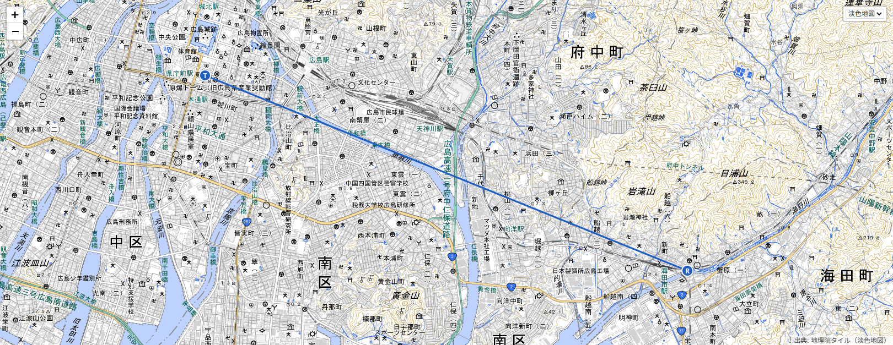
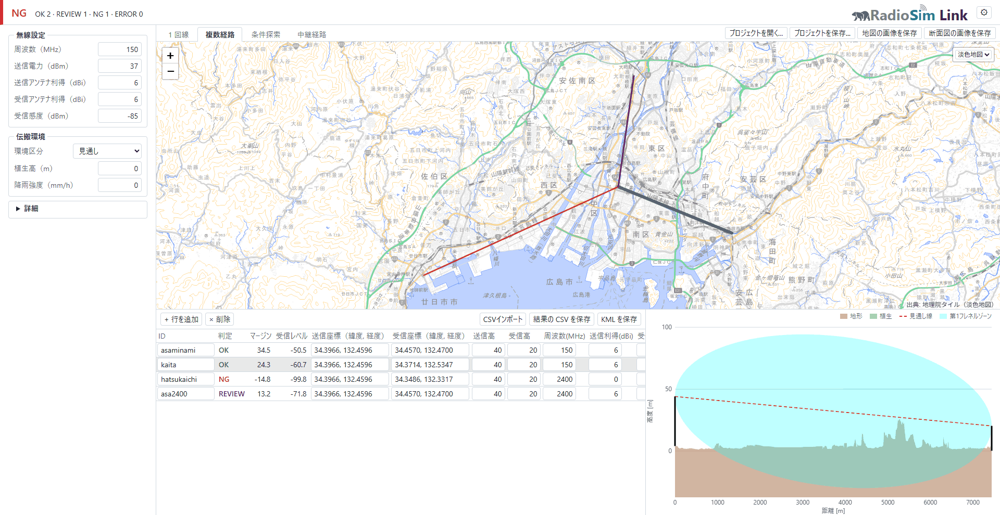
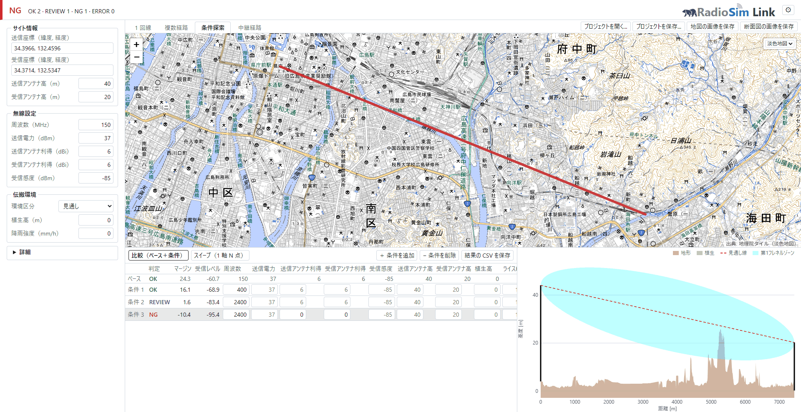
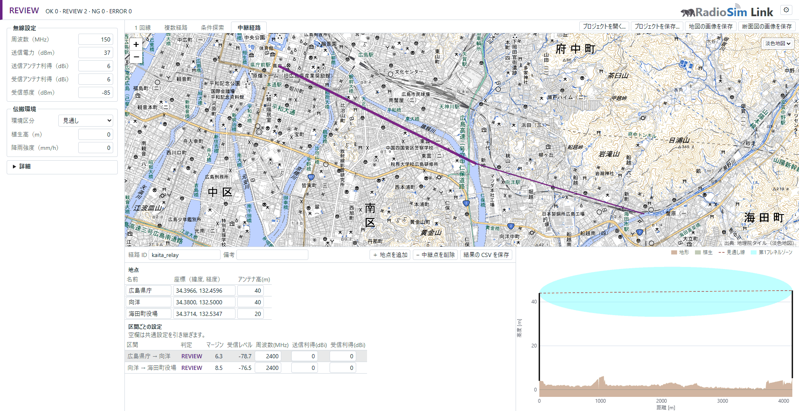

# RadioSim Link 1.0


> **Intended reader**: users who run **RadioSim Link from a distribution (installer or ZIP)**. This is also the document that Open Documentation in the app's Settings panel shows.
> To run it from source or work on the code, see [developer_en.md](developer_en.md).

> 📣 **RadioSim Link is the successor to RadioSim Pro 3.x.** Project files (`.rsproj`) saved by 3.x open in Link 1.0. When you open one, it is calculated the same way as in 3.9.x (→ [Project Files (.rsproj)](#project-files-rsproj)).

A desktop simulator for screening radio link propagation characteristics before field surveys.
Automatically retrieves DEM (Digital Elevation Model) data from the Geospatial Information Authority of Japan (GSI) and visualizes terrain profiles, diffraction loss, vegetation attenuation, and link budgets in real time.

---

## Table of Contents

1. [Overview](#overview)
2. [Requirements](#requirements)
3. [Installation &amp; Launch](#installation--launch)
4. [The Settings panel](#the-settings-panel)
5. [Map](#map)
6. [Usage — Single Link](#usage--single-link)
7. [Usage — Multiple Paths](#usage--multiple-paths)
8. [Usage — Condition Explorer](#usage--condition-explorer-compare--sweep)
9. [Usage — Relay Path](#usage--relay-path)
10. [Project Files (.rsproj)](#project-files-rsproj)
11. [Input Parameters](#input-parameters)
12. [Calculation Models](#calculation-models)
13. [DEM Retrieval Logic](#dem-retrieval-logic)
14. [Saving — where and what](#saving--where-and-what)
15. [Uninstall](#uninstall)
16. [Known Limitations](#known-limitations)
17. [Reporting Bugs](#reporting-bugs)
18. [Copyright](#copyright)

---

## Overview

RadioSim Link is a tool designed specifically for **pre-survey screening** in radio link design.
Enter the coordinates, antenna heights, and radio settings for the TX (transmitter) and RX (receiver) stations, and the tool automatically retrieves GSI elevation data, draws a terrain cross-section, and determines link budget viability within seconds.

### Key Features

#### Workflows — four, by what you want to find out

Switch between them with the tabs at the top of the right column.

| Workflow | What it answers |
| --- | --- |
| **Single Link** | Does this one link close? Change an input and the verdict and the profile change on the spot |
| **Multiple Paths** | Many links at once, with CSV in and out |
| **Condition Explorer (compare / sweep)** | **Digs into one path.** Line up results under different conditions in a table (base + up to 5), or sweep one axis over N points and see in the table where the link starts to close. Terrain is fetched once |
| **Relay Path** | Bridges a link that will not close directly. Up to 7 relay points, a link budget per section, and **the overall verdict decided by the tightest section** (regenerative relay — each relay receives and transmits again) |

#### Map

- **Map**: one, at the top of the right column. Drag the endpoint pins (T and R) to enter coordinates, switch the background map at its top right, and hover over the profile to see that spot on the map

#### Calculation models

- Automatic terrain profile generation from GSI DEM PNG tiles (5 m / 10 m mesh)
- Earth curvature correction (standard atmosphere K = 4/3, fixed)
- Diffraction loss calculation using Bullington / Fresnel-Kirchhoff methods
- Vegetation attenuation (LoS intrusion depth model)
- Environmental loss (4 categories: Urban / Suburban / Rural / LoS)
- Rain attenuation (ITU-R P.838-3) and gaseous attenuation (ITU-R P.676-13 Annex 2)

#### Output

- Results CSV of the workspaces (Multiple Paths, Condition Explorer, Relay Path) and KML (Single Link, Multiple Paths)
- Images of the map and the profile (PNG)
- No results folder is created. Each artifact is saved, one at a time, where you choose (→ [Saving — where and what](#saving--where-and-what))
- Link has no A4 reports (print-ready reports are a RadioSim Pro feature)

#### Reusing your input

- **Project files (`.rsproj`)**: bundle coordinates, all parameters, Multiple Paths rows, Condition Explorer conditions and the relay path into **one file** and pick the work up later
- **Project info (name + free note)**: there are no fields for it on screen. The project info of an `.rsproj` you open is carried over when you save it again

#### Interface

- The verdict band (the verdict word, details and the range over varied assumptions) and the Link Budget table in the left column
- The profile. Hover over it to see that spot on the map
- Switchable coordinate notation (Decimal Degrees / Degrees Minutes Seconds)
- Japanese / English UI
- System-aware dark mode (Light / Dark / System auto)

### Accuracy Statement

The horizontal resolution of the built-in GSI DEM is 5–10 m. The calculations are not calibrated against measurements, so no error range ("±N dB") is claimed for diffraction loss. Where varying the assumptions (vegetation height, environment class, diffraction method and so on) flips the verdict, the verdict reads `REVIEW` (a site check is recommended) — that shows how much the result depends on the assumptions, not an error range. ⚠️ **Terrain resolution and DEM elevation error are not varied.** The combined loss of several overlapping obstacles has not been checked against measurements or a reference implementation either (described below).
This tool is intended solely for screening purposes — determining whether a field survey is necessary — and must not be used as the basis for final link design decisions.

---

## Requirements

| Item     | Requirement                                                   |
| -------- | ------------------------------------------------------------- |
| OS       | Windows 10 / 11 (64-bit)                                      |
| Internet | Required for DEM retrieval (fetched tiles are cached locally) |

> **You do not need to install Python.** Everything required to run the app is bundled.

---

## Installation & Launch

There are two distribution forms, with identical features.

### Installer (recommended)

1. Download `RadioSimLink-Setup-<version>.exe` from [Releases](https://github.com/kumahide/radiosim/releases) and run it.
2. Administrator rights are not required (by default it installs into your own user profile). Follow the prompts to finish.
3. Launch `RadioSim Link` from the Start menu.

The installer build stores **settings, cache and logs in OS-standard locations** (table below). It never writes anything into the install folder beyond the files placed there at install time (nothing is added while the app runs), so installing under a write-protected location (e.g. under `Program Files`) works fine. [Adding your own UI language](#adding-your-own-ui-language) uses one of these same locations (the "added UI language files" row below), so it carries the same guarantee.

| Contents                                        | Location                     |
| ------------------------------------------------ | ----------------------------- |
| UI settings (`radiosim_conf.json`) and the user-extension source files | `%APPDATA%\RadioSim\Link\`        |
| Logs and working data of the window              | `%LOCALAPPDATA%\RadioSim\Link\`   |
| Terrain and background map disk cache            | `%LOCALAPPDATA%\RadioSim\terrain_cache\` (shared with RadioSim Pro 3.9) |
| Added UI language files (`lang\<language-code>.json`) | `%APPDATA%\RadioSim\Link\lang\` |

### Installing a different version over an existing one

The installer build is **one per PC**. Running another version's installer on a PC that already has it **replaces** the contents of the same folder as before (no folder-selection page is shown). Settings and the terrain cache live in the locations in the table above, so they carry over as they are.

The installer compares against the installed version and tells you (the version numbers in the examples are from 3.x):

| Case | What you see |
| --- | --- |
| Installing a newer version | The top of the "Ready to Install" page says, e.g., "The installed 3.6 will be replaced with 3.7." |
| Installing the same version | The same page says the version will be reinstalled (repair) |
| Installing an older version | A confirmation appears before the wizard. **The default button is "No"** (cancel the installation) |

Going back to an older version means:

- Project files saved with the newer version may not open in the older one, or may lose the items the newer version added.
- Settings added in the newer version go back to their defaults once the older version saves its settings (installing the newer version again does not bring the old values back).
- The terrain cache can be used as it is.

> For an unattended install (run with `/VERYSILENT` or similar), replacing with an older version is cancelled without a prompt (exit code 1). To go ahead anyway, add `/ALLOWDOWNGRADE`.

To use several versions side by side, use the [Portable build (ZIP)](#portable-build-zip) instead of the installer.

### When Windows blocks the installer

The distributed executables are not code-signed, so Windows may step in before running them. **Below are the ways we have actually run into** (there may well be others). **Some let you continue and some do not, and they need different responses.**

**① You can continue (SmartScreen warning)**

If you see the blue "Windows protected your PC" screen, click **"More info" → "Run anyway"** to continue. This is the ordinary warning for unsigned executables, and it can appear for either the installer or the portable build.

**② You cannot continue (blocked by application control)**

The installer may abort immediately — before showing a single wizard page — with this error:

```
Unable to execute file in the temporary directory. Setup aborted.
Error 4551: This file is blocked by application control policy.
```

This is **not SmartScreen — it is Windows refusing to run the file at all**. Unlike ①, **there is no button to continue**, and "Unblock" in the file's properties has no effect either. These are the environments where we have seen it:

- A PC with **Smart App Control** (Windows 11) turned on. ⚠️ **To see where your PC stands, go to Settings > Privacy & security > Windows Security > App & browser control.** If it reads "On", the feature is active. **How it got that way — Windows turning it on by itself, someone turning it on in Settings, or how Windows was installed — does not matter here**; only the current setting does.
  - ⚠️ **In this case the very same file may be blocked on one attempt and allowed on the next.** We saw a blocked installer launch fine 30 minutes later with nothing changed. **Waiting a while and trying again sometimes works**, but the reverse holds too: one successful run is no guarantee for the next.
- A PC that has an **application control policy** forbidding unsigned programs (your organization may set this). Here, waiting does not help — ask your administrator.

> **If you are blocked, use the "Portable build (ZIP)" below instead.** It does not go through an installer, so it may still launch on the same PC (⚠️ the portable executable is subject to the same check, so this is not guaranteed either).
>
> ⚠️ If the portable build is blocked as well, **ask your IT administrator**. We deliberately do not tell you how to turn Smart App Control off: **doing so removes that protection from every program on the machine, not just RadioSim.** Lowering a machine-wide security setting to run one application is not a trade we recommend.

### Portable build (ZIP)

1. Extract the distribution ZIP file (`RadioSimLink-<version>.zip`) to any folder.
2. Place the extracted folder wherever you like. The app can be moved freely.

> **Note**: Do not modify the folder structure. Launch it with the bundled `RadioSimLink.cmd` (the Python inside runs the app, so files taken out of the folder will not run).

The portable build ships with a `portable.txt` marker, so settings, cache and logs are all created **inside the extracted folder** (`terrain_cache/`, `radiosim_conf.json` and so on). This suits carrying the app on a USB drive.

**To use several versions side by side** (to compare results between versions, or to try a new version while your work stays on the current one), **extract each version's ZIP into its own folder**. Settings, cache and logs are then separate per folder, so the versions do not interfere with each other. The same holds when you run a portable copy alongside the installer build.

> The installer build cannot hold several versions at once. Even with separate install folders, every version would share the same locations for settings and cache (the table above): an older version would read settings written by a newer one, and uninstalling would remove data they all share.

### Launch

Launch the installer build from `RadioSim Link` in the Start menu, or double-click `RadioSimLink.cmd` for the portable build. The screen opens in Microsoft Edge's app mode.

---

## The Settings panel

There is no menu bar. Click the **Settings button (gear)** at the right end of the top bar to open a small panel; the settings, file and help items all live there. Every item is listed below.

```
┌ Settings
├ Display
│ Language            [English                 ▼]
│                     [Export Translation Template...]
│ Theme               [System                  ▼]
│ Coordinate Display  [Decimal Degrees (DD)    ▼]
├ Network
│ Proxy URL           [                         ]
│                     Leave blank to use system proxy settings.
│                     ☐ Check for Updates at Startup
│                     ☐ Include Pre-releases
├ File
│ [Load Parameters...] [Load App Settings...]
│ [Delete All Cache...]
├ Help
│ [Open Documentation] [Save Diagnostic Package...]
│ [Check for Updates...] [About]
│ (one line for the result or the error)
└ [OK]
```

- **Each change is saved as soon as you make it** (to `radiosim_conf.json`, so it persists across restarts). **OK** only closes the panel.
- The result of a button ("Saved …" and the like) and the reason for a failure appear in one line at the bottom of the panel.
- **The basemap** (Pale map / Aerial photo, plus your own) is not in the panel but in the **box at the top right of the map**. A change is saved at once and also changes the background of the map PNG you save → [Adding a Background Map Source](#adding-a-background-map-source-user-extension).
- **Opening and saving a project** is not in the panel but at the top of the right column (to the right of the workspace switch: **Open Project...** / **Save Project As...**) → [Project Files (.rsproj)](#project-files-rsproj).

### Settings

| Item               | Options                          | Description                                                        |
| ------------------ | -------------------------------- | -------------------------------------------------------------------- |
| Language           | English / 日本語 (plus your own) | Screen language. Picking one reloads the screen, which switches at once → [Adding your own UI language](#adding-your-own-ui-language) |
| Export Translation Template... | —                    | Writes `_template.json` for a new translation into the language folder and opens that folder → [Adding your own UI language](#adding-your-own-ui-language) |
| Theme              | System / Light / Dark            | Light or dark screen. "System" follows the Windows setting           |
| Coordinate Display | Decimal Degrees (DD) / Degrees Minutes Seconds (DMS) | How coordinates are **displayed** → see the note below |
| Proxy URL          | URL entry                        | Explicit HTTP proxy URL (blank = use OS proxy settings) → see below  |
| Check for Updates at Startup | Checkbox               | When checked, the app makes the same query as Check for Updates... at startup, at most once a day. **Off by default** (so that the app does not reach out to the internet at every start on company networks or offline field sites). It tells you only when a newer version exists (in the bar above the map); when you are up to date or the query fails, it shows nothing |
| Include Pre-releases | Checkbox                       | When checked, you are told of pre-releases (RCs) even on a final release; when unchecked, you hear only of final releases even on an RC. Applies to both Check for Updates... and Check for Updates at Startup. **Until you first touch it, it follows the version you use** (off on a final release, on on an RC). Once you change it, your choice stays even after you upgrade |

> **Language on the very first launch** — Until you choose one, the app looks at the **language you picked in the installer** (if you installed it that way), then at the **Windows display language**. If neither answers, it starts in English. ⚠️ **The first launch saves whichever language it settled on into the settings file, and that saved value wins from then on** (the same applies once you pick one under **Language** in the Settings panel). If you **run the installer again** on a PC you have already used and pick a different language in its wizard, the app switches to that language the next time it starts (this takes effect once each time you reinstall). A plain restart does not change it — change it under **Language** in the Settings panel.

### File

Operations that reach out to files or to the OS.

| Item                | Description                                                                                     |
| ------------------- | ------------------------------------------------------------------------------------------------- |
| Load Parameters...  | Imports **simulation parameters only** from a settings file into the input fields               |
| Load App Settings... | Imports **only** language, theme, coordinate display, basemap and proxy from a settings file (the two startup-check boxes are not imported) |
| Delete All Cache... | Deletes downloaded DEM / map tiles. A confirmation appears inside the panel; with two or more DEM sources you can pick what to delete |

> **"Load Parameters" vs "Load App Settings"** — the former imports **simulation parameters** (coordinates, frequency, antenna heights, …); the latter imports **how the app looks and connects**. **Neither touches the other's territory**, so opening a file you received from someone else will never silently change your display language or network settings.

### Help

| Item         | Description                          |
| ------------ | -------------------------------------- |
| Open Documentation | Opens this document in a browser       |
| Save Diagnostic Package... | Bundles version, settings, recent log, cache statistics, environment info, and storage paths into a zip. Clicking it first lists **what will go in**, inside the panel. Coordinates, credentials, and usernames are masked; result files are unchecked by default (they may hold project data, so you choose what to include). **Save** then asks where to save it. Attach this to a bug report |
| Check for Updates... | Asks GitHub's public release page only when you click it, and shows the answer in the line at the bottom of the panel. If a newer version exists, you get its number and the URL of its release page (downloading and installing are left to your browser and you). Which versions you hear of follows Include Pre-releases. Follows the Proxy URL |
| About        | Shows the installed version in the line at the bottom of the panel |

### Notices at startup

When there is something to tell you at startup, a **bar appears above the map** (close it with ×). It shows, for example, a newer version (when Check for Updates at Startup is on), or entries the app did not accept from a translation you added or from a DEM / basemap source file. When there is nothing to say, no bar appears.

### Adding your own UI language

Besides Japanese and English you can **add a translation of your own**. Where you put it depends on which build you have — the **installer build** uses `%APPDATA%\RadioSim\Link\lang`, the **portable build** uses a `lang` folder next to the app. Put `<language-code>.json` there and restart — the language then appears under **Language** in the Settings panel.

```json
{
  "_name": "Français",
  "btn_run": "Exécuter",
  "menu_help": "Aide"
}
```

- `_name` is **the name shown in the language menu**. Write it in the language's own script — someone looking for their language is reading a screen they cannot read yet. Without it the file's code is shown instead.
- **You do not have to translate everything.** Only the keys you write are replaced; **the rest stay in English**. New keys added in later versions will not break your file.
- You can get the key list from **Export Translation Template...** in the Settings panel, which writes `_template.json` (every key, with its English value). No save dialog appears: **it writes straight into the location above and opens that folder** (an existing file is not overwritten; the new one gets a name like `_template (2).json`). Edit the values and save it as `<language code>.json` in the same folder to finish. The same keys also live in the source file `core/i18n.py` (<https://github.com/kumahide/radiosim>), but ⚠️ **that file is not part of the binary (exe) distribution** — use the template export instead to check key names.
- **Keep the placeholders — `{n}`, `{dir}` and friends — exactly as they appear in the English text.** A key whose placeholders differ **is not applied** (it stays English), and at startup you are told what was skipped **grouped by reason** (how many per reason, with up to three examples). ⚠️ **Nothing appears when everything was applied** — silence means "no problems", not "the file was ignored" (whether it loaded is visible under **Language** in the Settings panel). ⚠️ Applying such a translation would crash the app the moment that screen opens; **skipping it is what prevents that**. ⚠️ **The format spec inside a placeholder (the `.2f` in `{n:.2f}`) must match English too** — only the **position** in the sentence is yours to move.
- **Words that appear in artifacts are out of scope.** This covers KML and CSV, and also **the wording inside the terrain profile and comparison graphs** (axis names, legends, titles, the way units are bracketed) and **the environment types** (Urban / Suburban / Rural / LoS). Artifact wording is a contract with whatever reads the files, so it does not move for the screen's convenience. ⚠️ **These also show on screen with the same wording**: a figure becomes an artifact as soon as you save it, and the environment wording is written into profiles, so the on-screen side cannot be translated on its own.
- The bundled `ja` / `en` cannot be overridden (a `ja.json` is ignored).

> ⚠️ **Layout is not guaranteed for languages you add.** Window sizes are verified against the length of the Japanese and English wording; longer wording may be clipped. Treat it as an **unofficial translation**.

### Coordinate Format (DD / DMS)

This selects **how coordinates are displayed**. It is not an input mode switch.

- **Input fields accept either notation.** With DMS selected you can still type `34.8, 132.6` (DD), and with DD selected you can still type `34°48'00.0"N, 132°36'00.0"E`. Everything is normalised to decimal degrees before the calculation runs.
- **When you switch the format or load app settings**, the TX and RX coordinate fields are rewritten in the selected notation. **Moving a pin on the map** also writes the field back in the selected notation. **Input that could not be read stays exactly as you typed it** — that is the signal it was not accepted as a coordinate, so retype it.
- Coordinates in tables such as Multiple Paths are not rewritten (they are used as typed).

### Proxy Settings

If DEM tile retrieval requires an HTTP proxy (e.g. on a corporate network), enter the proxy URL in **Proxy URL** in the Settings panel (e.g. `http://proxy.example.com:8080`). It takes effect as soon as you press Enter or leave the field (no restart needed). Leave it blank to revert to OS proxy settings.

> If no proxy is configured and the elevation server is completely unreachable, the run **aborts after a dozen seconds or so** and you are asked to check the proxy settings — it will not quietly finish and hand you flat terrain.

---

## Map



There is exactly one map, at the top of the right column, shared by all four workspaces. No separate window opens. The calculation works without the map; the map is a convenience for entering input and looking at results.

- **Single Link**: pins (T and R) mark the transmit and receive points, joined by a line. The first time both points are set, the map zooms to fit the whole path (not when you placed them by clicking the map). **Clicking the map enters coordinates**: if the TX or RX coordinate field is empty, the click fills it (TX first, then RX); once both are set, a click (left or right) opens a small menu with "Place TX here" and "Place RX here". **Dragging a pin also enters its coordinates.** While you drag, only the coordinate field in the left column and the line move; **it computes once when you let go** (terrain is fetched again only once an endpoint is settled). Editing a coordinate field moves the pin there
- **Multiple Paths, Condition Explorer and Relay Path**: each item in the workspace's table is drawn as a line from its transmit point to its receive point, colored by its verdict. The item selected in the table is drawn thicker, and clicking a line on the map selects that row in the table. Condition Explorer draws a single line, since every item shares the same path. Once every item is in and the set of coordinates has changed, the map zooms to fit them all (after you have placed points by clicking the map, only if they no longer fit in view). Points you enter show as pins before the calculation finishes (Multiple Paths: T and R of the selected row; Relay Path: the number of each point; Condition Explorer: T and R from the left column). **These pins can be dragged just like the Single Link pins.** While you drag, only the table cell (the left-column field in Condition Explorer) and the lines ending at that point (in Relay Path, the sections before and after it) move; it computes once when you let go. In Multiple Paths, select a row first to move its endpoints
- **Placing points from the map (Multiple Paths, Condition Explorer and Relay Path)**: where a click goes depends on the workspace
  - **Multiple Paths**: with no row selected, a click adds a row with its TX at that spot and selects it. If the selected row's TX or RX coordinate is empty, a left click fills it (TX first, then RX). Once both are set, a click (left or right) opens a menu with "Place TX here", "Place RX here" and "Add a row with TX here". Rows added from the map take the Single Link TX and RX antenna heights
  - **Condition Explorer**: the left column is the base, so a click fills the TX / RX coordinates in the left column, as in Single Link
  - **Relay Path**: a click fills the first point whose coordinates are empty, or adds a point at the end if none is empty. An empty antenna height takes the Single Link value (TX antenna height for the first point, RX antenna height for the others). When the point limit is reached, a notice appears above the table
- **Linked with the profile**: hovering over the profile marks that spot on the map. The other way round, hovering over a line on the map (the Single Link line, or the line of the item selected in the workspace) shows that spot on the profile
- **Basemap**: switched in the box at the top right (pale map, aerial photo, and any basemap added through a declaration file). Your choice is used again at the next start, and the saved map image uses the same background. Attribution that must be shown appears at the bottom right of the map

Fetching the terrain of an area ahead of time (cache management) is not part of Link's screen. Terrain is fetched as the calculation needs it and kept in the cache. To delete the whole cache, use [File](#file) (Delete All Cache...) in the Settings panel.

---

## Usage — Single Link


The Single Link workspace opens at startup. **There is no Run button.** When you change a field in the left column, the app waits a moment (about 0.3 s) and computes again; the verdict in the top bar, the Link Budget table in the left column and the profile change.

### 1. The input fields in the left column

| Group | Fields |
| --- | --- |
| Site Info | TX coords and RX coords (lat, lon, e.g. `34.5429, 132.4118`), TX / RX antenna height (m) |
| Radio Settings | Frequency (MHz), TX power (dBm), TX / RX antenna gain (dBi), sensitivity (dBm, the minimum RX level) |
| Environment | Environment category (Urban / Suburban / Rural / LoS), vegetation height (m), rain rate (mm/h) |
| Details (collapsed) | Diffraction model, terrain resolution, DEM source (shown only when two or more sources can be chosen) |

- The two coordinate fields accept decimal degrees or degrees-minutes-seconds ([Coordinate Format (DD / DMS)](#coordinate-format-dd--dms)). A format example is shown in faint text only while a field is empty
- Each field's tooltip gives its range. A value outside it does not go on to the calculation; the top bar shows "Waiting for input" with a one-sentence reason (ranges are in [Input Parameters](#input-parameters))
- **Vegetation height** is the **average canopy height** applied uniformly along the entire path. In urban areas you may enter a typical building height, but **individual building obstructions are not modeled** (see Known Limitations). It is purely an approximation as a uniform canopy
- **Terrain resolution** has three levels: High ~4 m px / Medium ~8 m px / Low 20 m spacing. ⚠️ **The level names the size of the pixel the samples are placed on**, not *which elevation data is read* (elevations always come from **the finest layer available**, whichever level you pick). The pixel is 3.3-4.4 m across depending on latitude, hence the "~". **You pick only the level; the app resolves the points.** "High" and "Medium" place a sample at **each edge of every DEM pixel the path crosses**, so the samples are **not evenly spaced** and the count follows from the path's length, bearing and latitude ("Low" alone keeps a 20 m even spacing and, as the *coarse but fast* level, skips pixels). On an extremely long path whose count hits the upper limit, "High" and "Medium" fall back to even spacing too. Default: Medium

The **Link Budget** table under the fields lists the terms from EIRP through total loss, RX level and sensitivity to margin, in the order they are added and subtracted. The **Distance** table below it shows the **slant distance** (between the two antennas, height difference included) and the **horizontal distance** (between the two sites projected onto the ground), in m. FSPL, environment loss, rain loss and gas loss are counted over the slant distance; the profile's horizontal axis uses the horizontal distance. While the verdict is stale both tables are drawn faded, to show the values are not those of the current input. On the Multiple Paths, Condition Explorer and Relay Path tabs the Link Budget table is hidden, and the Distance table shows the values of the row selected in the table (empty until a row is selected).

### 2. Fetching terrain and computing

- **Terrain**: when the endpoints, the resolution level and the DEM source are the same as before, nothing is fetched again. Elevations are fetched again only when they change (fetched tiles stay in the disk cache, so the second run over the same place is faster)
- **Computation**: changing only fields that do not affect terrain, such as an antenna height or the transmit power, does not fetch terrain again, so the verdict comes back at once

When the elevation server cannot be reached, the top bar shows "No terrain" with a one-sentence reason (the app does not quietly compute over flat terrain).

> **Date of the terrain data**: cached tiles are not fetched again, so the terrain acquisition date carried in saved results is not the run date but **the date the tiles the elevations were read from were saved on this PC** (when the path spans several dates, a range from oldest to newest). To recompute with fresh tiles, delete them with Delete All Cache in the Settings panel and let it compute again.

### 3. The verdict in the top bar

The bar at the top of the screen shows the verdict word (OK / REVIEW / NG / ERROR), the margin and the RX level. When varying the assumptions gives a spread, it shows that spread; on REVIEW it lists the assumptions that would flip the verdict. 🔑 **The verdict in the bar is only ever one computed from the input now on screen.** While computing, it shows "Updating the verdict…" with the fetch progress, and no old verdict is left standing.

### 4. The profile

The terrain profile is drawn at the bottom right.

| Element | Description |
| --- | --- |
| Terrain | Ground surface with Earth curvature correction applied |
| Vegetation | Vegetation height on top of the ground |
| Line of sight | Dashed line joining the tips of the TX and RX antennas |
| First Fresnel zone | The ±F1 band around the line of sight |
| Vertical bars at both ends | The TX and RX antennas (from foot to tip) |

Hovering over it shows the distance and ground elevation at that spot, and marks the same spot on the map ([Map](#map)).

With "High" and "Medium", terrain samples sit on DEM pixel edges (see "Terrain resolution" above), but the profile (and the KML profile) **collapses the samples belonging to the same pixel to its centre** before joining them, so the outline is smooth. ⚠️ **This is a visual adjustment only** — diffraction loss and the other calculations use the uncollapsed samples, so no values change. "Low" is evenly spaced at 20 m and smooth to begin with, at the price of skipping fine relief.

### 5. Carrying your input

The input is **not written back** to `radiosim_conf.json` (it is only read at startup, so you start from the last input of 3.x). To keep your work, use **Save Project As...** at the top of the right column ([Project Files (.rsproj)](#project-files-rsproj)); to take only the conditions from another settings file, use [File](#file) (**Load Parameters...**) in the Settings panel. For saving results, see [Saving — where and what](#saving--where-and-what).

---

## Usage — Multiple Paths



Choose **Multiple Paths** in the workspace switch at the top of the right column, and a table appears below the map. **There is no Run button.** When you edit the table, the app waits a moment and computes every row again; results come back to the right end of each row (verdict, margin, RX level) as soon as that row is done. Once every row is in, the top bar shows the overall word and the count for each verdict word.

### Design — one set of common inputs, the rows carry only the paths

The radio and environment fields are shared by all four workspaces (the left column). In the Multiple Paths workspace the **endpoint and antenna height fields are hidden** (each row carries its own), and the remaining fields become the common settings for every row. When a row's frequency or gain is blank, the common setting is used.

### Input Methods

**Manual entry**: type the ID, coordinates, antenna heights, frequency, TX/RX gains and note into the table cells. The measurement columns (such as `meas_dbm` in the CSV below) are not shown in the table; they are only carried along.

- **+ Add Row**: adds an empty row at the end
- **× Delete**: deletes the selected row (the last row if none is selected)
- **Import CSV**: reads a CSV and replaces the table with it. A mistake in the header is shown as one sentence above the table

⚠️ **A mistake in a row makes only that row ERROR**; the other rows are still computed. The one-sentence reason is carried on the row and appears where the profile is when you select it.

#### CSV Format

Required columns: `id, start, end, h_tx, h_rx`

Optional columns: `freq, gain_tx, gain_rx, note, meas_dbm, meas_method, feeder_loss_db, env_class`

```csv
id,start,end,h_tx,h_rx,freq,gain_tx,gain_rx,note,meas_dbm,meas_method,feeder_loss_db,env_class
path01,"34.54, 132.41","34.53, 132.40",30.0,10.0,2400,12.5,8.0,Main link,-78.5,spot,2.1,suburban
path02,"34.55, 132.42","34.52, 132.39",20.0,15.0,,,,Sub link,,,,
```

- `start` / `end` take the form "lat, lon" and must be enclosed in double quotes
- `freq` / `gain_tx` / `gain_rx` fall back to the common settings when omitted (they are **per-link identifying attributes** that may differ per path). Environment, rain rate and diffraction model are set once in the common settings
- Older CSVs without `gain_tx` / `gain_rx` columns still load (backward compatible; gains inherit the common settings)
- Column names are **case-insensitive and ignore surrounding spaces** (`ID,Start,…` loads fine). `id` values must be unique **case-insensitively** (`p01` and `P01` are rejected as duplicates)
- `meas_dbm` / `meas_method` / `feeder_loss_db` / `env_class` are for matching field measurements against the model. See "Recording field measurements" below

#### Recording field measurements

If you write receive levels measured on site into the CSV, Link carries them in the table and writes them out unchanged into the results CSV (the table of residuals against measurement appears in the Multiple Paths summary report of RadioSim Pro). **These values can only be recorded at measurement time** — they cannot be added later, so capture them on site whenever you measure.

- `meas_dbm`: measured receive level (dBm)
- `meas_method`: `spot` (a single-point reading) or `mean` (spatial average over multiple points). **Spot readings can be off by ±5-10 dB due to multipath**, so mark them as `spot` to keep them distinguishable when the data is later used for statistics
- `feeder_loss_db`: feed-line loss (cable type, length, and connectors combined, dB)
- `env_class`: self-assessed environment class (`urban` / `suburban` / `rural` / `los`). This is not visible in the DEM, so it should be judged by someone who saw the site
- Enter the **actual installed height** in `h_tx` / `h_rx` — not the planned/design value

The following also matter but have no CSV column — keep them as separate notes or photos so the measurement's value isn't lost later: date/time and weather, the receiver model and reading unit (dBm / S-meter / raw RSSI) and whether it was calibrated, transmit power and antenna models, and anything along the path the DEM doesn't show (buildings on a ridgeline, tree species/height, etc.).

### Map, profile and results

- The map draws each row as a line from its transmit point to its receive point, colored by its verdict; the selected row is drawn thicker. Clicking a line on the map selects that row in the table
- The profile shows the terrain of the selected row
- 🔑 Editing the table or the left column while it is computing cancels the whole run in progress and starts again with the new input (results from the old input are not kept)
- Save the results with **Save Results CSV** (`summary.csv`) and **Save KML** (`summary.kml`) at the right end of the table, each to a place you choose (→ [Saving — where and what](#saving--where-and-what))

---

## Usage — Condition Explorer (Compare / Sweep)



Choose **Condition Explorer** in the workspace switch at the top of the right column. This workspace is for **taking one fixed path and digging into it under different conditions**. The path comes from the left column (as in Single Link), and **terrain is fetched only once** — changing the conditions does not fetch the DEM again.

The toggle above the table switches between **Compare (base + N)** and **Sweep (1 axis, N points)**.

### Compare (base + N conditions)

- Each row of the table is a condition. The **Base** row at the top only mirrors the left column and cannot be typed into
- **+ Condition** adds rows, up to 5; **− Condition** removes one. Change only the fields you care about. A blank cell uses the base value, shown in faint text
- You can vary frequency, TX power, TX/RX antenna gain, RX sensitivity, TX/RX antenna height, vegetation height, rain rate, environment and diffraction model. **Coordinates and terrain resolution cannot be varied** (comparing different paths is what Multiple Paths is for)

### Sweep (one axis, N points)

- Set the **Axis** (frequency, TX power, TX/RX antenna gain, RX sensitivity, TX/RX antenna height, vegetation height, rain rate), **From**, **To** and **Points** (2-41)
- Each row of the table is one point. Where the verdict color at the right end changes is the answer to "how high must the antenna be?"

### Results

The verdict, margin and RX level come back to the right end of each row. The map draws a single path (every row shares it). Save the results with **Save Results CSV** (`scenario.csv`) to a place you choose (→ [Saving — where and what](#saving--where-and-what)).

---

## Usage — Relay Path



Choose **Relay Path** in the workspace switch at the top of the right column. This workspace is for **one link carried over relay points**: two points cannot see each other directly across a mountain, and a ridge (or another site) in between with a clear view can carry the traffic.

### Assumption — regenerative relay

Each relay point **receives and then transmits again** (regenerative relay). That means:

- Every section gets its own independent link budget — **section losses are never added together**.
- **The overall verdict is decided by the tightest section.** Both the overall verdict **and** the per-section breakdown are shown, because without seeing which section is short you cannot decide whether to add a relay or raise an antenna.
- **Passive reflectors are out of scope.** Their losses combine differently and are not part of this tool's calculation.

### Waypoints and sections

- Above the tables are the **Path ID** and **Note** fields
- In the **Waypoints** table, enter a name, coordinates (lat, lon) and antenna height (m) for each point. **The first point is the transmitter and the last is the receiver**; the order of the rows is the order of the route
- **+ Add point** adds a point at the end. **- Remove relay** deletes the selected point (the last one if none is selected) together with the settings of the section coming into it
- Coordinates accept **either decimal degrees or degrees/minutes/seconds**. **Height belongs to the point only** — a relay has one antenna, so it must not be possible to enter one value as "RX height of the previous section" and another as "TX height of the next section"
- The **Section Settings** table lets you override **frequency, TX gain and RX gain per section**. A blank cell inherits the common settings (the left column). This is for relays whose receive and transmit antennas differ
- Up to 9 points (7 relays, 8 sections)

> **⚠️ Relay points are meant to be placed, not moved around to explore.** Each section fetches its own terrain data, so every move triggers a new download. Use the [Condition Explorer](#usage--condition-explorer-compare--sweep) to explore heights and conditions.

### Results

The result of each section (verdict, margin, RX level) comes back to the right end of the section table, and the overall verdict (the value of the tightest section) appears in the top bar.

⚠️ **The overall verdict uses the same words as a section (OK / REVIEW / NG / ERROR).** If even one section could not be judged (ERROR), the overall verdict is **ERROR** as well — which is not the same thing as "computed, but the link does not close" (NG). In that case the overall margin is not a number either, because a path containing a section that could not be judged has no headroom to speak of. The section table shows which section is ERROR.

When a waypoint is malformed (unreadable coordinates and the like), no section is computed and the top bar shows "Waiting for input". Save the results with **Save Results CSV** (`hops.csv`) to a place you choose (→ [Saving — where and what](#saving--where-and-what)).

---

## Project Files (.rsproj)

Bundles **the whole input set into one file** so you can pick the work up later. Use **Save Project As... / Open Project...** at the top of the right column (to the right of the workspace switch). Whichever workspace you are in, the inputs of all four are handled together.

### What is included

| Included | Not included |
| --- | --- |
| Coordinates and all parameters (the left column inputs) | **Results** (those are what [saving](#saving--where-and-what) is for) |
| Project info (name and free note; Link has no field for them on screen, and the values from the opened file are carried over when you save) | **App settings** (theme, language, proxy, coordinate format) |
| Multiple Paths rows | Window position and size |
| Explorer conditions (compare rows / sweep axis and range) | |
| Relay path waypoints and sections | |

**Leaving out theme, language, proxy and coordinate format is deliberate** — opening a project you received from someone else must not switch your display language or your network settings.

### Saving

- The default file name is made from the project name. Choose where to save in the file dialog.
- A workspace holding a value that cannot be read as a number (Multiple Paths rows, Relay Path waypoints) is not saved, and a warning appears in the message area at the top of the right column (saving in the middle of your input comes first, and nothing is dropped silently).

### Opening

- The input and the three workspaces are **replaced all at once** (nothing of the previous input is kept). Fields missing from the file take their defaults, and workspaces missing from the file come up empty. Input you were typing just before opening is discarded.
- A file is refused only when **its format is newer than this version understands** (saved by a newer version after the format changed). A file that cannot be read changes nothing, and the reason appears in the message area. A file saved by a newer version still opens as long as the format has not changed.
- **Files saved by 3.x open in RadioSim Link 1.0.** They are calculated with the same method as 3.9.x (calculation profile v1) and stay on v1 when saved again. Input you start fresh is calculated with the new method (v2). What is reproduced is the calculation method, not the past numbers themselves (re-fetching the elevation data can change the numbers). Files saved by 2.x open too, but they are calculated with the 3.9.x method.

---

## Input Parameters

### Validation Ranges

| Parameter         | Min                            | Max     | Unit   |
| ----------------- | ------------------------------ | ------- | ------ |
| Frequency         | 1                              | 100,000 | MHz    |
| TX Power          | -30                            | 60      | dBm    |
| TX/RX Gain        | 0                              | 60      | dBi    |
| Sensitivity       | -130                           | -20     | dBm    |
| TX/RX Height      | 0                              | 500     | m      |
| Vegetation Height | 0                              | 100     | m      |
| Terrain Resolution | High / Medium / Low           | —       | —      |
| Rain Rate         | 0                              | 200     | mm/h   |
| Env Type          | Urban / Suburban / Rural / LoS | —      |        |
| Diff Method       | bullington / single            | —      |        |

---

## Calculation Models

### Earth Curvature Correction

Radio waves are refracted by the atmosphere and bend more than the Earth's curvature alone. This is modeled using the effective Earth radius factor K. This tool uses the standard atmosphere value (K = 4/3 ≈ 1.333) as a fixed internal constant.

```
Effective Earth radius  Re = R_earth × K  (K = 4/3, fixed)
Curvature correction   Δh(d) = d × (D - d) / (2 × Re)  [m]
```

| K value      | Meaning                                     |
| ------------ | ------------------------------------------- |
| 4/3 ≈ 1.333 | Standard atmosphere (value used by this tool) |
| K > 4/3      | Atmospheric duct (waves bend more strongly) |
| K < 4/3      | Sub-refractive conditions                   |

### Fresnel Zone

The 1st Fresnel zone radius (ITU-R P.526):

```
r₁(d) = √(λ × d₁ × d₂ / (d₁ + d₂))
```

When the 1st Fresnel zone is obstructed by terrain or vegetation, diffraction loss occurs.

### Diffraction Loss

#### Bullington Method (default, ITU-R P.526 4.5.1)

Replaces several obstacles with a single **equivalent knife edge**: two tangent lines are drawn from each end to the terrain point of maximum elevation angle, and their intersection becomes the obstacle. The standard correction term `(1 - exp(-Luc/6)) x (10 + 0.02 x d[km])` is then applied.

🔑 **Version 3.0 replaced the previous custom Deygout implementation with this** (history under Known Limitations). The reason was not accuracy but **continuity**: the old implementation counted obstacles, so **changing vegetation height or antenna height by 1 m could change the count and move the result by 84 dB** (raising an antenna by 1 m made the link 84 dB worse). The equivalent edge moves continuously as the terrain moves, so that jump cannot occur by construction.

⚠️ **This does not claim compliance with ITU-R P.526 or P.452.** Only this one method from P.526 4.5.1 is implemented; the **spherical-earth term** added by the full method of P.452 4.2.1 (Delta-Bullington), clutter, and ducting are not included.

#### Fresnel-Kirchhoff Loss J(ν)

```
J(ν) = max(0, 6.9 + 20 × log₁₀(√((ν - 0.1)² + 1) + ν - 0.1))  [dB]  (ν > -0.8)
J(ν) = 0                                                          (ν ≤ -0.8)
```

#### Single Method

Applies J(ν) only to the maximum ν across all sample points. Fast, but it does not represent the combined loss of multiple ridges.

### Vegetation Attenuation

```
Intrusion depth(d) = clip(veg_top(d) - LoS(d), 0, vegetation height)
Weight(d)          = clip(intrusion depth / r₁(d), 0, 1)
Effective length   = Σᵢ [(weight(dᵢ) + weight(dᵢ₊₁)) / 2 × (dᵢ₊₁ − dᵢ)]
Veg Loss           = min(effective length × coeff, 45 dB)
```

> **The effective length is integrated over the actual distance between adjacent samples**
> (trapezoidal rule). Samples are not necessarily evenly spaced (see "Terrain resolution"), so it is
> not computed as "sum of weights × a fixed spacing". Each end sample covers half an interval
> (corrected in 3.0).

> ⚠️ **The intrusion depth is capped at the vegetation height.** The thickness of vegetation the
> signal can pass through is at most the canopy height; anything beyond that is the ground itself
> blocking the line of sight, which the diffraction loss already accounts for.
> **A vegetation height of 0 m therefore always yields 0 dB** (corrected in 3.0).

| Frequency band  | coeff (`v2`, the Link 1.0 method) | coeff (`v1`, the 3.9.x method) |
| --------------- | --------------------------------- | ------------------------------ |
| Below 1 GHz     | 0.20 × f^0.7                     | 0.12 × f^0.5                  |
| 1–6 GHz        | 0.20 × f^0.7                     | 0.20 × f^0.7                  |
| 6 GHz and above | 0.35 × f^0.9                     | 0.35 × f^0.9                  |

> ⚠️ **Link 1.0 (calculation profile `v2`) changed the coefficient below 1 GHz.** The separate branch below 1 GHz
> (`0.12 × f^0.5`) was dropped; the 1–6 GHz formula is used below 1 GHz as well. The ITU-R P.833 measurements
> (106 MHz–2.1 GHz) fall on a single curve (`0.194 × f^0.70`) that is practically the 1–6 GHz formula, so there was no basis
> for switching formulas at 1 GHz (the switch made the coefficient jump by a factor of 1.67 across 1 GHz).
> **Vegetation loss below 1 GHz is larger**: running the 32 verification paths at 922 MHz with a 3 m vegetation height,
> the 15 paths with vegetation loss gain +0.00 to +14.87 dB (median +6.04 dB); the 2 paths at the 45 dB cap do not move.
> ⚠️ **The 6 GHz boundary is unchanged** (there are no measurements on the far side of it). Links at 6 GHz and above with a
> vegetation height entered carry the report note "the value jumps at that boundary (unverified)". Project files saved by
> 3.x open with `v1` and keep the 3.9.x coefficients.

### Environmental Loss

```
Env Loss = base + slant_dist × dist_c
```

> ⚠️ **Shadowing-derived quantities (F1 obstruction ratio, diffraction loss) are not included.**
> Terrain blocking the line of sight is already expressed by the diffraction loss; folding it into
> the environmental loss as well would double-count it (removed in 3.0).

| Environment | base | dist_c | min | max  |
| ----------- | ---- | ------ | --- | ---- |
| Urban       | 10.0 | 1.20   | 6.0 | 30.0 |
| Suburban    | 6.0  | 0.80   | 3.0 | 30.0 |
| Rural       | 4.0  | 0.50   | 2.0 | 25.0 |
| LoS         | 2.0  | 0.30   | 1.0 | 15.0 |

### Rain Attenuation (ITU-R P.838-3)

```
γ_R = k × R^α  [dB/km]
Rain Loss = γ_R × d_slant
```

Rain sensitivity at 2.4 GHz is very low (≈ 0.1 dB/km at 100 mm/h). Practical impact begins above 10 GHz.

### Gaseous Attenuation (ITU-R P.676-13 Annex 2)

```
γ_total = γ_O₂ + γ_H₂O  [dB/km]
Gas Loss = γ_total × d_slant
```

### Link Budget

```
EIRP       = P_tx + G_tx                             [dBm]
FSPL       = 20×log₁₀(d) + 20×log₁₀(f) - 147.55   [dB]
Total Loss = FSPL + Diff + Veg + Env + Rain + Gas   [dB]
P_rx       = EIRP + G_rx - Total Loss               [dBm]
Act Margin = P_rx - Sensitivity                     [dB]
Status     = OK (≥ 0 dB) / NG (< 0 dB)                 ← v1 (the 3.9 method)
             v2: REVIEW if varying the assumptions flips it; ERROR if any terrain sample failed to download
```

---

## DEM Retrieval Logic

### Data Sources

| Layer ID      | Resolution           | Zoom | Coverage                      |
| ------------- | -------------------- | ---- | ----------------------------- |
| `dem5a_png` | 5 m (airborne LiDAR) | 15   | Urban areas, mountain regions |
| `dem5b_png` | 5 m (photogrammetry) | 15   | Wider coverage than dem5a     |
| `dem_png`   | 10 m (base map)      | 14   | Nationwide                    |

Layers are tried in order: `dem5a_png` → `dem5b_png` → `dem_png`. If a higher-priority layer returns 404, or its pixel is missing data or exactly 0 m, the next layer is used.

### Caching Strategy

- **Tile prefetch**: At simulation start, all tiles within the TX/RX bounding box are pre-downloaded to the disk cache (supports offline use and speeds up Multiple Paths runs). ⚠️ **Only when the built-in GSI source is selected** — the step is skipped for DEM sources you added
- **Disk cache**: Tiles saved to `terrain_cache/`, persists after the app is closed
- **Terrain cache**: If TX/RX coordinates, sample count, resolution level and DEM source match a previous run, DEM retrieval is skipped (cleared on app restart, and also whenever you delete or force-refetch cached tiles, so the next calculation uses the refetched tiles)

### Adding a DEM Source (User Extension)

The only built-in elevation data is the GSI (Geospatial Information Authority of Japan) DEM, but you can add your own DEM source — a remote XYZ PNG tile service using either the Terrarium or Mapbox Terrain-RGB decoding scheme — through a declaration file in the settings folder. **This extends coverage, not accuracy** (it is there so you can get elevation outside Japan, where GSI has no data — it is not a way to gain accuracy. The pixel size depends on the source's data and the zoom you declare, and the app does not check how fine the data really is; at zoom 12, as in the example below, one pixel is several tens of metres).

⚠️ **The background map (pale map / aerial photo) is extended through a separate declaration file from the DEM source** (see "Adding a Background Map Source" below). Adding a DEM source alone leaves the map background (pale map / aerial photo) and the saved map PNG Japan-only.

Create `dem_sources.toml` in the settings folder (the same folder as `radiosim_conf.json`) and add one `[[source]]` entry per source. Example (Terrarium, AWS Open Data Terrain Tiles):

```toml
[[source]]
source_id = "terrarium_aws"
display_name = "Terrarium (AWS Open Data)"
layers = [["terrarium", 12]]
url_template = "https://s3.amazonaws.com/elevation-tiles-prod/terrarium/{z}/{x}/{y}.png"
decode = "terrarium"
attribution = "AWS Open Data Terrain Tiles"
terms_url = "https://github.com/tilezen/joerd/blob/master/docs/attribution.md"
```

- `source_id`: letters, digits, `_` and `-` only. Cannot be `gsi_dem` or `unavailable` (reserved values of the `elev_source` output CSV column).
- `decode`: either `"terrarium"` or `"mapbox_terrain_rgb"` (this is a fixed choice, not a place to write an expression).
- `url_template`: must start with `https://` and contain `{z}`, `{x}` and `{y}` (also `{layer}` if you declare more than one layer).
- `layers`: an array of `[layer_id, zoom]` pairs, listed from highest to lowest priority.

After saving the file, restart Link and the **DEM Source** field itself appears under Details (collapsed) in the left column, with the new source selectable (if there is no declaration file, or only the built-in GSI source could be loaded, this field is not shown at all). **Only one source is used per calculation** (a source never changes partway through a path). If part of a declaration is broken, only that entry is dropped and the app still starts (the error appears in the [notices at startup](#notices-at-startup)).

⚠️ **The vertical datum can differ between sources** — do not directly compare numbers from the same path computed with GSI and with an external source. ⚠️ Checking the terms of use is your own responsibility (see the `terms_url` for each source).

### Adding a Background Map Source (User Extension)

The built-in background maps (pale map / aerial photo on the map) stay fixed to GSI tiles, but you can add your own background-map source — a remote XYZ tile service — through a declaration file separate from the DEM source one. **The background map is display-only and does not affect calculation results** (it is a separate axis from the DEM source, which is fixed to one per calculation, and it is not part of the "conditions" saved with a project).

Create `tile_sources.toml` in the settings folder. Example:

```toml
[[source]]
source_id = "osm"
display_name = "OpenStreetMap"
url = "https://tile.openstreetmap.org/{z}/{x}/{y}.png"
max_zoom = 19
attribution = "(c) OpenStreetMap contributors"
terms_url = "https://www.openstreetmap.org/copyright"
```

- `source_id`: letters, digits, `_` and `-` only. Cannot be `pale` or `photo` (the built-in two).
- `url`: must start with `https://` and contain `{z}`, `{x}` and `{y}`.
- `max_zoom`: an integer from 1 to 22.

After saving the file, restart Link and `display_name` is added to the basemap box at the top right of the map. If part of a declaration is broken, only that entry is dropped and the app still starts (the error appears in the [notices at startup](#notices-at-startup)). `attribution` is shown verbatim at the bottom right of the map (unlike the built-in two, it is not translated). ⚠️ Checking the terms of use is your own responsibility — tiles are prefetched and cached, which may not be allowed by every tile server's terms.

---

## Saving — where and what

Link does not write to a results folder (`results/`). Each time you press a save tool, it writes one file to the place you choose in the file save dialog (when the save dialog is not available, the file is written as a download). The saved name, or the reason it could not be saved, appears in the message area at the top of the right column.

| Tool | Where it is | What it writes (default name) |
| --- | --- | --- |
| **Open Project...** / **Save Project As...** | Top of the right column (from any workspace) | `.rsproj` (default name made from the project name) → [Project Files (.rsproj)](#project-files-rsproj) |
| **Save Results CSV** | Single Link: top of the right column; other workspaces: right end of the table tools | Single Link and Multiple Paths: `summary.csv` (Single Link writes one row with path ID `P1`); Relay Path: `hops.csv`; Condition Explorer: `scenario.csv` (columns in the output contract below) |
| **Save KML** | Single Link: top of the right column; Multiple Paths: right end of the table tools | Single Link: `path.kml` (terrain, line of sight, Fresnel zone and obstructed span in 3D); Multiple Paths: `summary.kml` (colored by verdict). Relay Path and Condition Explorer have no KML |
| **Save Map Image** | Top of the right column | `map.png` (north up, lines in verdict colors; not saved when the background tiles cannot be fetched) |
| **Save Profile Image** | Top of the right column | `profile.png` (the on-screen profile, with the verdict word, a one-line margin summary and a legend added) |

- **CSV, KML and the map image can be saved once the results for the input now on screen are complete.** While computing, while waiting for input, or before every row is in, nothing is saved and the message area shows "The results are not complete yet. Save after the calculation finishes." For the profile image in the other workspaces, select a row first.
- Just before saving, input you were typing is sent first, so that what is saved matches the values you see on screen.
- The diagnostic package (ZIP) is saved from [Help](#help) in the Settings panel.

> **About A4 reports**: the print reports (`report.html`, `summary.html`, `report_all.html` and so on), and the "Notes on handling this result" section, the sensitivity range and the measured-residuals table at their foot, are **RadioSim Pro reports** and are not part of Link. Link shows the spread from varying the assumptions, and on REVIEW the assumptions that would flip the verdict, in the top bar (→ [Accuracy Statement](#accuracy-statement)). For how to read reports saved by 3.x, see the 3.x manual.

### Output column specification (the output contract) and its change policy

Spreadsheet formulas and roll-up scripts reference **column names and their order directly**. RadioSim therefore treats the **file name, column names, column order and value format of every machine-readable artifact as a contract**, governed by the following policy (written down in 3.0).

- **New columns are appended at the end only.** Existing columns never move (some readers address them by position).
- **Removing, renaming or redefining a column is announced one version ahead.** The announcement goes into both the CHANGELOG and this document (one alone does not reach a reader who only has the binary).
- **The value format (unit, decimals, clamping) is part of the contract too.** When a unit changes, the column name changes with it (e.g. `slant_km` → `slant_m` in 2.5), so an old formula fails loudly instead of reading the wrong number.
- **The file name is part of the contract.** When "what one row means" changes, we add a **new file** rather than new columns (e.g. the relay path writes `hops.csv` instead of pushing per-section columns into `summary.csv`).

⚠️ **This policy is not a promise never to change anything** — it is the road a change has to travel.

> 📣 **What changed in RadioSim Link 1.0 (announced in 3.4–3.9.1, change policy 2)**:
> - **The `status` column now has four words** (`OK` / `NG` / `REVIEW` / `ERROR`). The column name, its position, and the 0 dB margin line between `OK` and `NG` are unchanged. What changed is which margin is held against that line. The notice said "OK if it holds even under pessimistic assumptions, NG if it fails even under optimistic ones"; in practice the verdict is decided from the margins of **every combination** of the varied assumptions. `OK` means **the link closes within the assumptions evaluated**; terrain resolution and DEM elevation error are not varied. A sample whose terrain fetch failed on the network makes the row `ERROR` (samples with no elevation tile — at sea or outside Japan — are computed at 0 m, and the report states how many). The words are defined under "The four `status` words" below. **`ERROR` is not renamed.** If your code reads `status == "OK"` as a yes/no, handle `REVIEW` separately as "needs review" (treating everything other than `OK` as a failure drops links that a site check would confirm).
> - **Two columns were appended** (the calculation profile ID `calc_profile` and the input-settings hash `input_hash`). No existing column moved.
> - **The on-screen/report "Rice K factor" (current value) was removed.** It was a display-only estimate computed from the diffraction loss as `initial_k − diff_loss / 3`; the "3" had no cited basis, and with the product default (initial value 10) it read 0 on every path whose diffraction loss exceeded 30 dB (measured in 3.4). It was never used in the calculation, so no other number moves.
> - **Vegetation loss below 1 GHz is now larger.** This was not in the notice (the column contract does not change, so change policy 2 does not apply), but numbers move, so it is stated here. What changed and by how much is under [Vegetation Attenuation](#vegetation-attenuation). The way terrain elevation is read (interpolated between samples) and the ground-reflection range on terrain-blocked paths (no longer shown on paths that carry diffraction loss) changed as well.
> - **How much the numbers moved**: the 31 verification paths were run with the 3.9.x method (calculation profile `v1`) and the Link 1.0 method (`v2`). 13 paths moved to `REVIEW` (9 from `OK`, 4 from `NG`); none flipped between `OK` and `NG`. The margin moved on 28 paths, by more than 1 dB on 9 (the largest drop −13.32 dB from vegetation loss, the largest rise +11.62 dB from diffraction loss).
> - Project files saved by 3.x open with the 3.9.x method (`v1`) (→ [Project Files (.rsproj)](#project-files-rsproj)).

> 🔴 **Changed in 3.9 (announced in 3.8)**: **The minimum supported Python version, for running from source, rose from 3.11 to 3.12.** This has no effect if you use the packaged exe (installer or ZIP). `numpy` moved from 2.4.4 to 2.5.3 at the same time. We compared the calculation results and the output CSVs before and after the update and confirmed that not a single value changed.

> 🔴 **Format change in 3.0 (policy 3 applied to itself)**: **dB values now carry one decimal instead of two** (`-93.20` → `-93.2`). This covers `rx_dbm`, `margin_db`, `fspl_db`, `diff_db`, `veg_db`, `env_db`, `rain_db`, `gas_db`, `total_loss_db` and the two gain columns, in **all three CSVs** (`summary.csv` / `hops.csv` / `scenario.csv`). **No column or file name changes** — `-93.2` is the same number as `-93.20`, so **anything reading the value as a number keeps working**. ⚠️ **Fix anything that relies on the digit count of the text.** The reason: 0.01 dB was a precision this calculation does not have (the GSI elevation grid is 5–10 m wide and carries metres of error of its own, vegetation height is a single assumed value, environment loss is an empirical figure per area class). **The maths is unchanged — only what is shown was coarsened.**

⚠️ **Free-text columns (`note` / `error` / `label`) are prefixed with `'` when the value starts with `=` `+` `@` and similar**, so spreadsheets do not evaluate them as formulas. Values that read as numbers (a negative margin, for instance) are written as they are.

**The four `status` words** (calculation profile `v2`): the status is decided not by the single margin computed under the default assumptions, but by the margins of every combination of varied assumptions. What is varied: vegetation height (±30% of the value entered), area class (up to the neighbouring class), the diffraction method (single and Bullington) and how diffraction loss and vegetation loss are combined (their sum or the larger of the two), in every combination; plus the swing of the ground reflection (from the cancelling side to the reinforcing side), and one more run with missing land pixels of the elevation data filled from their neighbours.

- `OK` = **the link closes within the assumptions evaluated** (margin ≥ 0 dB in every combination). Terrain resolution and the error of the DEM elevations are not varied, so they are not covered.
- `NG` = margin < 0 dB in every combination.
- `REVIEW` = **the result flips with the assumptions** (it closes under the default assumptions but fails in the worst combination, or fails under the defaults but closes in the best one). A site check is recommended.
- `ERROR` = no status could be given (the calculation or the artifacts failed, or some terrain samples are missing because fetching them failed).
- `margin_db` and the other numbers are always the values under the default assumptions, whatever the word.
- Code that reads everything other than `OK` as a failure will also drop the `REVIEW` links. Treat `REVIEW` separately, as “check”.
- Calculation profile `v1` (the 3.9.x method, used when an older project without a calculation profile is opened) decides `OK` / `NG` from the default margin alone, as 3.9.x did, and never gives `REVIEW`.

#### `summary.csv` (Multiple Paths — **one row per path**)

| Column | Unit | Meaning |
| --- | --- | --- |
| `id` | — | Path ID (the `id` of the input CSV) |
| `status` | — | Status (`OK` / `REVIEW` / `NG` / `ERROR`; see “The four `status` words” above) |
| `freq_mhz` | MHz | Frequency |
| `gain_tx_dbi` | dBi | TX antenna gain |
| `gain_rx_dbi` | dBi | RX antenna gain |
| `h_tx` | m | TX antenna height |
| `h_rx` | m | RX antenna height |
| `rx_dbm` | dBm | RX level |
| `margin_db` | dB | Margin (RX level − threshold) |
| `fspl_db` | dB | Free-space path loss |
| `diff_db` | dB | Diffraction loss |
| `veg_db` | dB | Vegetation attenuation |
| `env_db` | dB | Environmental loss |
| `rain_db` | dB | Rain attenuation |
| `gas_db` | dB | Gaseous attenuation |
| `total_loss_db` | dB | Total loss |
| `slant_m` | m | Slant distance (integer) |
| `f1_pct` | % | F1 obstruction (**clamped at 100%**) |
| `note` | — | The note from the input CSV (free text) |
| `error` | — | Why it failed; empty for a path that succeeded |
| `f1_depth_x` | ×F1 | F1 intrusion depth — how many F1 radii the obstruction reaches into the zone (**not capped**). When `f1_pct` reads 100, `1.00` means *exactly* full obstruction while `2.50` means it reaches 2.5 F1 radii past the line of sight |
| `samples` | points | How many terrain samples were taken for this link. It is **derived per row** from the resolution level and the path, so it differs from row to row within one CSV. Note that on "high" and "medium" the samples are **not evenly spaced** (they sit on DEM pixel edges, except when the count hits the upper limit; "low" keeps a 20 m even spacing), so **the individual spacings cannot be derived from this count** (only the average spacing can be approximated, as `horiz_m ÷ (samples − 1)`); the pixel size that actually applies is stated in the report's handling notes |
| `horiz_m` | m | Horizontal distance between the two ends (integer). `slant_m` includes the antenna-height and elevation difference, so use this column — not `slant_m` — when you want the effective spacing (`horiz_m ÷ (samples − 1)` is still only an approximation for resolution levels whose samples are not evenly spaced) |
| `dem_fail_pct` | % | Share of terrain samples where the DEM fetch failed because of a network problem or an unexpected error (such as a tile that could not be decoded) (**not capped**). Legitimate sea-level (0 m) values and points where GSI simply has no data (404 — sea, outside Japan) are not counted |
| `calc_profile` | — | Calculation profile ID (`v2` is the Link 1.0 calculation method, `v1` the 3.9.x one). Empty on rows whose input could not be resolved |
| `input_hash` | — | Hash of the input settings (text starting with `i1-`). The same value means the same inputs that determine the calculation. It leaves out the calculation profile and the terrain (the same settings can give different numbers once the elevation data is re-fetched). Empty on rows whose input could not be resolved |

⚠️ **A row may carry numbers even when `status` is `ERROR`** — the calculation went through and only the artifacts (graph, report) failed to be written. The `error` column says what is missing.

#### `hops.csv` (Relay Path — **one row per section**, N rows per path)

| Column | Unit | Meaning |
| --- | --- | --- |
| `group_id` | — | Path ID (the same value on every section of that path) |
| `hop_index` | — | Section number (starts at 1) |
| `hop_id` | — | Section ID |
| `from` | — | Name of the waypoint the section starts at |
| `to` | — | Name of the waypoint the section ends at |
| `status` | — | Status of the section (`OK` / `REVIEW` / `NG` / `ERROR`; see “The four `status` words” above) |
| `freq_mhz` | MHz | Frequency |
| `gain_tx_dbi` | dBi | TX antenna gain |
| `gain_rx_dbi` | dBi | RX antenna gain |
| `h_tx` | m | TX antenna height |
| `h_rx` | m | RX antenna height |
| `rx_dbm` | dBm | RX level |
| `margin_db` | dB | Margin |
| `slant_m` | m | Slant distance (integer) |
| `f1_pct` | % | F1 obstruction (**clamped at 100%**) |
| `error` | — | Why it failed; empty for a section that succeeded |
| `f1_depth_x` | ×F1 | F1 intrusion depth — how many F1 radii the obstruction reaches into the zone (**not capped**). When `f1_pct` reads 100, `1.00` means *exactly* full obstruction while `2.50` means it reaches 2.5 F1 radii past the line of sight |
| `samples` | points | How many terrain samples were taken for this section. It is **derived per section** from the resolution level and the section (its length, bearing and latitude), so it differs between sections of one route |
| `dem_fail_pct` | % | Share of terrain samples where the DEM fetch failed because of a network problem or an unexpected error (such as a tile that could not be decoded) (**not capped**). Each section fetches its own terrain, so this differs between sections |
| `calc_profile` | — | Calculation profile ID (`v2` is the Link 1.0 calculation method, `v1` the 3.9.x one). Empty on rows whose input could not be resolved |
| `input_hash` | — | Hash of the input settings (text starting with `i1-`). The same value means the same inputs that determine the calculation. It leaves out the calculation profile and the terrain (the same settings can give different numbers once the elevation data is re-fetched). Empty on rows whose input could not be resolved |

⚠️ **Losses are never chained across sections** (a regenerative relay receives and transmits anew). The overall status takes the heaviest section status in the order `NG` > `REVIEW` > `OK`, and it is **`ERROR` whenever any section could not be judged (`ERROR`)** (the screen shows this as `ERR`).

#### `scenario.csv` (Condition Explorer — **one row per condition**, one per point in a sweep)

| Column | Unit | Meaning |
| --- | --- | --- |
| `label` | — | Condition name (the axis value in a sweep) |
| `axis_value` | — | The condition name in compare mode (same value as `label`), or the axis value in a sweep |
| `status` | — | Status (`OK` / `REVIEW` / `NG` / `ERROR`; see “The four `status` words” above) |
| `rx_dbm` | dBm | RX level |
| `margin_db` | dB | Margin |
| `total_loss_db` | dB | Total loss |
| `fspl_db` | dB | Free-space path loss |
| `diff_db` | dB | Diffraction loss |
| `veg_db` | dB | Vegetation attenuation |
| `env_db` | dB | Environmental loss |
| `rain_db` | dB | Rain attenuation |
| `gas_db` | dB | Gaseous attenuation |
| `f1_pct` | % | F1 obstruction (**clamped at 100%**) |
| `slant_m` | m | Slant distance (integer) |
| `freq_mhz` | MHz | Frequency used for this condition |
| `p_tx_dbm` | dBm | TX power |
| `gain_tx_dbi` | dBi | TX antenna gain |
| `gain_rx_dbi` | dBi | RX antenna gain |
| `sens_dbm` | dBm | Threshold |
| `h_tx` | m | TX antenna height |
| `h_rx` | m | RX antenna height |
| `veg_h` | m | Vegetation height |
| `rain_mmh` | mm/h | Rain rate |
| `env_type` | — | Env type |
| `diff_method` | — | Diffraction model |
| `f1_depth_x` | ×F1 | F1 intrusion depth — how many F1 radii the obstruction reaches into the zone (**not capped**). When `f1_pct` reads 100, `1.00` means *exactly* full obstruction while `2.50` means it reaches 2.5 F1 radii past the line of sight |
| `axis` | — | Name of the sweep axis (e.g. `freq_mhz`); empty in compare mode |
| `dem_fail_pct` | % | Share of terrain samples where the DEM fetch failed because of a network problem or an unexpected error (such as a tile that could not be decoded) (**not capped**). The condition explorer fetches terrain once and holds it fixed while varying conditions, so **every row carries the same value** |
| `calc_profile` | — | Calculation profile ID (`v2` is the Link 1.0 calculation method, `v1` the 3.9.x one). Empty on rows whose input could not be resolved |
| `input_hash` | — | Hash of the input settings (text starting with `i1-`). The same value means the same inputs that determine the calculation. It leaves out the calculation profile and the terrain (the same settings can give different numbers once the elevation data is re-fetched). Empty on rows whose input could not be resolved |

⚠️ Sweeping `freq_mhz` / `h_tx` / `h_rx` / `veg_h` still puts a same-named fixed column (e.g. `freq_mhz`) alongside `axis_value` — they mean different things: `axis_value` is the value being swept, while the fixed column is **the actual value used for every parameter in that row**.

#### `terrain_profile.csv` (Single Mode — **one row per terrain sample**)

| Column | Unit | Meaning |
| --- | --- | --- |
| `Distance_m` | m | Horizontal distance from the TX site (0.1 m resolution) |
| `Elevation_m` | m | Elevation, raw — before the earth-curvature correction (0.01 m resolution). **A sample that could not be fetched because of a network problem or an unexpected error (such as a tile that could not be decoded) is an empty cell (NaN)** (announced in 3.2, applied in 3.3). ⚠️ **`0.0` is not always sea level** — points where GSI simply has no data (404 — sea, outside Japan) and pixels with missing data also come out as `0.0`, and their `elev_source` still names the source (`gsi_dem` and so on). The empty cell and `elev_source` mark only those failed fetches |
| `elev_source` | — | Where this sample's elevation came from: the `source_id` of the DEM source actually used. Two values are reserved — `gsi_dem` (the built-in GSI DEM) and `unavailable` (could not be fetched; network problem or unexpected error) — and samples taken from an external source you declared carry that source's own `source_id` |
| `calc_profile` | — | Calculation profile ID (`v2` is the Link 1.0 calculation method, `v1` the 3.9.x one). Empty on rows whose input could not be resolved |
| `input_hash` | — | Hash of the input settings (text starting with `i1-`). The same value means the same inputs that determine the calculation. It leaves out the calculation profile and the terrain (the same settings can give different numbers once the elevation data is re-fetched). Empty on rows whose input could not be resolved |

⚠️ **The row count is exactly the number of terrain samples taken for that run** (derived from the resolution level and the path).

⚠️ **"High" and "medium" produce a staircase** (unless the count hits the upper limit on an extremely long path, where they fall back to even spacing). Elevation is constant inside one DEM pixel, so each pixel the path crosses contributes **two rows — where the path enters it and where it leaves**. Distances are written at 0.1 m resolution, so **two neighbouring rows can show the same distance** (a different elevation on the second one is the pixel boundary). "Low" stays evenly spaced.

---

## Uninstall

**Installer build**: Uninstall `RadioSim Link` from "Apps & features" (or the Start menu).

At the end of the uninstall you can choose, **by category**, which data to remove from this PC. **Only the boxes you tick are deleted**, and **nothing is ticked by default (everything is kept)**. Only categories that actually exist are listed.

| Choice | What is deleted | What you lose |
| --- | --- | --- |
| UI settings and last used input values | `%APPDATA%\RadioSim\Link\radiosim_conf.json` | The next install starts from the defaults |
| Logs and working data of the window | `%LOCALAPPDATA%\RadioSim\Link\` | The logs are gone. The working data of the window is recreated at the next start |
| Terrain and background map disk cache (shared with RadioSim Pro 3.9) | `%LOCALAPPDATA%\RadioSim\terrain_cache\` | Elevation and background map tiles are fetched again next time. ⚠️ 3.9 uses the same cache, so 3.9 fetches them again too |
| Display language files you added | `%APPDATA%\RadioSim\Link\lang\` | Translations you added are gone (the bundled Japanese and English remain) |

Anything left unticked stays on this PC and is picked up again by the next install. If something could not be deleted (a file left open, for example), its path is shown.

> **If you uninstall as an administrator, these choices are not offered and nothing is deleted.** The locations visible in that case are not necessarily those of the person who used the app (the locations are shown instead, so that person can sign in and delete them by hand).

**Portable build**:

1. Confirm the app is not running.
2. Delete the entire extracted folder.

The portable build keeps settings, cache, and results inside the extracted folder, so deleting the folder is a complete uninstall (and it writes nothing to the registry).

---

## Known Limitations

### Accuracy

- DEM horizontal resolution (5–10 m for the built-in GSI DEM; a DEM source you add may be coarser) is the hard ceiling for accuracy; individual building obstructions are not modeled
- The Bullington method is an approximation for multiple obstacles. The calculations are not calibrated against measurements, so no error range (±N dB) can be given. **The combined loss of several overlapping obstacles has not been checked against measurements or a reference implementation**
- 🔴 **Diffraction loss can come out too high or too low, and there is no way to tell in advance which paths are trustworthy.** Version 3.0 replaced the diffraction model with the **Bullington equivalent knife edge (ITU-R P.526 4.5.1)**, removing two defects: the divergence that drove mountain paths to hundreds or thousands of dB, and a **discontinuity that moved the result by 84 dB when vegetation height or antenna height changed by 1 m** (raising an antenna by 1 m made the diffraction loss 84 dB worse). **The possibility of being wrong has not gone away**: (1) the combined loss has only been placed alongside two structurally different methods (Epstein-Peterson and the previous custom implementation) to check its order of magnitude — it has **not been checked against measurements or a reference implementation**; (2) **where two or more ridges are well separated the result reads low** (a known property of this method, accepted by the standard that defines it); (3) on a single hill it now reads **higher** than before, by the standard correction term; (4) **a finer terrain resolution raises the diffraction loss** (up to +407% from the 20 m "low" step to the pixel-edge "high" step); note that sampling *within* "high" no longer has a step size to tune - DEM elevations are constant inside a pixel, so placing the samples on the pixel edges removes that degree of freedom entirely (measured: 27.02 dB at 210 pixel-edge samples against a converged 27.014 dB at 250 000 samples); (5) the **spherical-earth term is not included**, so a **long, flat path with low antennas beyond the radio horizon** (over sea or tidal flats) can read low — none of the 26 representative paths of the 3.0-era corpus met that condition (the links added since have not been checked for it), but **the product does not check for it**. ⚠️ **Neither the amount of relief nor the Fresnel blockage tells you which paths are affected** — relief is not a predictor. ⚠️ **Fresnel blockage is capped at 100% on screen and in the CSV** even though the internal raw value goes above it, so the percentage will not warn you.
- 🛡 **What you can do about it**: switch "Diffraction Model" to `Single`, compute the path again, and compare the two numbers. **Where they differ substantially, do not trust the default (Bullington) value** — the verdict may read NG, but **you cannot tell from these numbers whether that NG is correct**. ⚠️ **This does not tell you which one is right.** A large gap means the result **depends heavily on the choice of model** — that is the diagnosis. **A small gap does not guarantee accuracy either**, since neither value has been checked against measurements or a reference implementation. ⚠️ `Single` does not represent the combined loss of several obstacles (it looks at one point only) and does not apply the standard correction term, so it **comes out lower than Bullington**. ⚠️ How that relates to the true value is equally unknown — it does not mean `Single` is the safer side
- The vegetation model is empirical; species, density, and seasonal variation are not accounted for
- Environmental loss coefficients are empirical; suitability for specific regions is not guaranteed

### Data Coverage

- **The built-in DEM (GSI) covers Japan only.** GSI tiles do not cover areas outside Japan; with the DEM source left at GSI, coordinates outside Japan will return elevation 0 m. If you need elevation outside Japan, add an external source as described in "Adding a DEM Source (User Extension)". You can also add your own background map as described in "Adding a Background Map Source (User Extension)". **The saved map PNG also follows the basemap chosen at the top right of the map**, so selecting an added background map source makes it appear outside Japan too
- `dem5a_png` / `dem5b_png` (5 m) do not cover the entire country; missing areas fall back to `dem_png` (10 m)
- Ocean, lakes, and missing data areas are treated as elevation 0 m

### Path Length

- Paths up to 20 km are recommended for screening purposes
- Longer distances exceed the practical accuracy limits of this tool

### Operation

- The terrain cache is cleared on restart; the disk cache persists across sessions
- After rewriting a declaration file (DEM source or background map source), the change does not take effect until Link is restarted

---

## Reporting Bugs

Please report bugs and feature requests via [GitHub Issues](https://github.com/kumahide/radiosim/issues).

**Attach the zip created by "Save Diagnostic Package..." in the Settings panel.** It bundles the version, settings, recent log, cache statistics, environment info, and storage paths; coordinates, credentials, and usernames in paths are masked automatically (see [Help](#help)). Result files are unchecked by default, so you choose whether to include project data.

---

## Copyright

© 2026 BearValley AI Craftworks. All rights reserved.

This software is distributed under the **MIT License**, commercial use included. The license text is in `LICENSE` in the install folder (for the portable build, the extracted folder).
